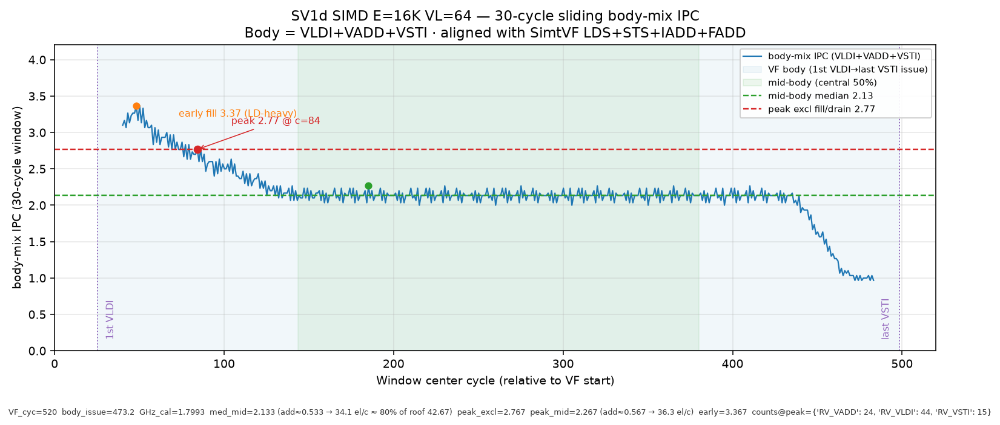
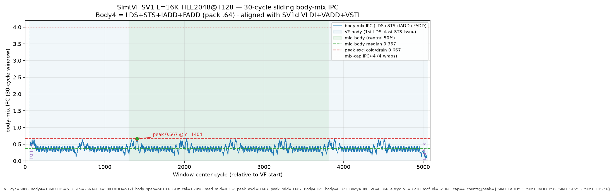

# SV1 analysis — short-live stream eltwise (Simt + SIMD)

**Date:** 2026-10-16 HKT · **SOC:** Ascend950PR_9599 opsim · **CANN / PTOAS:** cann_92b2 / PTOAS nightly (`config.toml` pins)

This is the **only** SV1 analysis doc. Older NOTES / VERDICT / rooftop-32 writeups were removed.

---

## 1. Aims

- Show a **short-live** stream eltwise where inputs do **not** need to stay in register: load → add → store.
- Demonstrate how **SIMD LD/ST high bandwidth** performs well on this **UB-bound** case.

Kernel: one TileLang file `sv1_stream_eltwise.py` (`vf_region` + `ST_VF_MODE`); handwritten SIMD twin `sv1d_stream_eltwise.py` (VL=64).

---

## 2. Test-case design

| Axis | Choices |
|------|---------|
| Problem size | **E = 16K** f32 elements |
| Tile sizes | **2K / 4K / 8K** (then focus **8K**) |
| SIMT threads | **128 / 256 / 512 / …** (untiled T sweep + tiled T=128 ladder) |
| VMI / handwritten SIMD DSL | **VL=64 only** — nothing special to sweep |

**Footprint note (8K tile):** one f32 array @ 8K = **32 KB**; A+B = **64 KB**; A+B+C = **96 KB** — can fit UB / approach whole MRF (128 KB). After the tile ladder we **focus on 8K** as min overhead.

This set is the full sensitivity for the UB-bound case: **tile size**, **thread dim**, **Simt vs SIMD**, and whether current `T.Parallel` / DSL already meet **xx%** of the Simt / SIMD rooftops (sections below).

---

## 3. SIMD performance

Handwritten DSL **VL=64**, size ladder (`data/SUMMARY_sv1d_size_ladder.tsv`):

| E | VF_cyc | IPC | el/cyc |
|--:|-------:|----:|-------:|
| 256 | 60 | 0.35 | 4.27 |
| 4096 | 161 | 1.62 | 25.4 |
| 8192 | 280 | 1.85 | 29.3 |
| **16384** | **520** | **≈1.98** | **31.51** |

**Theory est (Lok): ~44 el/cyc.** Plot SoT on `plots/sv1d_e16k_ex_ipc_30cyc.png` uses derived roof **42.67** (IPC→el conversion); cite Lok’s **~44** as the design target and **42.67** as the plot’s derived roof.

From that same plot footer (authoritative mid-body IPC):

| Metric | Value | vs roof |
|--------|------:|---------|
| Mid-body median IPC | **2.13** → **~34.1 el/cyc** | **≈80%** of 42.67 · **≈77%** of 44 |
| Peak excl fill/drain IPC | 2.77 | — |
| Peak mid IPC | 2.27 | — |
| Early fill IPC | 3.37 | — |
| Overall VF | **31.5 el/cyc** | **≈72%** of 44 · **≈74%** of 42.67 |

**Takeaway:** SIMD DSL already delivers high BW — overall **~72% of Lok’s ~44 el/cyc** theory; mid-body **~80% of the plot’s 42.67** roof.

---

## 4. SIMT performance

Stock pack is **LDS/STS.64** (float2) — for that width path, load BW is framed as **64 B/cyc only**.

**Lead framing (Lok):** LD.64 A+B theory ≈ **8 el/cyc** (64 B/cyc load ÷ 8 B for A+B per elem). Stock / ILP Simt lands **~3.7–4.1 el/cyc** → about **half** of that ~8 roof. (One roof only in §4.1–4.3; alternate 1R+1W@16 is a footnote in §4.4.)

Data: `data/SUMMARY_sv1_simt_T_dim_rooftop.tsv` / `SUMMARY_sv1_simt_tile16k.tsv`.

### 4.1 Tile-size performance (E=16384, LDS/STS.64, fixed T128)

| Case | el/cyc | % of LD.64 A+B (~8) |
|------|-------:|--------------------:|
| TILE2048 @ T128 | 3.22 | 40% |
| TILE8192 @ T128 | 2.99 | 37% |

**Point:** at fixed T128, larger TILE does **not** beat the best untiled thread-dim result below; TILE2048 is still below untiled T512.

### 4.2 Thread-dim performance (E=16384, untiled LDS/STS.64)

| Case | el/cyc | % of LD.64 A+B (~8) |
|------|-------:|--------------------:|
| untiled T128 | 2.87 | 36% |
| untiled T256 | 3.37 | 42% |
| **untiled T512** | **3.71** | **46%** |

**Point:** more threads (warps) raise stock Simt el/cyc; best stock here is **untiled T512 = 3.71**.

### 4.3 ILP16 @ T128 (schedule sensitivity)

| Case | el/cyc | % of LD.64 A+B (~8) |
|------|-------:|--------------------:|
| **ILP16 @ T128** | **4.08** | **51%** |

**Point:** hand ILP16 at T128 beats stock untiled T512 (**4.08** vs **3.71**) without SoftLib MS/MI schedule.

### 4.4 Footnote — alternate roof only (do not mix into §4.1–4.3)

Prior pack docs also used **1R+1W @ 128 B each → 16 el/cyc**. Against that roof: untiled T512 ≈ **23%**, ILP16 ≈ **25.5%**. Lead framing for Simt stock stays **~8**; keep **16** only here.

### 4.5 Side note: LD.32

- Theory: LD.32 can do **128 B/cyc**, but **too many instructions / hard to schedule**.
- For LD.32 A+B (dual load on one R port), **theory best ~8 el/cyc**.
- SoftLib / best-thread cases land around **~4–5 el/cyc** VF average under realistic schedules:
  - SoftLib **A-only** LDS.b32 contig T128: VF **4.54** el/cyc @ E=8192 (label **A-only** — not A+B).
  - Stock / ILP Simt (A+B, .64 pack): **~3.7–4.1** el/cyc.
  - SoftLib A-only T512 / T1024 VF **8.5 / 9.9** el/cyc are **A-only** — do **not** mix with A+B theory without labeling.
- SoftLib A-only LDS.b32 contig T128: LDS-window **101 B/cyc (79% of 128)**, LDS-window elems **25.3**; whole-VF elems **4.54** — see `/workspace/st_out_cce_vadds_const/reports/`.
- SoftLib A+B LDS.b32 contig T128: **~52 B/cyc** (~41% of 128) from LDS width BW report.

### 4.6 SoftLib LDS.b32 / LDS.b64 BW — PURE port isolation (2026-10-17)

**SoT:** `/workspace/st_out_cce_lds_bw_confirm/reports/LD32_LD64_BW_CONFIRM.md` (pto-b10, Ascend950PR_9599, E=8192 T=128).

Prior SoftLib T128 ~**101 B/cyc** (section 4.5 / §5 baseline) was **compiler IADD↔LDS interleave** (`I1L1…`) — **not** LDS-port isolation. Confirmed PURE numbers below require:

1. **Self-scheduled (自己排好):** hand/manual schedule with explicit **IADD-then-LDS** separation (`sep_ptr` — all address IADD/LEA first, hard phase barrier, then LDS burst alone). Disasm must show LDS region with **zero** IADD/LEA (`separation_ok=True`, motif `L64` / `L32`).
2. **MI schedule disabled** (Lok: 「MR schedule disabled」 → SoftLib/SV1 flag): `-mllvm -enable-misched=false -mllvm -enable-post-misched=false`. Default MI keeps MIXED interleave even with `sep_ptr`.

| Width | Tag | Disasm | Peak B/cyc | Sustained first→last B/cyc | vs 128 roof |
|-------|-----|--------|----------:|---------------------------:|------------:|
| **LDS.b32 (LD32)** | `bw_b32_sep_ptr_e8192_t128_mi_off` | **PURE** `L64` | **128.00** | **~115** (114.98) | **100%** peak · **~90%** sustained |
| **LDS.b64 (LD64)** | `bw_b64_sep_ptr_e8192_t128_mi_off` | **PURE** `L32` | (burst†) | **~64.5** (64.50) | **~50%** sustained |

† LD64 short-window rolling peak can exceed 128 (1× LDS.b64/cyc × 256 B); **claim metric is sustained first→last = 64.50**.

**One-liner:** under PURE / MI-off / self-scheduled IADD→LDS: **LD32 peak 128 B/cyc, sustained ~115; LD64 ~64.5 B/cyc (~half)**. Isolation costs whole-VF (LD32 PURE whole-VF **7.19** el/cyc vs T1024 **9.89**) — do not mix PURE port-BW with MIXED whole-VF chase (§5).

---

## 5. CCE T128 manual-schedule side note + verdict

SoftLib CCE A-only LDS.b32+const, E=8192 T=128 (reports under `/workspace/st_out_cce_vadds_const_sched/reports/` + `/workspace/st_out_cce_vadds_const/reports/`):

| Probe | VF | whole-VF el/cyc | LDS-win B/cyc | vs roof |
|-------|---:|----------------:|--------------:|---------|
| Baseline load-all (`-O2` MI on) | 1806 | **4.54** | **101.14** (79% of 128) | LDS-win **25.3** el/cyc |
| **Manual best** (`loadall_barrier` / `iadd_first`) | **882** | **9.29** | **101.45** | **~94%** of T1024 **9.89**; **~37%** of LDS-win roof **25.3** |
| MI-off (`-mllvm -enable-misched=false`) | 2381 | **3.44** | 48.91 | **worse** than `-O2` |
| `-O0` | 3380 | 2.42 | 44.34 | worse |
| T512 / T1024 (same SoftLib style) | 964 / **828** | **8.5 / 9.89** | LDS-win B/cyc **falls** as warps↑ | T1024 is the whole-VF roof reference |

| Probe | Result |
|-------|--------|
| All-four IADD+LDS+FADD+STS same cycle | **0** cycles at T128/512/1024 |
| Latency alone forbid ~4-issue? | **No** — schedule/port limited |
| Can T128 schedule alone beat T1024 9.89? | **No** — best **9.29**; win is **more warps (32 vs 4)**, not MI order |

### Verdict (this SV1 case)

| Path | Measured | Roof framing | % of roof |
|------|----------|--------------|----------:|
| **SIMD DSL VL=64** | **31.5 el/cyc** overall VF; mid-body **~34.1** | Lok **~44** (plot **42.67**) | **~72%** overall · mid **~80%** of 42.67 |
| **Simt `T.Parallel` LD.64** | stock best **3.71**; ILP16 **4.08** | LD.64 A+B **~8** | **~46–51%** (~half) |
| same Simt vs alt roof | 4.08 | 1R+1W@128B **16** | **~25%** |
| CCE hand (A-only LDS window) | **101 B/cyc** | 128 B | **79%** window BW |
| CCE manual T128 whole-VF | **9.29** el/cyc | T1024 **9.89** / LDS-win **25.3** | **~94%** of T1024 · **~37%** of LDS-win roof |

**Bottom line:** SIMD DSL already delivers high BW (**~72% of ~44 el/cyc**). Simt `T.Parallel` with default LD.64 is **~4 el/cyc** — about **half** of the **~8** LD.64 A+B theory (**~25%** if using the 16 el/cyc 1R+1W roof). CCE hand work shows LDS BW *can* approach the 128 B roof on A-only windows (~79%); manual T128 schedule reaches **9.29** el/cyc (**~94%** of T1024) but **MI-off is worse** — need more warps for the whole-VF roof, not just a better MI order.

---

## 6. Shared vs fragment — direct GM→shared only (no S-MEM staging tower)

**S-MEM tower removed.** The old shared arm used `t1/t2/t3 = alloc_shared` staging (shared→shared copies) and looked **−37%/−50%** vs fragment — that pattern is **gone**. No shared→fragment `T.copy` either.

**Kept path (SDS / direct GM→shared):**

1. `T.copy(A/B → a_ub/b_ub)` — GM→shared
2. Add **in shared:** `c_ub[i] = a_ub[i] + b_ub[i]` (no t1/t2/t3)
3. `T.copy(c_ub → C)`

Fragment arm stays as RF-temps baseline (`alloc_fragment` t1/t2/t3). Knob: `ST_SV1_TEMPS=frag|shared` → tags `frag` / `gmshared`. Stock **float2**, opsim 2026-10-16 HKT, cann_92b2, `ST_VF_MODE=simt-asc`.

| Case | frag VF / el/cyc | gmshared VF / el/cyc | Δ el/cyc | STS |
|------|-----------------:|---------------------:|---------:|----:|
| E8192 T128 | 3160 / **2.592** | 3160 / **2.592** | **0%** (tie) | 128 both |
| E8192 T512 | 2205 / **3.715** | 2205 / **3.715** | **0%** (tie) | 128 both |

Instr mix identical (`SIMT_LDS/STS/FADD/IADD`). See `data/SHARED_VS_FRAGMENT_AB_GM_SHARED_FLOAT2.md`.

**Verdict:** under direct GM→shared / add-in-shared, **shared matches fragment** — no shared penalty. Prefer either for this short-live stream case.

---

## 7. Meta / pins

| Pin | Value |
|-----|-------|
| SOC / opsim | Ascend950PR_9599 |
| CANN | cann_92b2 (`config.toml`: `cann_92b2/9.2.0-beta.2`) |
| PTOAS | nightly (`config.toml`: `0.67@1b36b6f…`) |
| Date | **2026-10-16 HKT** |

### Artifacts

- `data/` — `SHARED_VS_FRAGMENT_AB_GM_SHARED_FLOAT2.md` (+ `.tsv`/`.json`; primary), legacy `SHARED_VS_FRAGMENT_AB.md` (old staging, do not cite), `SUMMARY_sv1d_size_ladder.tsv`, `SUMMARY_sv1_simt_T_dim_rooftop.tsv`, `SUMMARY_sv1_simt_tile16k.tsv`, `OVERHEAD_ilp16.json`, bubbles / MIX / GPU compare
- `plots/` — `sv1d_e16k_ex_ipc_30cyc.png`, `sv1_simt_e16k_body4_ex_ipc_30cyc.png`, `sv1_thread_vs_ipc_el.png`, `sv1_tile_vs_vf_el_instr.png`, ILP timeline / waterfall
- SoftLib CCE — `/workspace/st_out_cce_vadds_const/reports/VADDS_CONST_B32_OPSIM.md`, `VADDS_CONST_T512_1024_OPSIM.md`; schedule dig `/workspace/st_out_cce_vadds_const_sched/reports/VERDICT.md`; **PURE LD32/LD64 BW** `/workspace/st_out_cce_lds_bw_confirm/reports/LD32_LD64_BW_CONFIRM.md`
- SoftLib LDS BW — `/workspace/st_out_cce_lds_bw_confirm/reports/LD32_LD64_BW_CONFIRM.md` (+ `COMBINED_LDS_PORT_AND_MI_OFF.md`)

### Weekly gate

`scripts/regression/oneshot_sv1_e8192_t128_t512.sh` — **E=8192**, **T=128** + **T=512**, `ST_VF_MODE=simt-asc`, stock schedule only.
