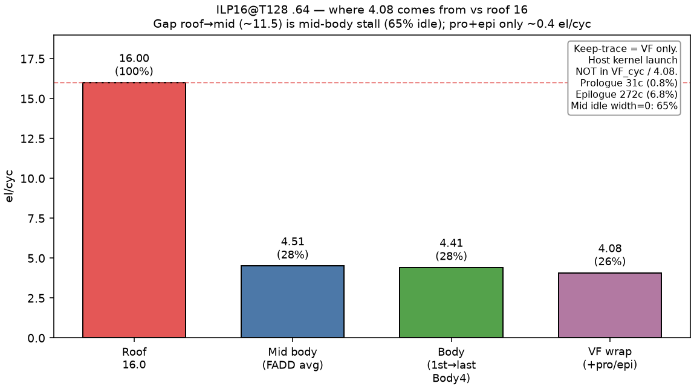
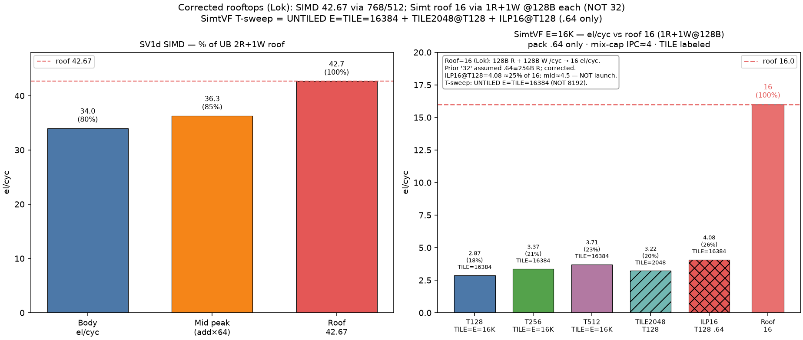

# SV1 analysis — SimtVF stream eltwise (current)

**Date:** 2026-10-15 HKT · **SOC:** Ascend950PR_9599 opsim · **Pack:** LDS/STS **`.64` only** (no `.128`)

This is the **only** SV1 analysis doc. Older NOTES / VERDICT / rooftop-32 writeups were removed.

## Verdict

| Item | Value |
|------|-------|
| **Simt roof** | **16 el/cyc** (UB **1R+1W @ 128B each**) — **not** 32 |
| Pack | **LDS/STS.64** (float2); Simt `T.Parallel` never emits `.128` |
| Stock best | untiled T512 ≈ **3.71** el/cyc (**23%** of 16); TILE2048@T128 ≈ **3.22** (**20%**) |
| **Best so far** | **ILP16 @ fixed T=128** → **4.08** el/cyc (**25.5%** of 16), beats untiled T2048 (**3.83**) |
| Gap to roof | **Mid-body stall** (~65% idle, Body4 mid-med IPC ~**0.47** ≪ mix-cap **4**, IADD tax) — **not** host launch / head–tail |
| Kernel | One TileLang file: `sv1_stream_eltwise.py` (`vf_region` + `ST_VF_MODE`). No `sv1v_*` twin. |

## Rooftop (Lok)

```
1R + 1W @ 128 B/cyc each  →  16 fp32 el/cyc
```

Do **not** use the historical “32 el/cyc” figure (that treated a `.64` R port as 256B).

Body4 mix-cap IPC ≈ **4** (wrap schedulers). FADD share of Body4 ≈ **27%** at steady `.64` ⇒ at IPC 4 would hit the mem/FADD roof of **16** el/cyc; measured mid-median IPC ~0.47 ⇒ ~**2** el/cyc typical, mid sustained with ILP16 ~**4.5**.

## Measured (E=16384 f32, camodel VF)

### Stock untiled T sweep

| T | VF_cyc | el/cyc | % of 16 |
|--:|-------:|-------:|--------:|
| 128 | 5700 | 2.87 | 18% |
| 256 | 4864 | 3.37 | 21% |
| 512 | 4415 | 3.71 | 23% |
| 2048 | 4279 | 3.83 | 24% |

### ILP reschedule @ T=128 (`.64` only)

| Case | el/cyc | % of 16 | FADD wait% | mid Body4 peak |
|------|-------:|--------:|-----------:|---------------:|
| T128 baseline | 2.87 | 18% | 50% | 0.50 |
| T2048 untiled | 3.83 | 24% | 50% | 1.50 |
| ILP8 @ T128 | 3.84 | 24% | 25% | 1.47 |
| **ILP16 @ T128** | **4.08** | **25.5%** | **13%** | **1.87** |

ILP win is **issue order** (many LDS before FADD), not fewer IADDs. Pack stays `.64`.

### Why only 4.08? (ILP16 keep-trace)

| Piece | % of VF | Notes |
|-------|--------:|-------|
| Prologue | **0.8%** | S2R / SHFI / LEA |
| **Body** | **92.5%** | LDS+STS+IADD+FADD |
| Epilogue | **6.8%** | SET_FLAG / MOV |
| Host launch | — | **Not in VF / not in 4.08** |

Mid sustained ≈ **4.51** el/cyc (**28%** of 16); VF **4.08** loses only ~**0.43** to pro+epi. Mid Body4 peak **1.87** is **bursty**, not the rate that sets wall time.






## Bubbles / T

Scoreboard RAW (IADD→LDS.64→FADD→STS.64). T↑ fills holes with other warps (Body4 IPC 0.38→0.47 T128→T512) but **mid-median stays ~0.47**. Prefer **schedule at fixed T=128**, not pile warps.

## GPU compare (order-of-magnitude; different roofs/ISAs)

| Case | Pack | el/cyc |
|------|------|------:|
| Ascend ILP16 @ T128 | .64 | **4.08** |
| GPU hand .128 1×CTA | .128 | ~0.88 |
| GPU hand .128 multi-CTA | .128 | ~2.15 |
| GPU TileLang TILE2048@T128 | float4 CUDA | ~1.04 |

## Weekly gate

`scripts/regression/oneshot_sv1_e8192_t128_t512.sh` — **E=8192**, **T=128** + **T=512**, `ST_VF_MODE=simt-asc`, stock schedule only.

## Todos — T=128 instruction scheduling

- [ ] Deeper software ILP at **fixed T=128** (ILP32/64), keep **LDS/STS.64**
- [ ] Cut **IADD** tax (imm / float2 base indexing); soft-pipe / interleave
- [ ] Raise **mid-median** Body4 IPC / sustained el/cyc toward roof **16** (today mid ~4.5 / VF 4.08)
- [ ] Re-check **I-cache** on deeper unroll (aicore `.text` ~6 KB @ ILP16 OK vs typical 16–32 KB I$)
- [ ] Re-check **MRF 128 KB** for E=8K (A+B+C=96 KB + live regs)
- [ ] Optional later: emit **`.128`** (separate from schedule)

## Artifacts

- Plots under `plots/` (timeline, waterfall, rooftop-corrected, bubble, TILE/T sensitivity)
- Raw numbers under `data/` (`SUMMARY_*.tsv`, `OVERHEAD_ilp16.json`, `MIX_*.txt`)
