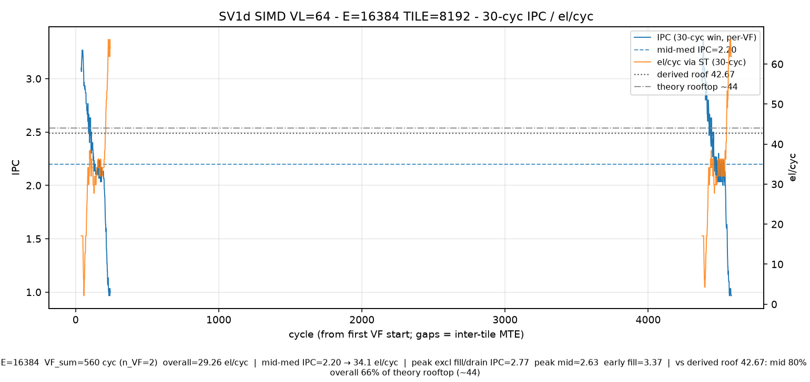
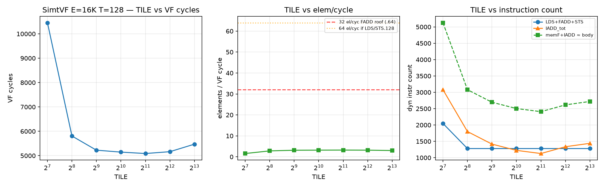
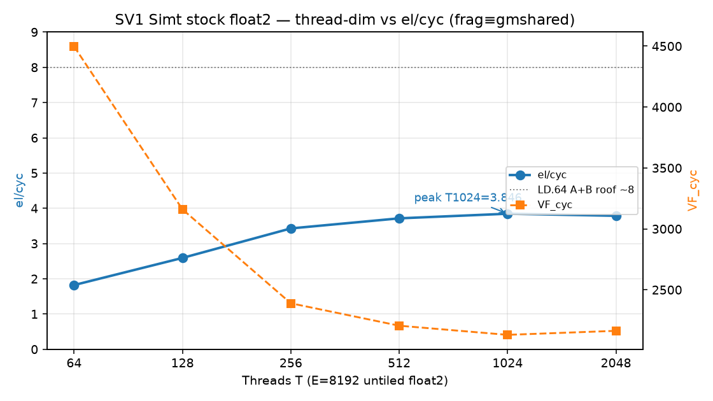
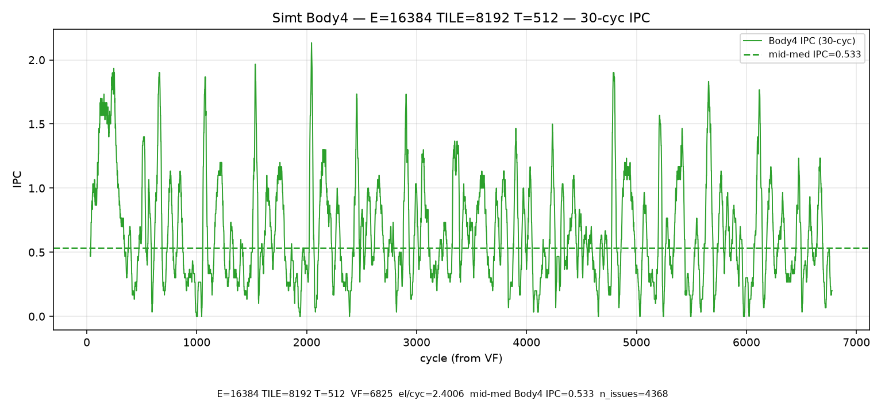

# SV1 analysis — short-live stream eltwise (Simt + SIMD)

**Date:** 2026-10-17 HKT · SoftLib fence×source addendum **2026-10-20** · SoftLib rooftop rewrite **2026-10-20** · **SOC:** Ascend950PR_9599 opsim · **CANN / PTOAS:** cann_92b2 / PTOAS nightly (`config.toml` pins) · **TileLang tip:** `e700041f` (float4 / max_vector_bits 64→128)

This is the **only** SV1 analysis doc. Older NOTES / VERDICT / rooftop-32 writeups were removed.

---

## 1. Aims

- Show a **short-live** stream eltwise where inputs do **not** need to stay in register: load → add → store.
- Demonstrate how **SIMD LD/ST high bandwidth** performs well on this **UB-bound** case.

Kernel: one TileLang file `sv1_stream_eltwise.py` (`vf_region` + `ST_VF_MODE`); handwritten SIMD twin `sv1d_stream_eltwise.py` / tiled `sv1dt_*` via `scripts/gen_sv1dt_kernel.py` (VL=64). Aligned Simt tags `sv1tt_e{E}_tile{TILE}_t{T}` (`SUMMARY_sv1_aligned_e16k_tile8k.tsv`); aligned SIMD tags `sv1dt_e{E}_tile{TILE}_vl64` (`SUMMARY_sv1d_aligned_e16k_tile8k.tsv`).

---

## 2. Test-case design

| Axis | Choices |
|------|---------|
| Problem size | **E = 16K** f32 elements |
| Tile sizes | **2K / 4K / 8K / 16K** @ fixed **E=16K** (both Simt and SIMD) |
| SIMT threads | **128 / 256 / 512 / 1024 / 2048** @ fixed **E=16K, TILE=8192** (not untiled) |
| VMI / handwritten SIMD DSL | **VL=64**, **same E=16K + TILE 2K/4K/8K/16K** (per-tile MTE stream) |

**Footprint note (8K tile):** one f32 array @ 8K = **32 KB**; A+B = **64 KB**; A+B+C = **96 KB** — can fit UB / approach whole MRF (128 KB). After the tile ladder we **focus on 8K** as the compare hub vs SIMD.

This set is the full sensitivity for the UB-bound case: **tile size**, **thread dim**, **Simt vs SIMD**, and whether current `T.Parallel` / DSL already meet **xx%** of the Simt / SIMD rooftops (sections below).

**Pin note:** aligned Stock Simt + tiled SIMD numbers below are from **2026-10-17** opsim under **cann_92b2 + tip e700041f** (Simt) / **cann_92b2** (SIMD DSL). Prior whole-E SIMD size ladder (`SUMMARY_sv1d_size_ladder.tsv`) and older cann_91b3 Simt tables are **appendix-only** — do not mix into §4 / §5.1–5.2 primary tables.

## 3. Best schedule

**Target** for this short-live stream (load → add → store; UB-bound) is path-specific:

| Path | Target best schedule |
|------|----------------------|
| **SIMD / VMI DSL** (`sv1d` / `sv1dt`, VL=64) | Keep the kernel as a **simple load → add → store** loop on the data. No fancy instruction schedule is required — VL=64 UB vector ld/st + VADD is the design target. |
| **SIMT** (`T.Parallel` / SimtVF) | Best schedule does **not** hinge on fragment vs shared temps for this case (direct GM→shared ties fragment — see later shared-vs-fragment section). What matters is a **relatively large thread dim (T=256 / T=512)** for **latency hiding** on UB ld/st, because the kernel is **UB load-bound**. |

Later SIMD / SIMT sections measure how close stock + hand paths land relative to these targets (SIMD near theory rooftop with the simple VL loop; Simt stock peaking around T512 on the TILE=8K hub).

## 4. SIMD performance

Handwritten DSL **VL=64**, **tiled** short-live stream @ fixed **E=16384** (`data/SUMMARY_sv1d_aligned_e16k_tile8k.tsv`):

| TILE | VF_cyc | IPC | el/cyc | us |
|-----:|-------:|----:|-------:|---:|
| 2048 | 824 | 1.2913 | **19.8835** | 7.69 |
| 4096 | 644 | 1.6211 | **25.4410** | 5.87 |
| **8192** | **560** | **1.8464** | **29.2571** | **4.99** |
| 16384 | 520 | 1.9788 | **31.5077** | 4.55 |

Kernel: `sv1dt_*` / `scripts/gen_sv1dt_kernel.py` — per tile MTE load A/B → VL=64 vload/vadd/vstore → MTE store C. Tag `sv1dt_e16384_tile{TILE}_vl64`.

**Theory rooftop: ~44 el/cyc.** Plot SoT on `plots/sv1d_e16k_tile8k_ex_ipc_30cyc.png` is a **single VF** 30-cyc window (first body VF; dual-tile ping/pong gap omitted). Derived roof **42.67** (IPC→el conversion); cite **theory rooftop ~44** as the design target and **42.67** as the plot’s derived roof.

From that same plot footer (authoritative mid-body IPC @ **E=16K TILE=8K**):

| Metric | Value | vs roof |
|--------|------:|---------|
| Mid-body median IPC | **2.17** → **~34.1 el/cyc** | **≈80%** of 42.67 · **≈78%** of theory rooftop (~44) |
| Peak excl fill/drain IPC | 2.77 | — |
| Peak mid IPC | 2.63 | — |
| Early fill IPC | 3.27 | — |
| Overall VF (TILE8K) | **29.26 el/cyc** | **≈66%** of theory rooftop (~44) · **≈69%** of 42.67 |

**Takeaway (SIMD alone):** at **TILE=8K E=16K**, SIMD DSL lands **29.26 el/cyc** overall VF (~66% of theory rooftop ~44); mid-body ~**34.1** el/cyc (~78% of ~44). Larger TILE amortizes per-tile MTE fill/drain (2K→16K: 19.9→31.5 el/cyc). Prior whole-E E-ladder is appendix-only — not the §4 compare SoT. Head-to-head vs Simt is after §5.

## 5. SIMT performance

Stock pack under tip e700041f is wider-vector (LDS:FADD:STS ≈ **256:512:128** in the aligned harvest — float4-class). Lead framing still uses Lok’s **LD.64 A+B ≈ 8 el/cyc** roof for % columns (same A+B dual-load story).

**Lead framing (Lok):** LD.64 A+B theory ≈ **8 el/cyc**. Aligned stock Simt lands **~2.40–2.45 el/cyc** → about **~30%** of that ~8 roof under **cann_92b2 + e700041f**. Thread ladder **peaks @ T512** then drops @ T2048 (§5.2). Alternate 1R+1W@16 is a footnote in §5.3.

Data: `data/SUMMARY_sv1_aligned_e16k_tile8k.tsv` (+ `.json`, `NOTES_sv1_aligned_e16k_tile8k.md`).

### 5.1 Tile-size performance (E=16384, fixed T=512)

| Case | VF_cyc | el/cyc | % of LD.64 A+B (~8) |
|------|-------:|-------:|--------------------:|
| TILE2048 @ T512 | 6721 | **2.44** | 30% |
| TILE4096 @ T512 | 6692 | **2.45** | 31% |
| **TILE8192 @ T512** | 6825 | **2.40** | **30%** |
| TILE16384 @ T512 | 6721 | **2.44** | 30% |

**Point:** at fixed T=512, tile size is **flat (~2.40–2.45 el/cyc)**. **8K** remains the focus tile for Simt↔SIMD compare (footprint / hub), not because it uniquely wins the ladder.

### 5.2 Thread-dim performance (E=16384, TILE=8192)

| Case | VF_cyc | el/cyc | IPC_body | % of LD.64 A+B (~8) |
|------|-------:|-------:|---------:|--------------------:|
| TILE8192 @ T128 | 8221 | **1.99** | 0.506 | 25% |
| TILE8192 @ T256 | 7041 | **2.33** | 0.600 | 29% |
| **TILE8192 @ T512** | **6825** | **2.40** | **0.638** | **30%** |
| TILE8192 @ T1024 | 6857 | **2.39** | 0.616 | 30% |
| TILE8192 @ T2048 | 11270 | **1.45** | 0.540 | 18% |

**Point:** el/cyc is **not monotonic**. It rises 128→256→**512 (peak 2.40)**, stays flat at **T1024 (2.39)**, then **drops hard at T2048 (1.45)**. Turning point ≈ **T512** on this TILE=8K stock schedule. Body4 plot remains the **TILE8K@T512** capture (IPC_body **0.638**).

**Forward (not run):** later try **T128/T256 fully unroll** and let **ccec** schedule, then compare vs hand/manual — do not treat as SoT until measured.

## 6. SoftLib handwritten Simt rooftop analysis

**Date:** SoftLib rooftop rewrite **2026-10-20**. Stock Simt TILE8K@T512 stays **2.40** el/cyc (~30% of LD.64 A+B roof ~8) from §5.2. SoftLib below is the handwritten Simt rooftop story: width (LDS.32 vs LDS.64), schedule (1-in first), then dual-input %rooftop + full fence×source table.

### 6.1 LDS.32 vs LDS.64

PURE / MI-off / self-scheduled port isolation (IADD→LDS separated; disasm LDS region with zero IADD/LEA). SoT: `/workspace/st_out_cce_lds_bw_confirm/reports/LD32_LD64_BW_CONFIRM.md`.

| Width | Tag | Peak B/cyc | Sustained first→last B/cyc | vs 128 |
|-------|-----|----------:|---------------------------:|-------:|
| **LDS.b32** | `bw_b32_sep_ptr_e8192_t128_mi_off` | **128** | **~115** (114.98) | **~90%** sustained |
| **LDS.b64** | `bw_b64_sep_ptr_e8192_t128_mi_off` | (burst) | **~64.5** (64.50) | **~half** |

**Implication:** Simt el/cyc rooftop **depends on width**. For stream eltwise A+B:

| Framing | Roof el/cyc | Notes |
|---------|------------:|-------|
| Classic lead (LD.64 A+B) | **~8** | Stock / §5.1–5.2 % columns |
| SoftLib LDS.b32 **1-in** serial | **16** | LDS 32 + STS 32 el/cyc ports |
| SoftLib LDS.b32 **A+B** serialized harmonic | **10.67** | `1/(1/16+1/32)` — dual-load LDS 16 + STS 32 |

Default stock TileLang uses wider / LDS.64-class lowering. SoftLib hand targets **LDS.b32** for the high ceiling.

### 6.2 Schedule — single-source (1-in VADDS+const) first

One input keeps the case simple: IADD → LDS → FADD(+const) → STS. SoftLib A-only LDS.b32+const, E=8192. Reports under `/workspace/st_out_cce_vadds_const*/reports/` and T256 fence harvest `T256_FENCE_X_SOURCE_SUMMARY.md`.

**1. MI-off stage-sep ≈ 8.x baseline.** All LDS then all FADD then all STS (`loadall_barrier` / `iadd_first`; simple same-latency stages + warp hide; MI off):

| role | MI | VF | el/cyc | tag / note |
|------|----|---:|-------:|---|
| **Controllable baseline** | OFF | **942** | **8.70** | stage-sep under hand control |
| SoftLib ceiling | ON | **759** | **10.79** | same source; MI compresses (−183 VF / +2.10 el) |

**2. Split LD and ST stages to reach ~10.x.** Compute can fuse either way. MI-on stage-sep + **one** compiler `asm volatile("" ::: "memory")` fence (LDS-bar *or* STS-bar) → **10.79** @ T256. Second fence unused (`fence1 ≡ store-only ≡ barrier` on VF). **Nofence** collapses to **6.87** — schedule/overlap, not mem latency (LDS/STS issue→retire latency fence-invariant: LDS 28.516/12.878, STS 21.496/20.737).

**3. Performance rooftop (split / fenced case).** Serialized walls: **%ser ≈ 72.6%** of roof **16** (ser 11.6199). Stage util for 1-in MI-on: LDS-win ~**74%** / post ~**76%**. Hand MI-off mix attempts do **not** beat 8.70:

| probe | el/cyc | vs MI-off 8.70 |
|-------|-------:|----------------|
| best F↔S mix | **8.83** (+0.13) | marginal |
| idx[] IL / bad IL | **~6.06** | loses |
| F/S bleed reimpl | **~5.6** | loses |

The ~**+2** el/cyc is **MI’s I↔L**, not C source-order mix.

**4. Threads and SWP.** Need **≥256 threads** for LDS/STS outstanding — T128 (4 warps) cannot hide LDS latency ≈27. SWP Body4 @ T128 falsified ~**3.4** el/cyc (interleaves FADD/STS into LDS window → LDS-win collapses).

**Compact T ladder — 1-in barrier best (MI-on `loadall_barrier` / `iadd_first`):**

| T | warps | VF | el/cyc | % of roof 16 |
|--:|------:|---:|-------:|-------------:|
| 128 | 4 | 882 | **9.29** | 58% |
| **256** | **8** | **759** | **10.79** | **67.5%** |
| 512 | 16 | 796 | **10.29** | 64% |

Best whole-VF: **T256 = 10.79**. Wider T helps hide FADD/STS up to T256, then turns down.

**§6.2 conclusion.** To approach the SoftLib ceiling we must **split the schedule into LDS and STS stages** (compute fused either way), using **LDS.32 + STS.32**. Rooftops are the **serial model**:

| Case | Serial roof | Derivation |
|------|------------:|------------|
| **1-in / 1-out** | **16** el/cyc | 128 B/c R + 128 B/c W |
| **Dual-input A+B** | **10.667** el/cyc | `1/(1/16+1/32)` |

MI-off stage-sep alone stays ~**8.x**; split LD/ST + MI-on reaches ~**10.x** (~**72.6%** of serial **16**).

### 6.3 Dual-input — same %rooftop story + full fence×source table

Bring A+B back: performance rooftop **% similar** to 1-in. MI-on stage-sep + **one** fence reaches **≈72–73%** of the serialized rooftop (1-in **72.6%** of 16; A+B **72.2%** of 10.67). Full report: SoftLib opsim harvest `T256_FENCE_X_SOURCE_SUMMARY.md`.

**Roofs:** %s1/%s2 vs LDS **32** / STS **32** el/cyc. **%ser** = `E/(s1_wall+s2_wall)` ÷ roof (**16** / **10.67**). **nofence:** s1/s2/%ser = **N/A** — raw `[first_I,last_S]` body matches fenced but **VF ≫ body**; use **(E/VF)/roof** only for %whole.

| source | fence | VF | whole (E/VF) | %whole | s1 el/cyc | %s1 | s2 el/cyc | %s2 | ser el/cyc | %ser | LDS mean/var | STS mean/var |
|---|---|--:|--:|--:|--:|--:|--:|--:|--:|--:|---|---|
| 1-in | nofence | 1192 | 6.8725 | **43.0%**† | N/A | N/A | N/A | N/A | N/A | N/A | 28.516/12.878 | 21.496/20.737 |
| 1-in | LDS-bar | 759 | 10.7931 | — | 27.4899 | 85.9% | 20.1278 | 62.9% | 11.6199 | **72.6%** | 28.516/12.878 | 21.496/20.737 |
| 1-in | STS-bar | 759 | 10.7931 | — | 27.4899 | 85.9% | 20.1278 | 62.9% | 11.6199 | **72.6%** | 28.516/12.878 | 21.496/20.737 |
| A+B | nofence | 1853 | 4.4209 | **41.4%**† | N/A | N/A | N/A | N/A | N/A | N/A | 31.443/32.470 | 22.504/36.165 |
| A+B | LDS-bar | 1119 | 7.3208 | — | 22.9468 | 71.7% | 11.6034 | 36.3% | 7.7065 | **72.2%** | 31.926/26.969 | 21.543/24.249 |
| A+B | STS-bar | 1119 | 7.3208 | — | 22.9468 | 71.7% | 11.6034 | 36.3% | 7.7065 | **72.2%** | 31.926/26.969 | 21.543/24.249 |

† nofence **%whole** = `(E/VF)/roof`. Fenced **%ser** = serialized walls. Latency issue→retire fence-invariant on 1-in; A+B fence1≡store-only. VF collapse is schedule/overlap, not mem latency.

**Classic VF framing vs serial rooftop (not fixed-8):** SoftLib **LDS.b32** A+B %rooftop uses serial **10.667**. Do **not** fix SoftLib b32 % to **8** — that **~8** is the **LD.64 A+B** classic lead from §5.

| Case | el/cyc | Serial roof | % of serial |
|------|-------:|------------:|------------:|
| SoftLib A+B LDS.b32 T512 `loadall_barrier` | **7.42** | **10.667** | **~69.5%** |
| SoftLib A+B LDS.b32 T256 fence1 | **7.32** | **10.667** | **~68.6%** |
| SoftLib A+B LDS.b64 T256 `loadall_barrier` (width contrast) | **4.82** | LD.64 A+B **~8** | **~60%** of LD.64 roof |

Fence-table **%ser** for A+B remains **72.2%** of **10.67**. SoT A+B b32: `/workspace/st_out_cce_lds_bw_confirm/reports/LDS32_AB_TWO_SOURCE.md`. A+B b64: `LDS64_AB_TWO_SOURCE.md`.

---

## 7. Head-to-head highlight

**Answer first.**

- **SIMD** simple VL=64 schedule @ TILE8K: **29.26** el/cyc (~**66%** of theory rooftop ~44; mid-body ~34 / ~**78%**). A simple load→add→store does **28+**.
- **Simt rooftop** depends on **LDS.32 vs LDS.64**. Need **≥256 threads** for LDS/STS outstanding, and **split LD/ST stages** (LDS.32 + STS.32) for instruction schedule to approach the SoftLib ceiling. Serial roofs: 1-in/1-out **16** (128 B/c R + 128 B/c W); A+B **10.667**.
- **Default lowering** (stock LDS.64-class A+B) ≈ **2.40** el/cyc @ TILE8K T512 → **~30%** of LD.64 A+B roof ~8 → **~12×** vs SIMD 29.26.
- **Handcraft best so far** (SoftLib A+B LDS.b32 T512 `loadall_barrier`): **7.42** → **~69.5%** of serial **10.667** (fence **%ser ~72%** of 10.67) → remaining gap **~3.9×** vs SIMD 29.26, which **matches the input UB BW difference** (256R+256R vs 128R).

**MRF = 128 KB.** SoftLib `loadall` keeps the live tile in RF (f32 E=8192: one array **32 KB**; A+B **64 KB**; A+B+C **96 KB** = **75%** of MRF). Stock Simt + SIMD TILE8K hub use the same **A+B+C = 96 KB** tile footprint (UB / RF path differs; see §2).

**Fair H2H @ schedule/mapping (A+B arms vs SIMD TILE8K hub):**

| Mapping / schedule | el/cyc | Roof | Rooftop % | vs SIMD 29.26 | MRF live (KB / %) |
|--------------------|-------:|------|----------:|--------------:|------------------:|
| Stock Simt LDS.64 — TILE8K@T512 (§5.2) | **2.40** | LD.64 A+B **~8** | **~30%** | **~12×** | A+B+C **96** / **75%** |
| SoftLib A+B LDS.b64 — T256 `loadall_barrier` | **4.82** | LD.64 A+B **~8** | **~60%** | **~6.1×** | A+B+C **96** / **75%** |
| SoftLib A+B LDS.b32 — T512 `loadall_barrier` | **7.42** | serial **10.667** | **~69.5%** | **~3.9×** | A+B+C **96** / **75%** |
| SIMD VL=64 — TILE8K hub (§4) | **29.26** | theory **~44** | **~66%** | **1×** | A+B+C **96** / **75%** |

SoftLib phase-sep A+B closes most of the Simt schedule gap vs stock; remaining SoftLib↔SIMD gap tracks UB BW (256R+256R vs 128R), not “need a bigger TILE.” All fair A+B arms sit at **~75% MRF** for the 8K/E=8192 A+B+C tile — SoftLib’s win is schedule/width, not extra register budget.

## 8. Shared vs fragment — layout A/B @ E8192

**Scope callout:** §8 is layout A/B @ **E8192**; it is **not** the §5 aligned hub SoT (**2.40** @ E16K TILE8K). Do **not** mix older **3.715** / “tie” numbers into the default schedule story.

Measured frag vs shared-tower temps (`data/SHARED_VS_FRAGMENT_AB.md`, 2026-10-16 HKT):

| Case | frag VF / el/cyc | shared VF / el/cyc | Δ el/cyc |
|------|-----------------:|-------------------:|---------:|
| E8192 T128 | 4680 / **1.750** | 7450 / **1.100** | **−37%** |
| E8192 T512 | 3405 / **2.406** | 6840 / **1.198** | **−50%** |

Fragment arm: RF temps (`alloc_fragment`). Shared arm: UB ptr temps (`alloc_shared`) — extra STS vs frag (shared-tower pattern). Frag T512 **2.406** matches the §5 ballpark for frag-class Simt.

Prior “gmshared float2 SDS tie” / **3.715** row cited `data/SHARED_VS_FRAGMENT_AB_GM_SHARED_FLOAT2.md` — **missing on branch**; that row is dropped.

**Verdict:** shared temps are **materially slower** than fragment on every PASS pair (≈ **37–50%** lower el/cyc at T128/T512). Prefer fragment for this short-live stream case unless a direct GM→shared remeasure lands.

## 9. Meta / pins

| Pin | Value |
|-----|-------|
| SOC / opsim | Ascend950PR_9599 |
| CANN | cann_92b2 (`config.toml`: `cann_92b2/9.2.0-beta.2`) |
| TileLang tip (aligned matrix) | **e700041f** (`tilelang-pto-isa-st`) |
| PTOAS | nightly (`config.toml`: `0.67@1b36b6f…`) |
| Date | **2026-10-17 HKT** |

### Artifacts

- `data/` — **`SUMMARY_sv1_aligned_e16k_tile8k.tsv`** (+ `.json`, `NOTES_sv1_aligned_e16k_tile8k.md`; primary Simt §5.1–5.2), **`SUMMARY_sv1d_aligned_e16k_tile8k.tsv`** (+ `.json`, `NOTES_…`; primary SIMD §4 TILE@E16K), appendix `SUMMARY_sv1d_size_ladder.tsv`, `SHARED_VS_FRAGMENT_AB_GM_SHARED_FLOAT2.md` (+ `.tsv`/`.json`), legacy `SUMMARY_sv1_simt_tile16k.tsv` / `SUMMARY_sv1_simt_T_dim_rooftop.tsv` (older cann_91b3 / untiled — do not mix into §5.1–5.2), `OVERHEAD_ilp16.json`, bubbles / MIX / GPU compare
- `plots/` — **`sv1d_e16k_tile8k_ex_ipc_30cyc.png`** (SIMD §4 SoT @ E16K TILE8K, **single VF**), `sv1_tile_vs_vf_el_instr.png` (**aligned TILE@T512**), `sv1_thread_vs_ipc_el.png` (**aligned TILE8K×T**), **`sv1_simt_e16k_tile8k_body4_ex_ipc_30cyc.png`** (aligned Simt Body4), legacy `sv1d_e16k_ex_ipc_30cyc.png` / `sv1_simt_e16k_body4_ex_ipc_30cyc.png` (whole-E / untiled — appendix), ILP timeline / waterfall
- SoftLib CCE — `/workspace/st_out_cce_vadds_const/reports/VADDS_CONST_B32_OPSIM.md`, `VADDS_CONST_T512_1024_OPSIM.md`; schedule dig `/workspace/st_out_cce_vadds_const_sched/reports/VERDICT.md`; **PURE LD32/LD64 BW** `/workspace/st_out_cce_lds_bw_confirm/reports/LD32_LD64_BW_CONFIRM.md`
- SoftLib LDS BW — `/workspace/st_out_cce_lds_bw_confirm/reports/LD32_LD64_BW_CONFIRM.md` (+ `COMBINED_LDS_PORT_AND_MI_OFF.md`)
- Aligned opsim OUT (pto-b10) — Simt `/tmp/sv1_aligned_e16k_tile8k_20261017/` · SIMD tiled `/tmp/sv1d_aligned_e16k_tile8k_20261017/`

### Weekly gate

`scripts/regression/oneshot_sv1_e8192_t128_t512.sh` — **E=8192**, **T=128** + **T=512**, `ST_VF_MODE=simt-asc`, stock schedule only.
