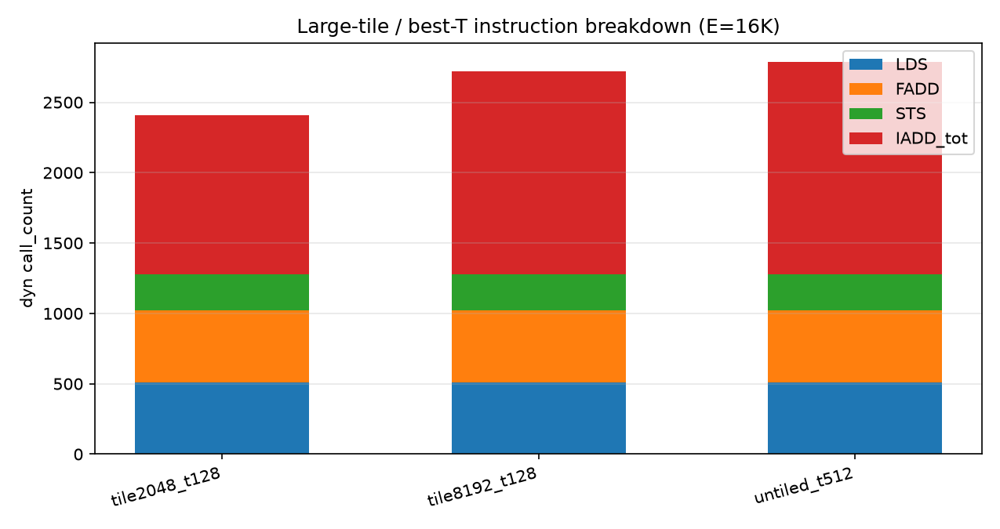
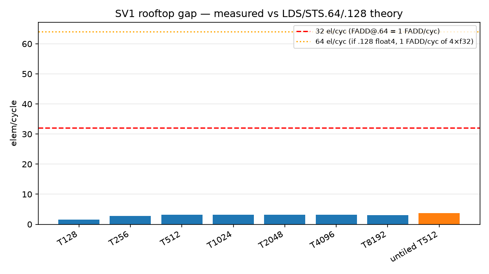

# SV1 analysis — Simt + Simd exploration, sensitivity plots, rooftop

**Date:** 2026-10-14 HKT · **SOC:** Ascend950PR_9599 opsim · **Focus:** simt-asc / simd-pto / handwritten SIMD DSL

Companion plots under `plots/`. Raw Simt E=16K harvest: `data/SUMMARY_sv1_simt_tile16k.tsv`, `data/MIX_sv1_simt_tile16k.txt`, `data/IADD_IPC_REPORT_tile16k.txt`.

## Full case list explored

### Gate (oneshot regress)

| Tag | Path | Shape | Role |
|-----|------|-------|------|
| `sv1_e256_t32` | simt-asc | E=256 T=32 | gate |
| `sv1_e2048_t32` | simt-asc | E=2048 T=32 | gate |
| `sv1d_e256` / twin | handwritten SIMD DSL | E=256 VL=64 | gate twin |
| simd-pto twin | simd-pto | same shapes | active focus (suite-wide still largely red) |

### Simt size ladder (T=32 fixed)

| Tag | E | T | Suite |
|-----|--:|--:|-------|
| `sv1_e512_t32` … `sv1_e32768_t32` | 512…32768 | 32 | explore |

### Simt thread sweep (large E)

| Tag | E | T | Suite |
|-----|--:|--:|-------|
| `sv1_e8192_t{64,128,256,512}` | 8192 | 64…512 | explore (config) |
| `sv1t_e16384_t{32,64,128,256,512}` | 16384 | 32…512 | **measured** (tile16k harvest) |

### Simt tile sensitivity (E=16384, serial tiles inside one VF)

| Tag | TILE | T | ept | Suite |
|-----|-----:|--:|----:|-------|
| `sv1tt_e16384_tile{128,256,512,1024,2048,4096,8192}_t128` | 128…8192 | 128 | 1…64 | **measured** |
| `sv1tt_e16384_tile{256,1024,8192}_t32` | selected | 32 | — | **measured** foil |

### Handwritten SIMD DSL size ladder (VL=64)

| Tag | E | VL | Suite |
|-----|--:|---:|-------|
| `sv1d_e{256,512,1024,2048,4096,8192,16384,32768}_vl64` | 256…32768 | 64 | explore (kernels under cost-sweep / `kernel_dsl`) |

### simd-pto

Same gate + explore shapes as simt-asc when twins exist; treat as **active focus / remeasure TBD** (Oct-10 suite stamp `0/61` simd-pto overall).

---

## Measured Simt results (E=16K)

### TILE @ T=128 — VF cycles / elem/cycle / instr

| TILE | ept | VF_cyc | el/cyc | LDS:FADD:STS | IADD_tot | IPC_body | pack |
|-----:|----:|-------:|-------:|-------------:|---------:|---------:|------|
| 128 | 1 | 10456 | 1.57 | 1024:512:512 | 3080 | 0.541 | scalar |
| 256 | 2 | 5807 | 2.82 | 512:512:256 | 1800 | 0.577 | .64 |
| 512 | 4 | 5225 | 3.14 | 512:512:256 | 1416 | 0.495 | .64 |
| 1024 | 8 | 5146 | 3.18 | 512:512:256 | 1224 | 0.428 | .64 |
| **2048** | 16 | **5088** | **3.22** | 512:512:256 | **1128** | 0.395 | .64 |
| 4096 | 32 | 5164 | 3.17 | 512:512:256 | 1336 | 0.395 | .64 |
| 8192 | 64 | 5472 | 2.99 | 512:512:256 | 1440 | 0.376 | .64 |

Best tiled VF_cyc / el/cyc around **TILE=2048** (ept=16). Pack stays **`.64` (float2)** once ept≥2 — **no `.128` / float4** on Ascend Simt.


### Untiled thread sweep — IPC / elem/cycle

| T | VF_cyc | el/cyc | IADD_tot | IPC_body |
|--:|-------:|-------:|---------:|---------:|
| 32 | 14882 | 1.10 | 1474 | 0.136 |
| 64 | 8316 | 1.97 | 1476 | 0.244 |
| 128 | 5700 | 2.87 | 1480 | 0.357 |
| 256 | 4864 | 3.37 | 1488 | 0.423 |
| **512** | **4415** | **3.71** | 1504 | **0.475** |

More threads helps Ascend a lot; best overall el/cyc is **untiled T=512**.


### Large-tile instruction breakdown

At steady `.64` mix the data plane is **LDS:FADD:STS = 512:512:256** for E=16K (2 loads + 1 add + 1 store per 32-el quantum → FADD count = E/32 = 512). IADD (addr) is the tax (~0.9–1.5× memF).



Full opcode dumps: `data/MIX_sv1_simt_tile16k.txt`.

---

## Rooftop — LDS/STS.64 vs .128 and 32 el/cyc

### What the hw/trace shows

- Ascend Simt UB ld/st width is encoded as `type`/`btype` on `SIMT_LDS`/`SIMT_STS` (no `lds.64` mnemonic).
- **Widest seen on any Simt `T.Parallel` SV/CF/SP case: 64-bit (`float2`, type:5 / btype:3).** Histogram across 49 traces: never `type:6` / 128-bit.
- SV1 data plane is clean **LDS.64 / STS.64** once ept≥2 (see `data/SIMT_LDST_WIDTH_20261008.md`).

### Instruction math for E=16384 f32

| Pack | elems / mem op | LDS (A+B) | STS | FADD (if 1 issue = pack width) | Ideal memF issues | Theory el/cyc if 1 FADD/cyc |
|------|----------------:|----------:|----:|--------------------------------:|------------------:|----------------------------:|
| .32 scalar | 1 | 32768 | 16384 | 16384 | 49152 | 1 |
| **.64 float2** | **2** | **16384** | **8192** | — | — | — |
| .64 with SIMT_FADD counting 32-el warps | 32 / FADD issue | **512** | **256** | **512** | **1280** (+IADD) | **32** |
| .128 float4 (not emitted) | 4 | 8192 | 4096 | (if FADD still 32-el) 512 | 960 | still **32** unless FADD widens |
| .128 + 4× f32 FADD / issue | 4 / FADD | 8192 | 4096 | 4096 | 12288 | **64** |

Opsim fact used for the 32 el/cyc roof: once pack=.64, **FADD call_count = 512 for E=16K ⇒ E/FADD = 32**. So one `SIMT_FADD` issue in this counter = 32 elems. If VF retires 1 FADD/cyc with matching LDS/STS, **theory max = 32 el/cyc**.

Ideal issue mix for that roof (no IADD): `{LDS_A, LDS_B, FADD, STS}` = **4 issues / 32-el quantum** ⇒ need **IPC ≈ 4.0** sustained.

### Achievable?

| Point | body | IPC needed for 32 el/cyc | Measured IPC | Measured el/cyc | Gap |
|-------|-----:|-------------------------:|-------------:|----------------:|-----|
| TILE2048@T128 | ~2008 | ~3.92 | **0.395** | **3.22** | ~10× IPC; ~9.9× el/cyc |
| untiled T512 | ~2096 | ~4.09 | **0.475** | **3.71** | ~9× IPC; ~8.6× el/cyc |

**Verdict:** **32 el/cyc is not achieved** on current SimtVF SV1. Main gap is **stall/latency (IPC ~0.4 vs ~4)**, not only IADD (IADD/memF ≈ 0.88 at best tiled — zeroing IADD would still leave ~IPC 2.2 needed for memF alone). **LDS/STS.128 is not emitted** by stock Simt-asc; even if it were, without a wider FADD issue the FADD-count roof stays **32 el/cyc**; a true 64 el/cyc story needs both wider mem and wider add.



---

## Sensitivity takeaways

1. **Tile size:** sweet spot ~1024–2048 @ T128; TILE=128 stays scalar and ~2× worse VF_cyc.
2. **Thread count:** T=32→512 cuts VF_cyc ~3.4× on untiled E=16K; IPC climbs 0.14→0.48.
3. **Pack width:** Simt locks at `.64`; float4 / `.128` needs TileLang `max_vector_bits` + SoftLib f32x4 path (see agent float4 notes) — not one-liner.
4. **Simd DSL / simd-pto:** size-ladder kernels exist (`sv1d_e*_vl64`); fold measured VF/α here when remeasured on current pins — plot script `scripts/plot_and_fit.py` (cost-sweep) expects paired `SUMMARY_sv1_cost.tsv` + `SUMMARY_sv1d_cost.tsv`.

## Artifacts to regenerate plots

```bash
# from this folder after copying SUMMARY tsv into data/
python3 ../../scripts/plot_sv1_sensitivity.py   # or re-run the generator that wrote plots/
```
