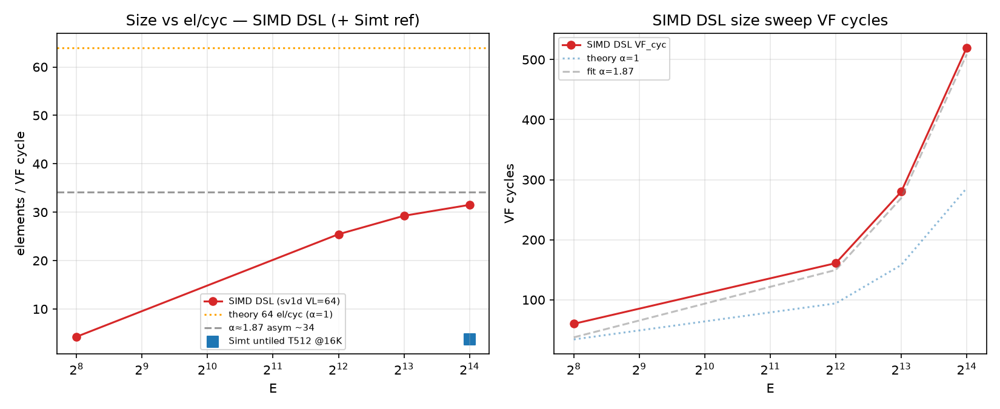
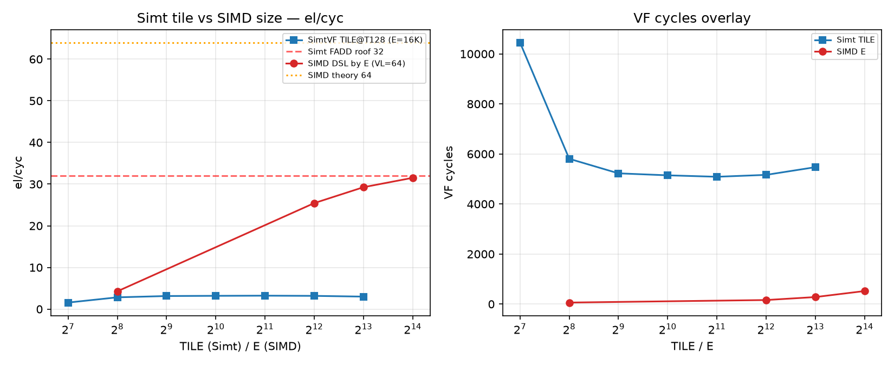

# SV1 analysis — short-live stream eltwise (Simt + SIMD)

**Date:** 2026-10-16 HKT · **SOC:** Ascend950PR_9599 opsim · **CANN / PTOAS:** cann_92b2 / PTOAS nightly (`config.toml` pins)

This is the **only** SV1 analysis doc. Older NOTES / VERDICT / rooftop-32 writeups were removed.

---

## 1. Aims

- Show a **short-live** stream eltwise where inputs do **not** need to stay in register: load → add → store.
- Demonstrate how **SIMD LD/ST high bandwidth** performs well on this **UB-bound** case.

Kernel: one TileLang file `sv1_stream_eltwise.py` (`vf_region` + `ST_VF_MODE`); handwritten SIMD twin `sv1d_stream_eltwise.py` (VL=64).

---

## 2. Test-case design

| Axis | Choices |
|------|---------|
| Problem size | **E = 16K** f32 elements |
| Tile sizes | **2K / 4K / 8K** (then focus **8K**) |
| SIMT threads | **128 / 256 / 512 / …** (untiled T sweep + tiled T=128 ladder) |
| VMI / handwritten SIMD DSL | **VL=64 only** — nothing special to sweep |

**Footprint note (8K tile):** one f32 array @ 8K = **32 KB**; A+B = **64 KB**; A+B+C = **96 KB** — can fit UB / approach whole MRF (128 KB). After the tile ladder we **focus on 8K** as min overhead.

This set is the full sensitivity for the UB-bound case: **tile size**, **thread dim**, **Simt vs SIMD**, and whether current `T.Parallel` / DSL already meet **xx%** of the Simt / SIMD rooftops (sections below).

---

## 3. SIMD performance

Handwritten DSL **VL=64**, size ladder (`data/SUMMARY_sv1d_size_ladder.tsv`):

| E | VF_cyc | IPC | el/cyc |
|--:|-------:|----:|-------:|
| 256 | 60 | 0.35 | 4.27 |
| 4096 | 161 | 1.62 | 25.4 |
| 8192 | 280 | 1.85 | 29.3 |
| **16384** | **520** | **≈1.98** | **31.51** |

**Theory est (Lok): ~44 el/cyc.** Plot SoT on `plots/sv1d_e16k_ex_ipc_30cyc.png` uses derived roof **42.67** (IPC→el conversion); cite Lok’s **~44** as the design target and **42.67** as the plot’s derived roof.

From that same plot footer (authoritative mid-body IPC):

| Metric | Value | vs roof |
|--------|------:|---------|
| Mid-body median IPC | **2.13** → **~34.1 el/cyc** | **≈80%** of 42.67 · **≈77%** of 44 |
| Peak excl fill/drain IPC | 2.77 | — |
| Peak mid IPC | 2.27 | — |
| Early fill IPC | 3.37 | — |
| Overall VF | **31.5 el/cyc** | **≈72%** of 44 · **≈74%** of 42.67 |

**Takeaway:** SIMD DSL already delivers high BW — overall **~72% of Lok’s ~44 el/cyc** theory; mid-body **~80% of the plot’s 42.67** roof.

---

## 4. SIMT performance

Stock pack is **LDS/STS.64** (float2) — for that width path, load BW is framed as **64 B/cyc only**.

### 4.1 Measured stock (E=16384, LDS/STS.64)

From `data/SUMMARY_sv1_simt_T_dim_rooftop.tsv` / `SUMMARY_sv1_simt_tile16k.tsv`:

| Case | el/cyc | % of LD.64 A+B theory (~8) | % of 1R+1W@128B (16) |
|------|-------:|---------------------------:|---------------------:|
| untiled T128 | 2.87 | 36% | 18% |
| untiled T256 | 3.37 | 42% | 21% |
| **untiled T512** | **3.71** | **46%** | 23% |
| TILE2048 @ T128 | 3.22 | 40% | 20% |
| TILE8192 @ T128 | 2.99 | 37% | 19% |
| **ILP16 @ T128** | **4.08** | **51%** | **25.5%** |

**Lead framing (Lok):** LD.64 A+B theory ≈ **8 el/cyc** (64 B/cyc load ÷ 8 B for A+B per elem). Stock / ILP Simt lands **~3.7–4.1 el/cyc** → about **half** of that ~8 roof.

**Accounting note (do not confuse):** prior pack docs also used **1R+1W @ 128 B each → 16 el/cyc**. Against that roof, ILP16 is **25.5%**. Lead with the LD.64 = 64 B/cyc → ~8 el/cyc framing above; keep 16 only as the alternate full-port accounting.

### 4.2 Side note: LD.32

- Theory: LD.32 can do **128 B/cyc**, but **too many instructions / hard to schedule**.
- For LD.32 A+B (dual load on one R port), **theory best ~8 el/cyc**.
- SoftLib / best-thread cases land around **~4–5 el/cyc** VF average under realistic schedules:
  - SoftLib **A-only** LDS.b32 contig T128: VF **4.54** el/cyc @ E=8192 (label **A-only** — not A+B).
  - Stock / ILP Simt (A+B, .64 pack): **~3.7–4.1** el/cyc.
  - SoftLib A-only T512 / T1024 VF **8.5 / 9.9** el/cyc are **A-only** — do **not** mix with A+B theory without labeling.
- SoftLib A-only LDS.b32 contig T128: LDS-window **101 B/cyc (79% of 128)**, LDS-window elems **25.3**; whole-VF elems **4.54** — see `/workspace/st_out_cce_vadds_const/reports/`.
- SoftLib A+B LDS.b32 contig T128: **~52 B/cyc** (~41% of 128) from LDS width BW report.

---

## 5. CCE T128 manual-schedule side note + verdict

SoftLib CCE hand schedule (contig + scheduling probes, T128; reports under `/workspace/st_out_cce_vadds_const/reports/`):

| Probe | Result |
|-------|--------|
| A-only LDS.b32+const T128 | **101 B/cyc** LDS-window (79% of 128); VF **4.54** el/cyc |
| A-only T512 / T1024 | VF **8.5 / 9.9** el/cyc; `ipc_pipe4` ≈ **1.33 / 1.55**; LDS-window B/cyc **falls** as warps↑ |
| All-four IADD+LDS+FADD+STS same cycle | **0** cycles at T128/512/1024 |
| Latency alone forbid ~4-issue? | **No** — schedule/port limited |

### Verdict (this SV1 case)

| Path | Measured | Roof framing | % of roof |
|------|----------|--------------|----------:|
| **SIMD DSL VL=64** | **31.5 el/cyc** overall VF; mid-body **~34.1** | Lok **~44** (plot **42.67**) | **~72%** overall · mid **~80%** of 42.67 |
| **Simt `T.Parallel` LD.64** | stock best **3.71**; ILP16 **4.08** | LD.64 A+B **~8** | **~46–51%** (~half) |
| same Simt vs alt roof | 4.08 | 1R+1W@128B **16** | **~25%** |
| CCE hand (A-only window) | **101 B/cyc** | 128 B | **79%** window BW; sustained ~4-issue / A+B toward roof still **schedule/port limited** |

**Bottom line:** SIMD DSL already delivers high BW (**~72% of ~44 el/cyc**). Simt `T.Parallel` with default LD.64 is **~4 el/cyc** — about **half** of the **~8** LD.64 A+B theory (**~25%** if using the 16 el/cyc 1R+1W roof). CCE hand work shows LDS BW *can* approach the 128 B roof on A-only windows, but **sustained ~4-issue and A+B toward roof remain schedule/port limited**, not latency-impossible alone.

---

## 6. Shared vs UB / register note

For this short-live stream case, temps as `alloc_shared` (UB) vs `alloc_fragment` (RF):

- **Register / layout differs** (measured).
- **Pre-measure expectation:** perf ≈ no diff.
- **Measured:** shared temps are **slower**, not equal — see `data/SHARED_VS_FRAGMENT_AB.md`.

Override: `ST_SV1_TEMPS=frag|shared` on `sv1_stream_eltwise.py` (tag suffix `_frag` / `_shared`). Opsim 2026-10-16 HKT, cann_92b2, `ST_VF_MODE=simt-asc`.

| Case | frag VF_cyc / el/cyc | shared VF_cyc / el/cyc | Δ el/cyc | layout |
|------|---------------------:|-----------------------:|---------:|--------|
| E8192 T128 | 4680 / **1.75** | 7450 / **1.10** | **−37%** | frag RF `tN[64]`; shared UB ptrs (STS 64→256) |
| E8192 T512 | 3405 / **2.41** | 6840 / **1.20** | **−50%** | frag RF `tN[16]`; shared UB ptrs (STS 64→256) |
| E16384 T128 | 9031 / **1.81** PASS | COMPILE_OK / **opsim FAIL** maxabs≈492 | — | shared UB footprint (A+B+C+t1+t2+t3) blows past UB |

**Verdict:** layout differs as expected; **perf is not ≈equal** — shared costs extra UB traffic (≈4× STS) and loses **~37–50%** el/cyc on the E8192 PASS pairs. Prefer **fragment** temps for this Simt stream case unless UB temps are required for another reason.

---

## 7. Meta / pins

| Pin | Value |
|-----|-------|
| SOC / opsim | Ascend950PR_9599 |
| CANN | cann_92b2 (`config.toml`: `cann_92b2/9.2.0-beta.2`) |
| PTOAS | nightly (`config.toml`: `0.67@1b36b6f…`) |
| Date | **2026-10-16 HKT** |

### Artifacts

- `data/` — `SHARED_VS_FRAGMENT_AB.md` (+ `.tsv`/`.json`), `SUMMARY_sv1d_size_ladder.tsv`, `SUMMARY_sv1_simt_T_dim_rooftop.tsv`, `SUMMARY_sv1_simt_tile16k.tsv`, `OVERHEAD_ilp16.json`, bubbles / MIX / GPU compare
- `plots/` — `sv1d_e16k_ex_ipc_30cyc.png`, `sv1_simd_size_vs_el.png`, `sv1_simt_vs_simd_el_overlay.png`, `sv1_simt_e16k_body4_ex_ipc_30cyc.png`, `sv1_thread_vs_ipc_el.png`, `sv1_tile_vs_vf_el_instr.png`, ILP timeline / waterfall
- SoftLib CCE — `/workspace/st_out_cce_vadds_const/reports/VADDS_CONST_B32_OPSIM.md`, `VADDS_CONST_T512_1024_OPSIM.md`

### Weekly gate

`scripts/regression/oneshot_sv1_e8192_t128_t512.sh` — **E=8192**, **T=128** + **T=512**, `ST_VF_MODE=simt-asc`, stock schedule only.
