# SV2 — one scale for the block, divide in the register

One scale for the whole block. The scale stays live across the reduce, and pass 2 divides the value already in the thread.

```text
scale = max(eps, max |X|)
Out = X / scale
```

Pass 1 finds the scale. Pass 2 writes `X / scale`.

## SIMD

VL = 64. VF is the tick the `VF` opcode completes minus the tick it was issued. el/cyc is N/VF. IPC excludes the `VF` opcode.

| N | N/64 | VF | el/cyc | IPC |
| ---: | ---: | ---: | ---: | ---: |
| 64 | 1 | 95 | 0.67 | 0.19 |
| 512 | 8 | 126 | 4.06 | 0.56 |
| 4096 | 64 | 351 | 11.67 | 1.32 |
| 16384 | 256 | 1119 | **14.64** | 1.61 |

**Note:** el/cyc rises with N, to 14.64 at 16384. At that N the shape does not matter: 32×512, 64×256, 256×64, and 512×32 share this VF.

## SIMT

One thread owns one column. The max of that column stays in the thread. The block scale is a max across threads, and it stays in a register for the divide.

Two ways to take that max were compared, then the later sections keep the loop.

cross: threads = N. Thread t owns element t.

```text
warp 0:  t0  .. t31     each owns one element, redux inside the warp
warp 1:  t32 .. t63
...
then one redux of those warp partials
```

loop: threads fixed at 128. Thread t walks a strided run, then the same redux runs across the 4 warps.

```text
t0:    x[0],   x[128], x[256], ...
t1:    x[1],   x[129], x[257], ...
t127:  x[127], x[255], ...
then one redux across these 128 threads
```

Bold is the lower VF at that N.

| N | Cross VF | Cross REDUX | Cross BAR | Loop VF | Loop REDUX | Loop BAR |
| ---: | ---: | ---: | ---: | ---: | ---: | ---: |
| 128 | 633 | 5 | 16 | **632** | 5 | 16 |
| 256 | 701 | 9 | 32 | **576** | 5 | 16 |
| 512 | 835 | 17 | 64 | **663** | 5 | 16 |
| 1024 | 988 | 64 | 128 | **535** | 5 | 16 |
| 2048 | 1549 | 128 | 256 | **503** | 5 | 16 |

**Takeaway:** The 128-thread loop is faster at every N here. At N=2048 it is 503 cycles against 1549 for cross. Cross does not fold partials past warp 31, so with only X[N−1] = 4 the scale stays at eps. The loop scale is 4.

`SIMT_BAR_THREAD_BLOCK` is 4 per warp, 1 tick each. The sections below keep the loop, so the barrier count stays 16 as N grows.

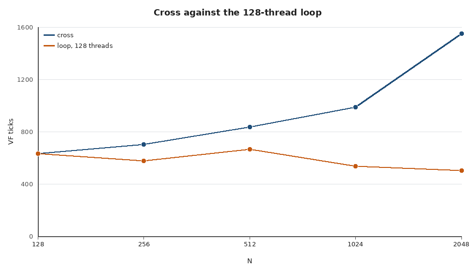

### No-Reload

128 threads, one column per thread. The scale stays in the register. R doubles. MRF is the live registers, unique Rn × 128 × 4 bytes, against 128KB.

```text
thread col owns column col
m = 0
for row in 0 .. R-1:
    held[row] = X[row, col]
    m = max(m, abs(held[row]))
scale = max(eps, redux(m))
for row in 0 .. R-1:
    Out[row, col] = held[row] / scale
```

| Rows | Elements | Method | Reload | LDK | MRF | VF | el/cyc |
| ---: | ---: | :---: | :---: | ---: | :---: | ---: | ---: |
| 32 | 4096 | unroll | No | 0 | 21.5KB / 17% | 1806 | 2.27 |
| 64 | 8192 | unroll | No | 0 | 47.5KB / 37% | 2474 | **3.31** |
| 128 | 16384 | unroll | Yes | 88 | 63.5KB / 50% | 4963 | 3.30 |
| 256 | 32768 | GM | Yes | 996 | 63.5KB / 50% | 113398 | 0.29 |

**Takeaway:** The best unrolled rate is 3.31 el/cyc, at 64 rows. The GM reload falls to 0.29.

Unroll keeps one local per row, and pass 2 divides that local. GM loads each value from X and stores it to Out, with no data in UB.

### Thread sensitivity

Same N, so rows × threads stays fixed. Rows per thread is N / threads. Bold is the best el/cyc inside that N.

<table align="center">
<thead>
<tr>
<th align="center">N</th>
<th align="center">Threads</th>
<th align="center">Rows</th>
<th align="center">VF</th>
<th align="center">el/cyc</th>
<th align="center">IPC</th>
<th align="center">REDUX</th>
<th align="center">BAR</th>
</tr>
</thead>
<tbody>
<tr><td align="center" rowspan="4">4096</td><td align="center">128</td><td align="center">32</td><td align="center">1806</td><td align="center">2.27</td><td align="center">0.49</td><td align="center">5</td><td align="center">16</td></tr>
<tr><td align="center">256</td><td align="center">16</td><td align="center">856</td><td align="center"><b>4.79</b></td><td align="center">1.16</td><td align="center">9</td><td align="center">32</td></tr>
<tr><td align="center">512</td><td align="center">8</td><td align="center">904</td><td align="center">4.53</td><td align="center">1.35</td><td align="center">17</td><td align="center">64</td></tr>
<tr><td align="center">1024</td><td align="center">4</td><td align="center">1190</td><td align="center">3.44</td><td align="center">1.40</td><td align="center">64</td><td align="center">128</td></tr>
<tr><td align="center" rowspan="4">8192</td><td align="center">128</td><td align="center">64</td><td align="center">2474</td><td align="center">3.31</td><td align="center">0.67</td><td align="center">5</td><td align="center">16</td></tr>
<tr><td align="center">256</td><td align="center">32</td><td align="center">1960</td><td align="center">4.18</td><td align="center">0.90</td><td align="center">9</td><td align="center">32</td></tr>
<tr><td align="center">512</td><td align="center">16</td><td align="center">1332</td><td align="center"><b>6.15</b></td><td align="center">1.49</td><td align="center">17</td><td align="center">64</td></tr>
<tr><td align="center">1024</td><td align="center">8</td><td align="center">1402</td><td align="center">5.84</td><td align="center">1.73</td><td align="center">64</td><td align="center">128</td></tr>
<tr><td align="center" rowspan="4">16384</td><td align="center">128</td><td align="center">128</td><td align="center">4963</td><td align="center">3.30</td><td align="center">0.68</td><td align="center">5</td><td align="center">16</td></tr>
<tr><td align="center">256</td><td align="center">64</td><td align="center">3042</td><td align="center">5.39</td><td align="center">1.09</td><td align="center">9</td><td align="center">32</td></tr>
<tr><td align="center">512</td><td align="center">32</td><td align="center">2513</td><td align="center">6.52</td><td align="center">1.40</td><td align="center">17</td><td align="center">64</td></tr>
<tr><td align="center">1024</td><td align="center">16</td><td align="center">2363</td><td align="center"><b>6.93</b></td><td align="center">1.68</td><td align="center">64</td><td align="center">128</td></tr>
</tbody>
</table>

**Takeaway:** Best el/cyc at each N is 4.79 (4096, 256 threads), 6.15 (8192, 512 threads), and 6.93 (16384, 1024 threads). At 128 threads the loads do not overlap.

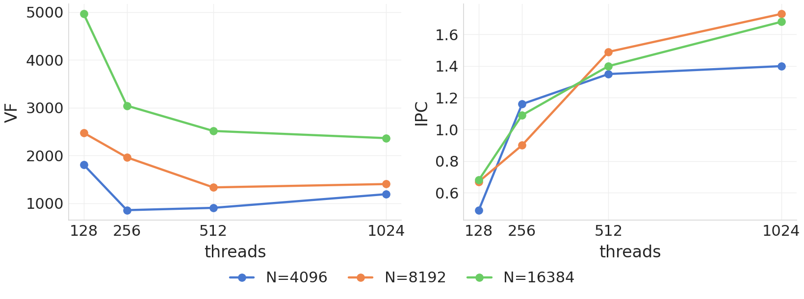

### Theoretical model

**In-Progress.** The estimate below is only for 512 threads (`W = 16`). A `REDUX` is 17 ticks, and the 16 warps do not overlap those issues. The barrier spread is 220 ticks, from the first warp's load to the last.

```text
pass1  = (R−1)×16 + 32    one max per row per warp, plus two S2R per warp
reduce = 17×16 + 220
pass2  = 32×R             one add and one divide, per row per warp
end    = 9                END issue to complete
VF     ≈ pass1 + reduce + pass2 + end
```

Measured VF is the 512-thread row from the sensitivity table.

| N | Rows | Measured VF | Model VF |
| ---: | ---: | ---: | ---: |
| 4096 | 8 | 904 | 901 |
| 8192 | 16 | 1332 | 1285 |
| 16384 | 32 | 2513 | 2053 |

**Note:** The 8-row estimate is 3 ticks short. The 16-row estimate is 47 ticks short. At 32 rows the estimate is 460 ticks short.

## Head-to-head

N=16384. SIMD is the N=16384 row above. SIMT is the best row in the thread sensitivity table, 1024 threads and 16 rows.

| Path | Shape | VF | el/cyc | IPC |
| :---: | :---: | ---: | ---: | ---: |
| SIMD | N=16384 | 1119 | **14.64** | 1.61 |
| SIMT | 1024 threads, 16 rows | 2363 | 6.93 | 1.68 |

**Takeaway:** SIMD is 2.11× this SIMT row. IPC is close. The gap is the element rate.

**SIMD instructions.** One vector pipe. `VLD` and `VMAX` run together. One `VCMAX`, then `VDUP`. Pass 2 is `VLD` again with `VDIV` and `VST`. The line underneath is the same IPC.

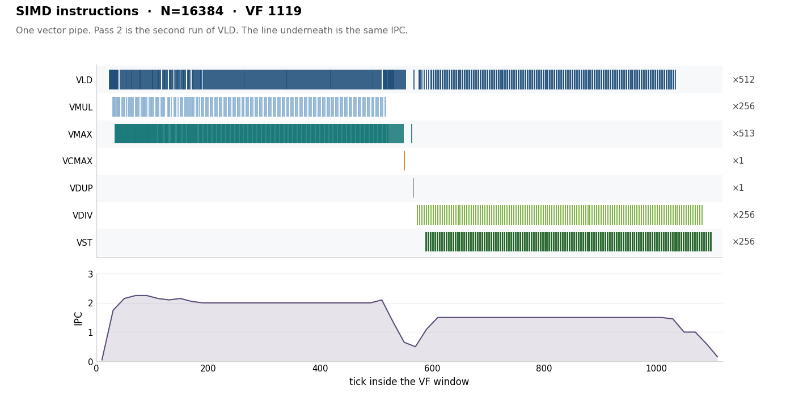

**SIMT instructions.** All 32 warps. Each opcode has its own color. Address math is left off the rows. The IPC line still counts it. `FMNMX` (×480) is the register max, one for each row after the first. `FMNMX_I` (×96) is the immediate form, three per warp: the first row against 0, `max(acc, m)` where acc starts at −inf, and `max(scale, eps)` just before the divide.

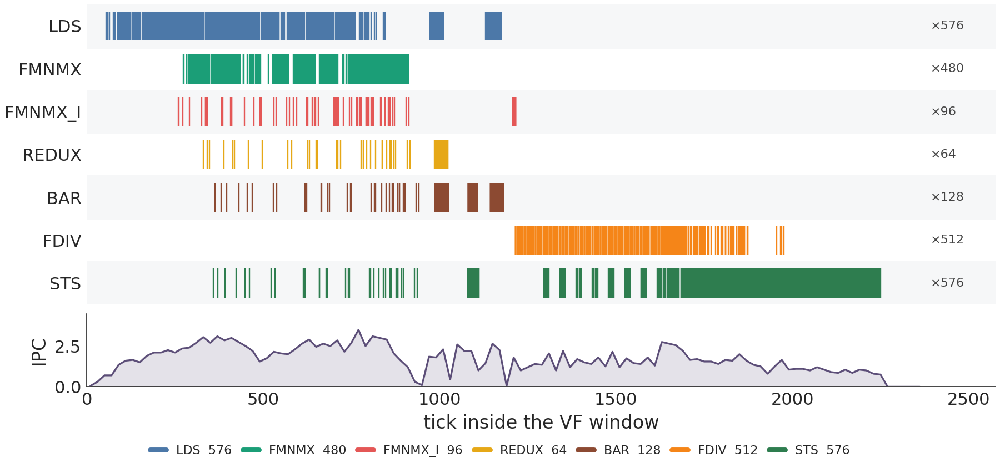

**SIMT warps.** One row per warp, in issue order of each PC. The legend is the same opcodes. The lower panel is ticks 240–1250, where the two max opcodes, the redux, and the barrier sit together.

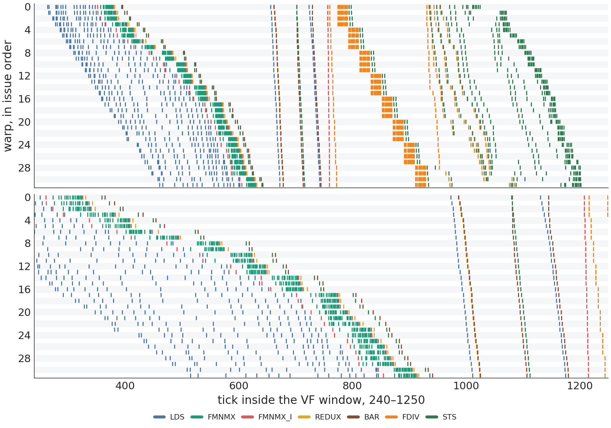

The trace has no warp id. Each PC is issued 32 times, and the row is that order. Warp 0 issues its first `FMNMX_I` at tick 260 and its first `FMNMX` at tick 273.

## Schedule fence

A schedule fence keeps the full program and forces one stage to finish before the next stage starts. The case is N=16384, 1024 threads, 16 rows, the same shape as the head-to-head.

Every row is the full block scale. A cut flushes the values that stage produced, by a volatile read and write of the same bits. An empty compiler fence is deleted in this VF, so it is not in the table. `LDS`, `STS`, `FDIV`, and `FMNMX` stay 576, 576, 512, and 480. `REDUX` stays 64 and `BAR` stays 128. `LDK` and `STK` are the flush.

This handwritten kernel measures 2360 ticks with no cut. The stock head-to-head kernel above is 2363. The two are not the same binary.

| Cut | VF | el/cyc | IPC | Issues | LDK | STK |
| :---: | ---: | ---: | ---: | ---: | ---: | ---: |
| fused | 2360 | **6.94** | 1.69 | 4000 | 0 | 0 |
| split | 2360 | **6.94** | 1.69 | 4000 | 0 | 0 |
| after load | 8355 | 1.96 | 0.66 | 5536 | 512 | 1024 |
| after max | 3179 | 5.15 | 1.29 | 4096 | 32 | 64 |
| after redux | 2368 | 6.92 | 1.73 | 4096 | 32 | 64 |
| after divide | 7158 | 2.29 | 0.77 | 5536 | 512 | 1024 |
| after load and divide | 14212 | 1.15 | 0.50 | 7072 | 1024 | 2048 |
| after every stage | 15181 | 1.08 | 0.48 | 7264 | 1088 | 2176 |

- fused: each load is written with its max, then the redux, then each divide with its store. No flush.
- split: load, max, redux, divide, store, in that order. No flush. This compiles to the same binary as fused, so both rows are one measurement.
- after load: flush the 16 loaded values.
- after max: flush the column max.
- after redux: flush the block scale.
- after divide: flush the 16 quotients.
- after load and divide: both of those flushes.
- after every stage: flush after the load, the max, the redux, and the divide.

**Takeaway:** No cut is fastest, at 6.94 el/cyc. Flushing the block scale stays at 6.92, because the redux already waits. Flushing the 16 loads or the 16 quotients falls to 1.96 and 2.29.

## Operation breakdown

Same shape as the fence and the head-to-head: N=16384, 1024 threads, 16 rows. Each row is its own kernel. The dashed line on the chart is the stock kernel, 6.93 el/cyc.

**Whole kernel.** The first table, and the blue bar. el/cyc is 16384/VF over the entire VF window, including the loads an operator needs and the store that keeps the result.

**Operator window.** The second table, and the orange bar. It runs from the first issue of that opcode to the last. el/cyc is the elements that opcode issues, divided by that span. The redux window is the 1024 values, so that bar is 1.95.

`max` and `fdiv` both start from an `LDS`. The max loads all 16 rows, then reduces them inside the thread. The divide loads all 16 rows and divides each by the column's first value. `redux` loads that first row, one value per thread, and takes the max across the 1024 threads. `load` writes the 16 values back. `sts` stores the constant 1 and does not load. Pass 2 is the divide, so there is no multiply.

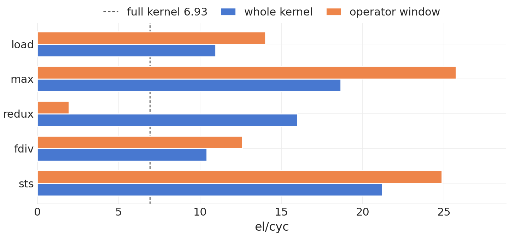

| Kernel | VF | el/cyc | IPC | Opcodes |
| :---: | ---: | ---: | ---: | :---: |
| load | 1496 | 10.95 | 1.48 | 512 LDS, 512 STS |
| max | 879 | 18.64 | 2.00 | 512 LDS, 512 max, 32 STS |
| redux | 1026 | 15.97 | 1.03 | 64 REDUX, 128 BAR, 96 LDS |
| fdiv | 1572 | 10.42 | 1.75 | 512 LDS, 512 FDIV, 512 STS |
| sts | 773 | **21.20** | 1.61 | 512 STS |

| Kernel | Operator | Ticks | Window el/cyc |
| :---: | :---: | :---: | ---: |
| load | LDS | 55–1224 | 14.02 |
| max | max | 209–846 | **25.72** |
| redux | REDUX | 98–624 | 1.95 |
| fdiv | FDIV | 187–1488 | 12.59 |
| sts | STS | 88–747 | 24.86 |

**Takeaway:** The 16 divides run at 10.42 el/cyc, next to the copy at 10.95. The full kernel is 6.93 because the redux sits between them. A store with no load reaches 21.20. The column max, without the cross-thread reduce, reaches 18.64. The max is the fastest issue window, at 25.72. The redux of 1024 values issues at 1.95.


# From the block scale to a column scale

Pass 2 divides every value by the block scale. That is one `FDIV` per element. The same result is one inverse of the scale, `inv = 1 / scale`, then a multiply.

The redux is the other cost. It crosses warps. On the 1024-thread, 16-row shape the copy is 10.95 el/cyc and the full kernel is 6.93, because the redux sits between the load and the divide. The redux window itself issues at 1.95 el/cyc.

A scale per column stays in the lane. There is no broadcast and no cross-warp redux. That case is SV2.A.

# SV2.A — scale per column, multiply by the inverse

One scale per column. The column never leaves its lane, so nothing is broadcast. After the max, the kernel takes the inverse once and multiplies.

```text
scale[col] = max(eps, max over rows |X[row, col]|)
Out[row, col] = X[row, col] * (1 / scale[col])
```

## SIMD

VL = 64. One lane owns one column. VF is the tick the `VF` opcode completes minus the tick it was issued. el/cyc is N/VF. IPC excludes the `VF` opcode.

The absolute value and the max issue in the same tick.

| N | Shape | VF | el/cyc | IPC |
| ---: | :---: | ---: | ---: | ---: |
| 64 | 1×64 | 77 | 0.83 | 0.16 |
| 512 | 8×64 | 103 | 4.97 | 0.62 |
| 4096 | 32×128 | 279 | **14.68** | 1.65 |

**Note:** el/cyc rises with N, to 14.68 at 4096.

N=16384 depends on the shape. Each column keeps its own scale. One instruction covers 64 columns, one lane each.

| Shape | VF | el/cyc | IPC |
| :---: | ---: | ---: | ---: |
| 256×64 | 849 | **19.30** | 2.12 |
| 64×256 | 1064 | 15.40 | 1.70 |
| 32×512 | 1255 | 13.05 | 1.45 |
| 16×1024 | 902 | 18.16 | 2.08 |

**Note:** 256×64 is the fastest shape at this N, at 19.30 el/cyc. Sixty-four columns fit in one instruction, so the inverse is one `VDIV` for the tile. More columns repeat that walk. SIMD needs C as a multiple of 64, so 512×32 is out.

For R>1 the steady counts are `VMUL = VMAX = 2×N/64`, `VST = N/64`, and one `VDIV` per 64 columns.

## SIMT

One thread owns one column. The max of that column stays in the thread, the inverse is taken once, and pass 2 multiplies the value already in the thread. Nothing is broadcast. `REDUX` and `BAR` stay at 0.

### No-Reload

128 threads, one column per thread. The inverse stays in the register. R doubles. MRF is the live registers, unique Rn × 128 × 4 bytes, against 128KB.

```text
thread col owns column col
m = 0
for row in 0 .. R-1:
    held[row] = X[row, col]
    m = max(m, abs(held[row]))
inv = 1 / max(m, eps)
for row in 0 .. R-1:
    Out[row, col] = held[row] * inv
```

| Rows | Elements | Method | Reload | LDK | MRF | VF | el/cyc |
| ---: | ---: | :---: | :---: | ---: | :---: | ---: | ---: |
| 32 | 4096 | unroll | No | 0 | 20.5KB / 16% | 1053 | **3.89** |
| 64 | 8192 | unroll | No | 0 | 37.0KB / 29% | 2153 | 3.80 |
| 128 | 16384 | unroll | Yes | 36 | 63.5KB / 50% | 4350 | 3.77 |
| 256 | 32768 | GM | Yes | 832 | 63.5KB / 50% | 144635 | 0.23 |

**Takeaway:** Unrolled rows stay near 3.8 el/cyc. The GM reload falls to 0.23.

Unroll keeps one local per row, and pass 2 multiplies that local by the inverse. GM loads each value from X and stores it to Out, with no data in UB.

### Thread sensitivity

Same N, so rows × threads stays fixed. Rows per thread is N / threads. `REDUX` and `BAR` are 0 on every row. LDK is 0 except 36 at 128 threads and 128 rows. Bold is the best el/cyc inside that N.

<table align="center">
<thead>
<tr>
<th align="center">N</th>
<th align="center">Threads</th>
<th align="center">Rows</th>
<th align="center">VF</th>
<th align="center">el/cyc</th>
<th align="center">IPC</th>
</tr>
</thead>
<tbody>
<tr><td align="center" rowspan="4">4096</td><td align="center">128</td><td align="center">32</td><td align="center">1053</td><td align="center">3.89</td><td align="center">0.76</td></tr>
<tr><td align="center">256</td><td align="center">16</td><td align="center">479</td><td align="center"><b>8.55</b></td><td align="center">1.72</td></tr>
<tr><td align="center">512</td><td align="center">8</td><td align="center">591</td><td align="center">6.93</td><td align="center">1.49</td></tr>
<tr><td align="center">1024</td><td align="center">4</td><td align="center">626</td><td align="center">6.54</td><td align="center">1.58</td></tr>
<tr><td align="center" rowspan="4">8192</td><td align="center">128</td><td align="center">64</td><td align="center">2153</td><td align="center">3.80</td><td align="center">0.73</td></tr>
<tr><td align="center">256</td><td align="center">32</td><td align="center">1426</td><td align="center">5.74</td><td align="center">1.12</td></tr>
<tr><td align="center">512</td><td align="center">16</td><td align="center">910</td><td align="center"><b>9.00</b></td><td align="center">1.81</td></tr>
<tr><td align="center">1024</td><td align="center">8</td><td align="center">980</td><td align="center">8.36</td><td align="center">1.80</td></tr>
<tr><td align="center" rowspan="4">16384</td><td align="center">128</td><td align="center">128</td><td align="center">4350</td><td align="center">3.77</td><td align="center">0.73</td></tr>
<tr><td align="center">256</td><td align="center">64</td><td align="center">2352</td><td align="center">6.97</td><td align="center">1.33</td></tr>
<tr><td align="center">512</td><td align="center">32</td><td align="center">1665</td><td align="center"><b>9.84</b></td><td align="center">1.91</td></tr>
<tr><td align="center">1024</td><td align="center">16</td><td align="center">1690</td><td align="center">9.69</td><td align="center">1.95</td></tr>
</tbody>
</table>

**Takeaway:** Best el/cyc at each N is 8.55 (4096, 256 threads), 9.00 (8192, 512 threads), and 9.84 (16384, 512 threads). At 128 threads the loads do not overlap.

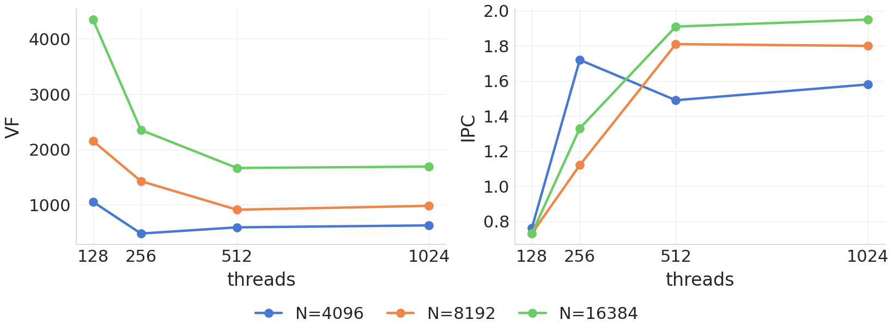

### Theoretical model

**In-Progress.** A cycle model for this per-column inverse is not settled.

What is known is the issue count. `W` is threads / 32 and `R` is rows per thread. `LDS = STS = FMUL = R×W`, `FMNMX = (R−1)×W`, and there is one `FDIV` per warp. For a fixed N the row issues stay put, and the inverse prologue grows with W.

## Head-to-head

N=16384. SIMD is the fastest shape in the SIMD table, 256×64. SIMT is the best row in the thread sensitivity table, 512 threads and 32 rows.

| Path | Shape | VF | el/cyc | IPC |
| :---: | :---: | ---: | ---: | ---: |
| SIMD | 256×64 | 849 | **19.30** | 2.12 |
| SIMT | 512 threads, 32 rows | 1665 | 9.84 | 1.91 |

**Takeaway:** SIMD is 1.96× this SIMT row. IPC is close. The gap is the element rate.

**SIMD instructions.** One vector pipe. Each opcode has its own color. The single `VDIV` is the orange mark. The line underneath counts every issue, including the ones left off the rows.

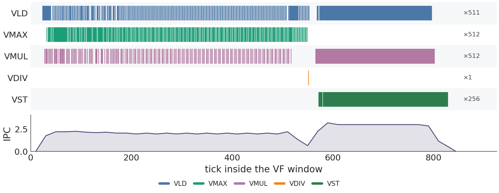

**SIMT instructions.** All 16 warps. Each opcode has its own color. Address math is left off the rows. The IPC line still counts it. `FMNMX` (×496) is the register max, one for each row after the first. `FMNMX_I` (×32) is the immediate form: the first row maxes against 0, and `max(m, eps)` sits just before the inverse. The 16 `FDIV_I` marks are one inverse per warp.

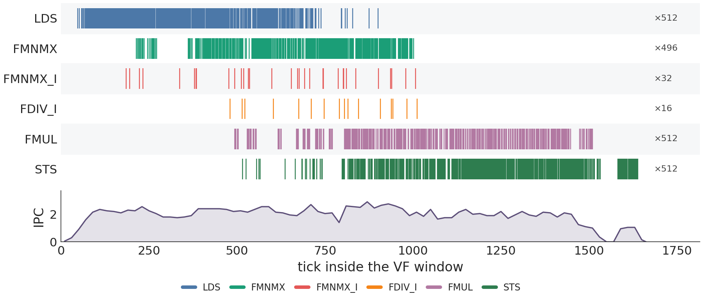

**SIMT warps.** One row per warp, in issue order of each PC. The legend is the same opcodes.

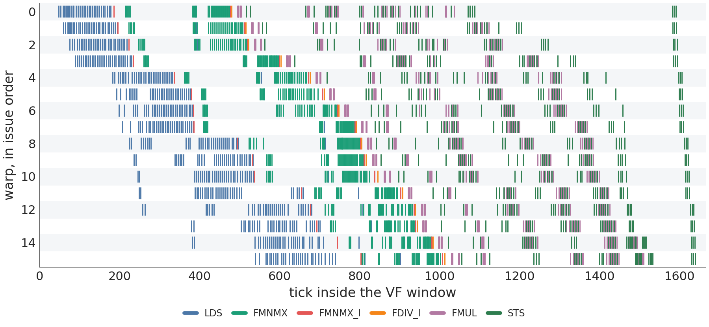

Each PC is issued 16 times. The multiply is underway while later warps are still loading.

## Schedule fence

A schedule fence keeps the full program and forces one stage to finish before the next stage starts. The case is N=16384, 1024 threads, 16 rows. That is the 9.69 row in the thread table, not the 512-thread head-to-head.

Every row is the full column scale. A cut flushes the values that stage produced, by a volatile read and write of the same bits. An empty compiler fence is deleted in this VF, so it is not in the table. `LDS`, `STS`, `FMUL`, and `FMNMX` stay 512, 512, 512, and 480. `LDK` and `STK` are the flush.

| Cut | VF | el/cyc | IPC | Issues | LDK | STK |
| :---: | ---: | ---: | ---: | ---: | ---: | ---: |
| fused | 1690 | **9.69** | 1.95 | 3296 | 0 | 0 |
| split | 1725 | 9.50 | 1.91 | 3296 | 0 | 0 |
| after load | 7694 | 2.13 | 0.63 | 4832 | 512 | 1024 |
| after max | 1991 | 8.23 | 1.70 | 3392 | 32 | 64 |
| after inverse | 1971 | 8.31 | 1.74 | 3424 | 32 | 64 |
| after multiply | 6403 | 2.56 | 0.75 | 4832 | 512 | 1024 |
| after load and multiply | 9972 | 1.64 | 0.64 | 6368 | 1024 | 2048 |
| after every stage | 11187 | 1.46 | 0.59 | 6592 | 1088 | 2176 |

- fused: each load is written with its max, then one inverse, then each multiply with its store. No flush.
- split: load, max, inverse, multiply, store, in that order. No flush. This is a different binary from fused.
- after load: flush the 16 loaded values.
- after max: flush the column max.
- after inverse: flush the inverse.
- after multiply: flush the 16 products.
- after load and multiply: both of those flushes.
- after every stage: flush after the load, the max, the inverse, and the multiply.

**Takeaway:** No cut is fastest, at 9.69 el/cyc. Flushing one value, the max or the inverse, stays near 8.3. Flushing the 16 loads or the 16 products falls to 2.13 and 2.56.

## Operation breakdown

Same shape as the fence: N=16384, 1024 threads, 16 rows. Each row is its own kernel. The dashed line on the chart is that full kernel, 9.69 el/cyc.

**Whole kernel.** The first table, and the blue bar. el/cyc is 16384/VF over the entire VF window, including the loads an operator needs and the store that keeps the result.

**Operator window.** The second table, and the orange bar. It runs from the first issue of that opcode to the last. el/cyc is the elements that opcode issues, divided by that span.

`max` and `fdiv` both start from an `LDS`. The max loads all 16 rows. The divide loads the first row of the column, then takes the inverse. `load` writes the 16 values back. `fmul` multiplies each row by the column's first value and stores the products. `sts` stores the constant 1 and does not load.

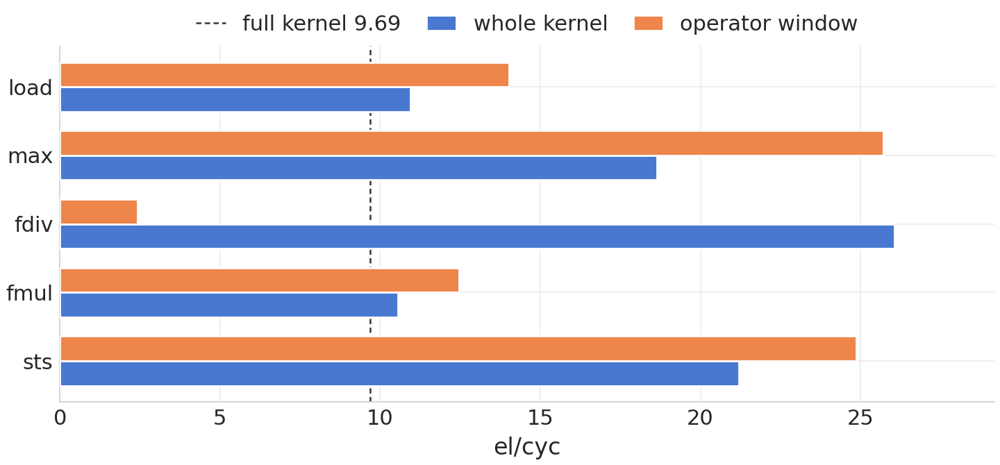

| Kernel | VF | el/cyc | IPC | Opcodes |
| :---: | ---: | ---: | ---: | :---: |
| load | 1496 | 10.95 | 1.48 | 512 LDS, 512 STS |
| max | 879 | 18.64 | 2.00 | 512 LDS, 512 max, 32 STS |
| fdiv | 629 | 26.05 | 0.61 | 32 LDS, 32 FDIV, 32 STS |
| fmul | 1551 | 10.56 | 1.75 | 512 LDS, 512 FMUL, 512 STS |
| sts | 773 | **21.20** | 1.61 | 512 STS |

| Kernel | Operator | Ticks | Window el/cyc |
| :---: | :---: | :---: | ---: |
| load | LDS | 55–1224 | 14.02 |
| max | max | 209–846 | **25.72** |
| fdiv | FDIV | 89–511 | 2.43 |
| fmul | FMUL | 183–1497 | 12.47 |
| sts | STS | 88–747 | 24.86 |

**Takeaway:** The full kernel at 9.69 sits next to the copy (10.95) and the multiply (10.56). The column max, which writes one value, reaches 18.64, and a store with no load reaches 21.20. The 26.05 on `fdiv` is a whole-kernel number for 1024 inverses. Those inverses themselves issue at 2.43. The max is the fastest issue window, at 25.72.

## Appendix

### SV2 — recreating the cases

Run these from `benches/sv2/block`.

Record with `npusim record -s Ascend950 -g -n 0`, one quoted command. VF, el/cyc, and IPC are read from veccore0 of that `instr.bin`.

**SIMD.** `block-quant/simd.py R C`.

`block-quant/r1c64/` (N=64), `r8c64/` (N=512), `r32c128/` (N=4096). At N=16384: `r32c512/`, `r64c256/`, `r256c64/`, `r512c32/`. These four share one VF.

```bash
npusim record -s Ascend950 -g -n 0 "python block-quant/simd.py R C"
```

Buffer-fit logs under `tile-fit/` have no body table. They are `python block-quant/simd.py R C` for the C=128, C=256, and 256KB checks.

**Reduce options.** `<name>` is `cross-nN` or `loop-nN`, for N in 128, 256, 512, 1024, 2048. Counts are in `reduce-options/sweep.txt`.

```bash
python reduce-options/reduce.py compile
npusim record -s Ascend950 -o reduce-options/<name>/npusim -g -n 0 "python reduce-options/launch.py reduce-options/<name>/kernel.so N"
```

**No-Reload.** Threads = 128, rows = R.

`simt-rows/keep-r32c128/`, `keep-r64c128/`, `keep-r128c128/` (unroll). `simt-rows/noreload-gm-r256c128/` (GM).

```bash
python simt-rows/keep.py R C
python simt-rows/noreload.py gm R C
npusim record -s Ascend950 -o <case>/npusim -g -n 0 "python block-quant/launch_simt.py <case>/kernel.so R C"
```

**Thread sensitivity.** Same kernel. Threads = C, rows = R.

- N=4096: `simt-rows/keep-r32c128/`, `keep-r16c256/`, `keep-r8c512/`, `keep-r4c1024/`
- N=8192: `keep-r64c128/`, `keep-r32c256/`, `keep-r16c512/`, `keep-r8c1024/`
- N=16384: `keep-r128c128/`, `keep-r64c256/`, `keep-r32c512/`, `keep-r16c1024/`

The head-to-head SIMT chart is `keep-r16c1024/`. Then the same launch as No-Reload.

**Schedule fence.** N=16384, 1024 threads, 16 rows. `barriers.py` writes eight kernels of the full block scale.

`barriers/fused/`, `split` is `barriers/sep/`, `after load` is `cut-load/`, `after max` is `cut-max/`, `after redux` is `cut-redux/`, `after divide` is `cut-div/`, `after load and divide` is `cut-mem/`, `after every stage` is `cut-all/`. Fused and split compile to one binary, so split was not launched again.

```bash
python barriers.py compile
npusim record -s Ascend950 -o barriers/<name>/npusim -g -n 0 "python block-quant/launch_simt.py barriers/<name>/kernel.so 16 1024"
```

**Operation breakdown.** Same 1024-thread shape. `ops.py` writes five kernels: `load`, `max`, `redux`, `fdiv`, `sts`, under `ops/<name>/`.

```bash
python ops.py compile
npusim record -s Ascend950 -o ops/<name>/npusim -g -n 0 "python ops_launch.py ops/<name>/kernel.so <name>"
```

### SV2 — counting VF, el/cyc, and IPC

All of these come from veccore0 (`core == 0`, `sub == 1`). Each instruction is paired by PC and ID. `is_popped == 1` is the issue tick, and `0` is the completion tick.

- **VF.** The tick `VF` or `VF_SIMT` completes minus the tick it was issued.
- **el/cyc.** N/VF. This is the whole-kernel number.
- **IPC.** Issues inside that window, excluding the VF opcode, divided by VF. On the head-to-head pair that is 1806/1119 = 1.61 on SIMD and 3968/2363 = 1.68 on SIMT. The 128-thread N=4096 row is 885/1806 = 0.49.
- **IPC line.** Those same issues in bins of 20 ticks. A point is the count in the bin divided by the bin width. The last bin is only the ticks that remain.
- **Operator window.** First issue of that opcode to its last, inside the VF window. el/cyc is the elements that opcode issues, divided by the span. For `redux` the elements are the 1024 values.
- **LDK and STK.** `SIMT_LDK` and `SIMT_STK` issues in the same window. In the fence table they are the flush.
- **MRF.** Unique `Rn` in the SIMT entry, times the thread count, times 4 bytes, against 128KB.
- **Phase bar.** From the first issue of that part to the last. SIMD setup is 0–23, load and max 23–550, reduce 550–574, divide and store 574–1119. SIMT init is 17–461, load and max 54–911, reduce 330–1180, divide and store 1216–2254. Those SIMT bars overlap. Drain is the last `END` issue to the VF completion, tick 2254 to 2363.

Issues per warp, with `W = threads / 32` and `R = N / threads`. These match all twelve sensitivity traces.

```text
once per warp, the reduce:
    REDUX × 1          inside the warp
    BAR   × 4
    STS   × 2          partial, then the broadcast
    LDS   × 1          read the broadcast
    IADD  × 1
    plus one REDUX and one LDS for the cross-warp fold
    (at 32 warps that fold is one more REDUX and LDS per warp)

each row:
    LDS   × 1          X
    STS   × 1          Out
    FDIV  × 1
    IADD  × 2          load address, store address
    FMNMX × 1          every row after the first
```

Totals: `FDIV = R×W`, `FMNMX = (R−1)×W`, `BAR = 4×W`, `IADD = W×(2R+1)`, `STS = W×(R+2)`, `LDS = R×W + REDUX`. `REDUX = W+1` up to 16 warps, and `REDUX = 2W` at 32 warps. Row issues fall with R. Reduce issues grow with W.

### SV2.A — recreating the cases

Run these from `benches/sv2/column`.

Record with `npusim record -s Ascend950 -g -n 0`, one quoted command. VF, el/cyc, and IPC are read from veccore0 of that `instr.bin`.

**SIMD.** `simd.py R C`.

`simd-r1c64/` (N=64), `simd-r8c64/` (N=512), `simd-r32c128/` (N=4096). At N=16384: `simd-r256c64/`, `simd-r64c256/`, `simd-r32c512/`, `simd-r16c1024/`. The head-to-head SIMD chart is `simd-r256c64/`.

```bash
npusim record -s Ascend950 -o simd-rRcC -g -n 0 "python simd.py R C"
```

**No-Reload.** `keep.py` writes the kernel. Threads = 128, rows = R.

`keep-r32c128/`, `keep-r64c128/`, `keep-r128c128/` (unroll). `keep-gm-r256c128/` (GM).

```bash
python keep.py R C
python keep.py gm 256 128
npusim record -s Ascend950 -o <case>/npusim -g -n 0 "python launch_simt.py <case>/kernel.so R C"
```

**Thread sensitivity.** Same kernel. Threads = C, rows = R.

- N=4096: `keep-r32c128/`, `keep-r16c256/`, `keep-r8c512/`, `keep-r4c1024/`
- N=8192: `keep-r64c128/`, `keep-r32c256/`, `keep-r16c512/`, `keep-r8c1024/`
- N=16384: `keep-r128c128/`, `keep-r64c256/`, `keep-r32c512/`, `keep-r16c1024/`

The head-to-head SIMT chart is `keep-r32c512/`. Then the same launch as No-Reload.

**Schedule fence.** N=16384, 1024 threads, 16 rows. `barriers.py` writes eight kernels of the full column scale.

`barriers/fused/`, `split` is `barriers/sep/`, `after load` is `cut-load/`, `after max` is `cut-max/`, `after inverse` is `cut-inv/`, `after multiply` is `cut-mul/`, `after load and multiply` is `cut-mem/`, `after every stage` is `cut-all/`.

```bash
python barriers.py compile
npusim record -s Ascend950 -o barriers/<name>/npusim -g -n 0 "python launch_simt.py barriers/<name>/kernel.so 16 1024"
```

**Operation breakdown.** Same 1024-thread shape. `ops.py` writes five kernels: `load`, `max`, `fdiv`, `fmul`, `sts`, under `ops/<name>/`.

```bash
python ops.py compile
npusim record -s Ascend950 -o ops/<name>/npusim -g -n 0 "python ops_launch.py ops/<name>/kernel.so <name>"
```

### SV2.A — counting VF, el/cyc, and IPC

All of these come from veccore0 (`core == 0`, `sub == 1`). Each instruction is paired by PC and ID. `is_popped == 1` is the issue tick, and `0` is the completion tick.

- **VF.** The tick `VF` or `VF_SIMT` completes minus the tick it was issued.
- **el/cyc.** N/VF. This is the whole-kernel number.
- **IPC.** Issues inside that window, excluding the VF opcode, divided by VF. On the head-to-head pair that is 1800/849 = 2.12 on SIMD and 3184/1665 = 1.91 on SIMT.
- **IPC line.** Those same issues in bins of 20 ticks. A point is the count in the bin divided by the bin width. The last bin is only the ticks that remain.
- **Operator window.** First issue of that opcode to its last, inside the VF window. el/cyc is the elements that opcode issues, divided by the span.
- **LDK and STK.** `SIMT_LDK` and `SIMT_STK` issues in the same window. In the fence table they are the flush.
- **MRF.** Unique `Rn` in the SIMT entry, times the thread count, times 4 bytes, against 128KB.
- **Phase bar.** From the first issue of that row's opcodes to the last. The number in the bar is that difference. The count beside it is the issue count.

Address math (`IADD`) is counted in IPC and left off the instruction rows. The max is two opcodes: `FMNMX` is the register form, and `FMNMX_I` is the immediate form.
