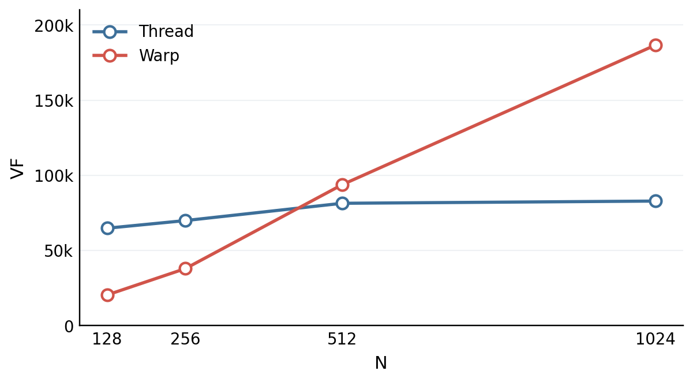
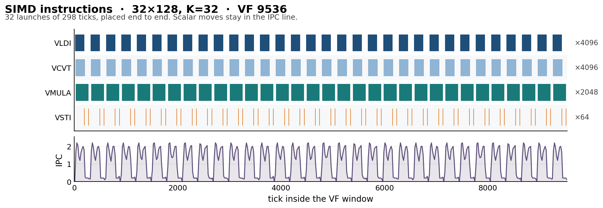
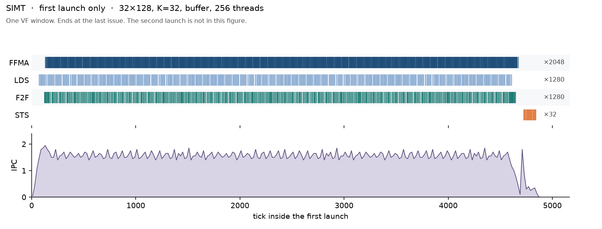

# SV3 — GEMV

`K` is the length of the sum. `k` runs from 0 to `K - 1`.

```text
Out[row, col] = sum_k A[k, row, col] * x[k]
```

`A` is `(K, row, col)`. `x` has length `K`. `N` is `rows × col`. el/cyc is `N / VF`. mac/cyc is `N × K / VF`.

## 1. Aims

Measure SIMD and the two SIMT k-maps, thread and warp.

## 2. Test-case design

Table 3 holds `N` at 4096 and doubles `K`. The shape is 32×128. `K` is 8, 16, 32, and 64. Table 4 holds `K` at 128 and doubles `N`: `4×32`, `8×32`, `8×64`, `8×128`, `8×256`. The first step doubles rows. The rest double columns.

`N = 128` and `N = 256` use 32 columns, which is not a multiple of 64, so they are not SIMD runs.

The stock SIMT launch is 256 threads. The head-to-head search is 128, 256, 512, 1024, and 2048 threads, and it stops when the launch would pass `N`.

## 3. Layout and schedule

### 3.1 SIMD

One instruction is 64 columns. A row of 128 columns is two of those, one after the other. The partial stays across `K`. The buffer is 248 KB. `K = 32` and `64` are 256 KB and 512 KB, so each row is copied on its own, then one VF launch. That is 32 launches, and VF is their sum. `K = 8` and `16` fit, at 64 KB and 128 KB, and this kernel still launches once per row.

```text
for row in 0 .. 31:
    copy A[0 .. K-1, row, :]
    for each 64 columns:
        partial = 0
        for k in 0 .. K-1:
            partial += A[k, row, those columns] * x[k]
        store partial
```

One output cell is one `(row, col)`. The base tile has 4096 cells.

### 3.2 Thread

Each thread owns the whole `K` of its cells. The launch is 256 threads. On the base tile that is `(32 × 128) / 256 = 16` cells. A tile of 1024 cells is 4 per thread, and a tile of 2048 cells is 8.

The 256 threads take two adjacent columns each, so one step covers 4 rows. Eight steps cover the 32 rows. A thread keeps those 8 rows, two columns each.

```text
thread t owns 2 columns, 8 rows
for each of those 16 cells:
    partial = 0
    for k in 0 .. K-1:
        partial += A[k, row, col] * x[k]
    store partial
```

### 3.3 Warp

A warp is 32 threads. The most threads in a launch is 2048, so the most warps is `2048 / 32 = 64`. This run uses 256 threads, which is 8 warps.

Each warp owns `4096 / 8 = 512` cells on the base tile, which is 4 rows, and walks those cells one at a time. A tile of 1024 cells gives each warp 128, and a tile of 2048 cells gives each warp 256. The 32 lanes split `K`, then one warp sum. Lane 0 stores.

`K = 8` and `K = 16`. Only the first `K` lanes load. The other lanes add 0, and all 32 lanes enter the sum.

```text
lane t, when t < K:  acc = A[t, row, col] * x[t]
                      redux across the 32 lanes
lane 0 stores
```

`K = 32`. One element per lane, then the sum.

```text
lane t:  acc = A[t, row, col] * x[t]
         redux across the 32 lanes
lane 0 stores
```

`K = 64`. Each lane adds two elements, which leaves 32 values, then the same sum.

```text
lane t:  acc = A[t, row, col] * x[t]
             + A[t + 32, row, col] * x[t + 32]
         redux across the 32 lanes
lane 0 stores
```

## 4. SIMD performance

`RV_SLDI` and `RV_SSTI` are 0 on every run, so they are left out.

**Table 1.** SIMD, doubling K. Shape 32×128. 32 launches.

<table align="center">
<thead>
<tr>
<th align="center">K</th>
<th align="center">VF</th>
<th align="center">el/cyc</th>
<th align="center">mac/cyc</th>
<th align="center">IPC</th>
<th align="center">RV_VMOV</th>
</tr>
</thead>
<tbody>
<tr>
<td align="center">8</td>
<td align="center">3648</td>
<td align="center">1.12</td>
<td align="center">8.98</td>
<td align="center">0.96</td>
<td align="center">32</td>
</tr>
<tr>
<td align="center">16</td>
<td align="center">5440</td>
<td align="center">0.75</td>
<td align="center">12.05</td>
<td align="center">1.04</td>
<td align="center">32</td>
</tr>
<tr>
<td align="center">32</td>
<td align="center">9536</td>
<td align="center">0.43</td>
<td align="center">13.74</td>
<td align="center">1.13</td>
<td align="center">32</td>
</tr>
<tr>
<td align="center">64</td>
<td align="center">19520</td>
<td align="center">0.21</td>
<td align="center">13.43</td>
<td align="center">1.08</td>
<td align="center">32</td>
</tr>
</tbody>
</table>

`RV_VMOV` is the same PC, once per row.

**Table 2.** SIMD, doubling N. `K = 128`. Eight launches. `N = 128` and `N = 256` use 32 columns, which is not a multiple of 64.

<table align="center">
<thead>
<tr>
<th align="center">N</th>
<th align="center">VF</th>
<th align="center">el/cyc</th>
<th align="center">mac/cyc</th>
<th align="center">IPC</th>
<th align="center">RV_VMOV</th>
</tr>
</thead>
<tbody>
<tr>
<td align="center">512, 8×64</td>
<td align="center">5560</td>
<td align="center">0.09</td>
<td align="center">11.79</td>
<td align="center">0.94</td>
<td align="center">0</td>
</tr>
<tr>
<td align="center">1024, 8×128</td>
<td align="center">10000</td>
<td align="center">0.10</td>
<td align="center">13.11</td>
<td align="center">1.04</td>
<td align="center">8</td>
</tr>
<tr>
<td align="center">2048, 8×256</td>
<td align="center">19112</td>
<td align="center">0.11</td>
<td align="center">13.72</td>
<td align="center">1.31</td>
<td align="center">32</td>
</tr>
</tbody>
</table>

## 5. SIMT performance

### 5.1 Thread and warp

Δ VF is the warp VF minus the thread VF. A negative Δ VF means the warp finished first. The lower VF is bold. `LDK` and `STK` are 0 on every run, so they are left out.

Doubling rows or doubling columns at the same `N` stayed within about a thousand cycles. Table 4 doubles `N`.

**Table 3.** SIMT thread and warp, doubling K. Shape 32×128.

<table align="center">
<thead>
<tr>
<th align="center" rowspan="2">Shape</th>
<th align="center" colspan="4">Thread</th>
<th align="center" colspan="4">Warp</th>
<th align="center" rowspan="2">Δ VF</th>
</tr>
<tr>
<th align="center">VF</th><th align="center">el/cyc</th><th align="center">mac/cyc</th><th align="center">IPC</th>
<th align="center">VF</th><th align="center">el/cyc</th><th align="center">mac/cyc</th><th align="center">IPC</th>
</tr>
</thead>
<tbody>
<tr>
<td align="center">32×128, K=8</td>
<td align="center"><b>16938</b></td><td align="center">0.24</td><td align="center">1.93</td><td align="center">0.20</td><td align="center">80606</td><td align="center">0.05</td><td align="center">0.41</td><td align="center">0.92</td><td align="center">63668</td>
</tr>
<tr>
<td align="center">32×128, K=16</td>
<td align="center"><b>31966</b></td><td align="center">0.13</td><td align="center">2.05</td><td align="center">0.20</td><td align="center">107818</td><td align="center">0.04</td><td align="center">0.61</td><td align="center">0.69</td><td align="center">75852</td>
</tr>
<tr>
<td align="center">32×128, K=32</td>
<td align="center"><b>61876</b></td><td align="center">0.07</td><td align="center">2.12</td><td align="center">0.21</td><td align="center">165298</td><td align="center">0.02</td><td align="center">0.79</td><td align="center">0.35</td><td align="center">103422</td>
</tr>
<tr>
<td align="center">32×128, K=64</td>
<td align="center"><b>121838</b></td><td align="center">0.03</td><td align="center">2.15</td><td align="center">0.21</td><td align="center">341235</td><td align="center">0.01</td><td align="center">0.77</td><td align="center">0.23</td><td align="center">219397</td>
</tr>
</tbody>
</table>

**Table 4.** SIMT thread and warp, doubling N. `K = 128`.

<table align="center">
<thead>
<tr>
<th align="center" rowspan="2">N</th>
<th align="center" colspan="4">Thread</th>
<th align="center" colspan="4">Warp</th>
<th align="center" rowspan="2">Δ VF</th>
</tr>
<tr>
<th align="center">VF</th><th align="center">el/cyc</th><th align="center">mac/cyc</th><th align="center">IPC</th>
<th align="center">VF</th><th align="center">el/cyc</th><th align="center">mac/cyc</th><th align="center">IPC</th>
</tr>
</thead>
<tbody>
<tr>
<td align="center">128, 4×32</td>
<td align="center">64873</td><td align="center">0.002</td><td align="center">0.25</td><td align="center">0.09</td><td align="center"><b>20460</b></td><td align="center">0.006</td><td align="center">0.80</td><td align="center">0.19</td><td align="center">−44413</td>
</tr>
<tr>
<td align="center">256, 8×32</td>
<td align="center">69957</td><td align="center">0.004</td><td align="center">0.47</td><td align="center">0.18</td><td align="center"><b>38018</b></td><td align="center">0.007</td><td align="center">0.86</td><td align="center">0.20</td><td align="center">−31939</td>
</tr>
<tr>
<td align="center">512, 8×64</td>
<td align="center"><b>81451</b></td><td align="center">0.006</td><td align="center">0.80</td><td align="center">0.16</td><td align="center">93811</td><td align="center">0.005</td><td align="center">0.70</td><td align="center">0.16</td><td align="center">12360</td>
</tr>
<tr>
<td align="center">1024, 8×128</td>
<td align="center"><b>82925</b></td><td align="center">0.012</td><td align="center">1.58</td><td align="center">0.21</td><td align="center">186704</td><td align="center">0.005</td><td align="center">0.70</td><td align="center">0.16</td><td align="center">103779</td>
</tr>
<tr>
<td align="center">2048, 8×256</td>
<td align="center"><b>87489</b></td><td align="center">0.023</td><td align="center">3.00</td><td align="center">0.29</td><td align="center">448960</td><td align="center">0.005</td><td align="center">0.58</td><td align="center">0.13</td><td align="center">361471</td>
</tr>
</tbody>
</table>

Warp `8×256` has no `instr.bin` on disk. That VF is from the earlier record.

**Figure 1.** VF as N doubles. `K = 128`. Thread and warp.



Warp is better only for a small `N`. Threads are better from 512 cells up.

- `N = 128` and `N = 256`: warp
- `N = 512`, `1024`, and `2048`: thread
- Below 256 cells the thread launch is one thread per cell. The warp launch stays 256 threads.

### 5.2 Thread sensitivity

Shape 32×128, `K = 32`. `N` is 4096. The launch is 128, 256, 512, 1024, and 2048 threads. Cells per thread is `4096 / threads`. The 256-thread row is the one in Table 3.

**Table 5.** Thread sensitivity. 32×128, `K = 32`.

<table align="center">
<thead>
<tr>
<th align="center">Threads</th>
<th align="center">Cells</th>
<th align="center">VF</th>
<th align="center">el/cyc</th>
<th align="center">mac/cyc</th>
<th align="center">IPC</th>
</tr>
</thead>
<tbody>
<tr>
<td align="center">128</td>
<td align="center">32</td>
<td align="center">62796</td>
<td align="center">0.07</td>
<td align="center">2.09</td>
<td align="center">0.19</td>
</tr>
<tr>
<td align="center">256</td>
<td align="center">16</td>
<td align="center">61876</td>
<td align="center">0.07</td>
<td align="center">2.12</td>
<td align="center">0.21</td>
</tr>
<tr>
<td align="center">512</td>
<td align="center">8</td>
<td align="center">42024</td>
<td align="center">0.10</td>
<td align="center">3.12</td>
<td align="center">0.36</td>
</tr>
<tr>
<td align="center">1024</td>
<td align="center">4</td>
<td align="center">25653</td>
<td align="center">0.16</td>
<td align="center">5.11</td>
<td align="center">0.78</td>
</tr>
<tr>
<td align="center">2048</td>
<td align="center">2</td>
<td align="center"><b>24134</b></td>
<td align="center">0.17</td>
<td align="center">5.43</td>
<td align="center">1.13</td>
</tr>
</tbody>
</table>

128 and 256 stay near 62000. The VF drops at 512 and again at 1024. 2048 is close to 1024. `LDK` and `STK` are 0.

### 5.3 Operation breakdown

32×128, `K = 32`, 256 threads, the GM thread run. `N` is 4096. Each row is its own kernel.

**Whole kernel.** el/cyc is `N / VF` over the entire VF window, including the loads an operator needs and the store that keeps the result.

**Operator window.** From the first issue of that opcode to the last. el/cyc is the elements that opcode issues, divided by that span. `load` and `ffma` credit `N × K`. `sts` credits `N`.

`load` sums `A` along `K`, so the loads stay. `ffma` is the gemv. `sts` stores the constant 1 and does not load. Address math is left out of the opcode column.

**Table 6.** Operation breakdown, whole kernel. 32×128, `K = 32`, 256 threads.

<table align="center">
<thead>
<tr>
<th align="center">Kernel</th>
<th align="center">VF</th>
<th align="center">el/cyc</th>
<th align="center">IPC</th>
<th align="center">Opcodes</th>
</tr>
</thead>
<tbody>
<tr>
<td align="center">load</td>
<td align="center">44001</td>
<td align="center">0.09</td>
<td align="center">0.27</td>
<td align="center">4096 FADD, 2048 LDG, 2048 F2F, 64 STS</td>
</tr>
<tr>
<td align="center">ffma</td>
<td align="center">61454</td>
<td align="center">0.07</td>
<td align="center">0.21</td>
<td align="center">4096 FFMA, 2304 LDG, 2304 F2F, 64 STS</td>
</tr>
<tr>
<td align="center">sts</td>
<td align="center">679</td>
<td align="center"><b>6.03</b></td>
<td align="center">0.28</td>
<td align="center">64 STS</td>
</tr>
</tbody>
</table>

**Table 7.** Operation breakdown, operator window. 32×128, `K = 32`, 256 threads.

<table align="center">
<thead>
<tr>
<th align="center">Kernel</th>
<th align="center">Operator</th>
<th align="center">Ticks</th>
<th align="center">Window el/cyc</th>
</tr>
</thead>
<tbody>
<tr>
<td align="center">load</td>
<td align="center">LDG</td>
<td align="center">285–43459</td>
<td align="center">3.04</td>
</tr>
<tr>
<td align="center">ffma</td>
<td align="center">FFMA</td>
<td align="center">2960–61305</td>
<td align="center">2.25</td>
</tr>
<tr>
<td align="center">sts</td>
<td align="center">STS</td>
<td align="center">206–524</td>
<td align="center"><b>12.88</b></td>
</tr>
</tbody>
</table>

`sts` is the fastest whole kernel and the fastest issue window. `load` and `ffma` stay near 0.07–0.09 el/cyc. The `ffma` VF is next to the stock thread run at 61876. The FFMA issues span most of the window after the loads.

### 5.4 Buffer staging

Same shapes as the head-to-head. `A` and `x` are copied into the buffer before the VF, and the VF loads them from the buffer. The copy sits outside the VF window. VF is the sum of the launches.

The buffer is 248 KB. A tile that fits is one launch. A tile that does not fit is split into row slabs, one launch each.

- `32×128`, `K = 8` and `K = 16`, and `8×64`, `K = 128`: one launch
- `32×128`, `K = 32`, and `8×128`, `K = 128`: two launches
- `32×128`, `K = 64`, and `8×256`, `K = 128`: four launches

The thread count is the head-to-head count when the slab has that many cells. `K = 64` is 1024 threads, because a slab is 8 rows. `8×128` and `8×256` are 512 threads, because a slab is 512 cells. The GM column on those two shapes is 1024. At `K = 8` and 2048 threads that GM run spills, 320 `LDK` and 320 `STK`. The other GM rows in that column stay at 0.

**Table 8.** Buffer staging against the GM SIMT column. Δ VF is the buffer VF minus the GM VF.

<table align="center">
<thead>
<tr>
<th align="center" rowspan="2">Shape</th>
<th align="center" colspan="6">Buffer staging</th>
<th align="center" rowspan="2">GM VF</th>
<th align="center" rowspan="2">Δ VF</th>
</tr>
<tr>
<th align="center">Threads</th>
<th align="center">Launches</th>
<th align="center">VF</th>
<th align="center">el/cyc</th>
<th align="center">mac/cyc</th>
<th align="center">IPC</th>
</tr>
</thead>
<tbody>
<tr>
<td align="center">32×128, K=8</td>
<td align="center">2048</td>
<td align="center">1</td>
<td align="center"><b>4608</b></td>
<td align="center">0.89</td>
<td align="center">7.11</td>
<td align="center">1.19</td>
<td align="center">5885</td>
<td align="center">−1277</td>
</tr>
<tr>
<td align="center">32×128, K=16</td>
<td align="center">2048</td>
<td align="center">1</td>
<td align="center"><b>5464</b></td>
<td align="center">0.75</td>
<td align="center">11.99</td>
<td align="center">2.59</td>
<td align="center">12639</td>
<td align="center">−7175</td>
</tr>
<tr>
<td align="center">32×128, K=32</td>
<td align="center">2048</td>
<td align="center">2</td>
<td align="center"><b>17599</b></td>
<td align="center">0.23</td>
<td align="center">7.45</td>
<td align="center">2.89</td>
<td align="center">24134</td>
<td align="center">−6535</td>
</tr>
<tr>
<td align="center">32×128, K=64</td>
<td align="center">1024</td>
<td align="center">4</td>
<td align="center"><b>35134</b></td>
<td align="center">0.12</td>
<td align="center">7.46</td>
<td align="center">2.85</td>
<td align="center">45829</td>
<td align="center">−10695</td>
</tr>
<tr>
<td align="center">8×64, K=128</td>
<td align="center">512</td>
<td align="center">1</td>
<td align="center"><b>11841</b></td>
<td align="center">0.04</td>
<td align="center">5.53</td>
<td align="center">2.09</td>
<td align="center">77535</td>
<td align="center">−65694</td>
</tr>
<tr>
<td align="center">8×128, K=128</td>
<td align="center">512</td>
<td align="center">2</td>
<td align="center"><b>22362</b></td>
<td align="center">0.05</td>
<td align="center">5.86</td>
<td align="center">2.22</td>
<td align="center">80559</td>
<td align="center">−58197</td>
</tr>
<tr>
<td align="center">8×256, K=128</td>
<td align="center">512</td>
<td align="center">4</td>
<td align="center"><b>49221</b></td>
<td align="center">0.04</td>
<td align="center">5.33</td>
<td align="center">2.02</td>
<td align="center">83326</td>
<td align="center">−34105</td>
</tr>
</tbody>
</table>

The buffer VF is lower than the GM VF on every row.

`K = 8` at 2048 threads spills, 448 `LDK` and 448 `STK`. The other rows stay at 0.

On `32×128`, 256 threads is lower than 2048. `K = 8` is one launch, VF 2232. `K = 32` is two launches, VF 9759.

## 6. Running IPC

The charts are `32×128`, `K = 32`, the middle of the K sweep. SIMD is the row kernel. SIMT is the 256-thread buffer run, the lowest SIMT VF on this shape. The line is IPC in bins of 20 ticks.

### 6.1 SIMD

The 32 launches are placed end to end. Each one is 298 ticks, and the sum is the VF of 9536. `VLDI`, `VCVT`, and `VMULA` issue together. Each launch ends with two `VSTI`. The line drops at the end of every launch. Scalar moves stay in the line and off the rows.

**Figure 2.** SIMD instructions. 32×128, `K = 32`. VF 9536.



### 6.2 SIMT

The case is two launches, and the sum is the VF of 9759. The figure is the first launch, and it stops at the last issue. `LDS`, `F2F`, and `FFMA` run together. `STS` is the stores at the end. Address math stays in the line and off the rows.

**Figure 3.** SIMT instructions, first launch, through the last issue. 32×128, `K = 32`, buffer, 256 threads.



## 7. Conclusion

SIMT is the lowest buffer VF on that shape. Bold is the lower VF.

**Table 9.** Head-to-head. Best buffer SIMT against SIMD.

<table align="center">
<thead>
<tr>
<th align="center">Shape</th>
<th align="center">SIMT VF</th>
<th align="center">SIMD VF</th>
<th align="center">Δ VF</th>
<th align="center">SIMT/SIMD</th>
</tr>
</thead>
<tbody>
<tr>
<td align="center">32×128, K=8</td>
<td align="center"><b>2232</b></td>
<td align="center">3648</td>
<td align="center">−1416</td>
<td align="center">0.61</td>
</tr>
<tr>
<td align="center">32×128, K=16</td>
<td align="center">5464</td>
<td align="center"><b>5440</b></td>
<td align="center">24</td>
<td align="center">1.00</td>
</tr>
<tr>
<td align="center">32×128, K=32</td>
<td align="center">9759</td>
<td align="center"><b>9536</b></td>
<td align="center">223</td>
<td align="center">1.02</td>
</tr>
<tr>
<td align="center">32×128, K=64</td>
<td align="center">35134</td>
<td align="center"><b>19520</b></td>
<td align="center">15614</td>
<td align="center">1.80</td>
</tr>
<tr>
<td align="center">8×64, K=128</td>
<td align="center">11841</td>
<td align="center"><b>5560</b></td>
<td align="center">6281</td>
<td align="center">2.13</td>
</tr>
<tr>
<td align="center">8×128, K=128</td>
<td align="center">22362</td>
<td align="center"><b>10000</b></td>
<td align="center">12362</td>
<td align="center">2.24</td>
</tr>
<tr>
<td align="center">8×256, K=128</td>
<td align="center">49221</td>
<td align="center"><b>19112</b></td>
<td align="center">30109</td>
<td align="center">2.58</td>
</tr>
</tbody>
</table>

Δ VF is the SIMT VF minus the SIMD VF. SIMT/SIMD is the VF ratio. Buffer SIMT is lower at `K = 8`. From `K = 16` on, SIMD is lower, and the gap widens as the tile takes more launches.

## Appendix

### Recreating the cases

Run these from `benches/sv3/kmap`. The default case directory is `<kind>-r<rows>c<cols>-k<K>`. A thread launch other than 256 is `<kind>-r<rows>c<cols>-k<K>-t<threads>`.

```bash
python compile.py thread|warp|simd rows cols K [threads]
npusim record -s Ascend950 -o <case>/npusim -g -n 0 "python launch.py <case>/kernel.so rows cols K"
python decode.py <instr.bin> rows cols K thread|warp|simd
```

`instr.bin` is the newest file under `<case>/npusim`. Decode reads veccore 0. It prints VF, el/cyc, mac/cyc, IPC, and the spill counts. Δ VF is the warp VF minus the thread VF.

**Table 3.** 32×128. `K` is 8, 16, 32, 64. Thread and warp.

**Table 4.** `K = 128`. `4×32`, `8×32`, `8×64`, `8×128`, `8×256`. Thread and warp. `N` doubles. The first step doubles rows. The rest double columns. Warp `8×256` has no `instr.bin` here; that VF is from the earlier record.

**SIMD.** 32×128. `K` is 8, 16, 32, 64. At `K = 128`, `8×64`, `8×128`, `8×256`.

**Thread sensitivity.** 32×128, `K = 32`. Threads 128, 512, 1024, and 2048 are `thread-r32c128-k32-t<threads>`. The 256-thread case is `thread-r32c128-k32`.

```bash
python compile.py thread 32 128 32 <threads>
```

**Head-to-head SIMT.** Best thread count per shape. Extra launches are `thread-r32c128-k{K}-t2048`, `thread-r8c64-k128-t512`, `thread-r8c128-k128-t1024`, and `thread-r8c256-k128-t1024`.

**Buffer staging.** Same shapes as the head-to-head. `ub-r32c128-k8-t2048`, `ub-r32c128-k16-t2048`, `ub-r32c128-k32-t2048`, `ub-r32c128-k64-t1024`, `ub-r8c64-k128-t512`, `ub-r8c128-k128-t512`, `ub-r8c256-k128-t512`. The 256-thread checks are `ub-r32c128-k8-t256` and `ub-r32c128-k32-t256`.

```bash
python compile.py ub rows cols K threads
```

**Running IPC.** `32×128`, `K = 32`. SIMD is `simd-r32c128-k32`. SIMT is the buffer run `ub-r32c128-k32-t256`.

**Operation breakdown.** 32×128, `K = 32`, 256 threads, the GM thread run. `ops.py` writes `load`, `ffma`, and `sts` under `ops/<name>/`.

```bash
python ops.py compile
npusim record -s Ascend950 -o ops/<name>/npusim -g -n 0 "python ops_launch.py ops/<name>/kernel.so <name>"
python ops_decode.py <instr.bin> load|ffma|sts
```

`<name>` is `load`, `ffma`, or `sts`.
