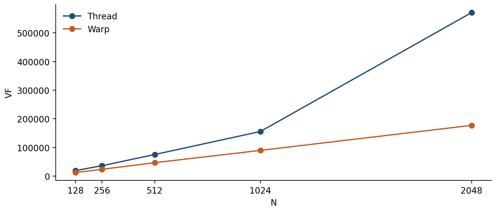
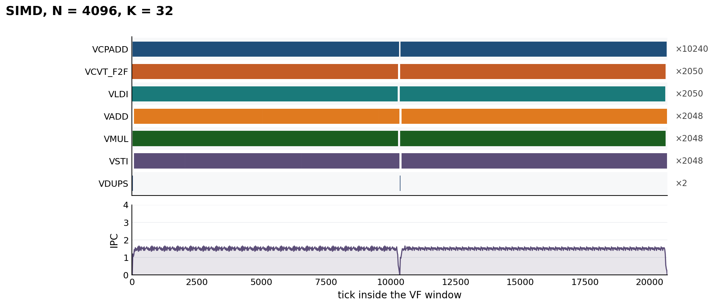
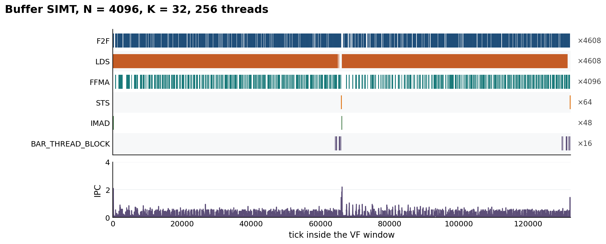

# SV3 — GEMV

## 1. Test-case design

`N` is the number of outputs. `K` is the length of the sum. `k` runs from 0 to `K - 1`. `A` is `(N, K)`. `x` has length `K`. `Out` has length `N`.

```text
Out[n] = sum_k A[n, k] * x[k]
```

el/cyc is `N / VF`. mac/cyc is `N × K / VF`.

Table 3 holds `N` at 4096 and doubles `K`. `K` is 8, 16, 32, and 64. Table 4 holds `K` at 128 and doubles `N`: 128, 256, 512, 1024, and 2048.

The stock SIMT launch is 256 threads. The head-to-head search is 128, 256, 512, 1024, and 2048 threads, and it stops when the launch would pass `N`.

## 2. Layout and schedule

`A[n, k]` is contiguous in `k`. One output is the `K` values on that row of `A`.

### 2.1 SIMD

One instruction is 64 float16 values along `K`. The buffer is 248 KB. A tile that fits is one launch. A tile that does not fit is split into slabs of outputs, and VF is the sum.

`K` of 8, 16, 32, and 64 fit in one load, and that load covers `64 / K` outputs. `K = 128` is two loads of one output.

```text
load 64 values along K
multiply by the matching x
pairwise-add down to one sum per output
store
```

At `N = 4096`, `K = 8` and `16` are one launch. `K = 32` is two. `K = 64` is four. At `K = 128`, `N = 128`, `256`, and `512` are one launch. `N = 1024` is two. `N = 2048` is four.

### 2.2 Thread

Each thread owns `N / threads` outputs and walks the whole `K` of each one. The stock launch is 256 threads. On `N = 4096` that is 16 outputs. On `N = 1024` it is 4, and on `N = 2048` it is 8. Below 256 outputs the launch is one thread per output.

```text
thread t owns its outputs
for each owned n:
    partial = 0
    for k in 0 .. K-1:
        partial += A[n, k] * x[k]
    Out[n] = partial
```

### 2.3 Warp

A warp is 32 threads. The stock launch is 256 threads, which is 8 warps. Each warp owns `N / 8` outputs and walks them one at a time. On `N = 4096` that is 512 outputs. The 32 lanes split `K`, then one warp sum. Lane 0 stores.

`K = 8` and `K = 16`. Only the first `K` lanes load. The other lanes add 0, and all 32 lanes enter the sum.

```text
lane t, when t < K:  acc = A[n, t] * x[t]
                      redux across the 32 lanes
lane 0 stores Out[n]
```

`K = 32`. One element per lane, then the sum.

```text
lane t:  acc = A[n, t] * x[t]
         redux across the 32 lanes
lane 0 stores Out[n]
```

`K = 64` is two steps. `K = 128` is four. The step is 32.

```text
lane t:  acc = 0
         for step in 0 .. K/32 - 1:
             acc += A[n, t + step * 32] * x[t + step * 32]
         redux across the 32 lanes
lane 0 stores Out[n]
```

## 3. SIMD performance

`RV_SLDI` and `RV_SSTI` are 0 on every run, so they are left out.

**Table 1.** SIMD, doubling K. `N = 4096`.

<table align="center">
<thead>
<tr>
<th align="center">K</th>
<th align="center">Launches</th>
<th align="center">VF</th>
<th align="center">el/cyc</th>
<th align="center">mac/cyc</th>
<th align="center">IPC</th>
</tr>
</thead>
<tbody>
<tr>
<td align="center">8</td>
<td align="center">1</td>
<td align="center">3669</td>
<td align="center">1.12</td>
<td align="center">8.93</td>
<td align="center">1.54</td>
</tr>
<tr>
<td align="center">16</td>
<td align="center">1</td>
<td align="center">9313</td>
<td align="center">0.44</td>
<td align="center">7.04</td>
<td align="center">1.54</td>
</tr>
<tr>
<td align="center">32</td>
<td align="center">2</td>
<td align="center">20688</td>
<td align="center">0.20</td>
<td align="center">6.34</td>
<td align="center">1.49</td>
</tr>
<tr>
<td align="center">64</td>
<td align="center">4</td>
<td align="center">45528</td>
<td align="center">0.09</td>
<td align="center">5.76</td>
<td align="center">1.44</td>
</tr>
</tbody>
</table>

`K = 32` and `K = 64` do not fit in one buffer copy. The VF is the sum of the slabs.

**Table 2.** SIMD, doubling N. `K = 128`.

<table align="center">
<thead>
<tr>
<th align="center">N</th>
<th align="center">Launches</th>
<th align="center">VF</th>
<th align="center">el/cyc</th>
<th align="center">mac/cyc</th>
<th align="center">IPC</th>
</tr>
</thead>
<tbody>
<tr>
<td align="center">128</td>
<td align="center">1</td>
<td align="center">2553</td>
<td align="center">0.050</td>
<td align="center">6.42</td>
<td align="center">1.56</td>
</tr>
<tr>
<td align="center">256</td>
<td align="center">1</td>
<td align="center">4984</td>
<td align="center">0.051</td>
<td align="center">6.57</td>
<td align="center">1.60</td>
</tr>
<tr>
<td align="center">512</td>
<td align="center">1</td>
<td align="center">9859</td>
<td align="center">0.052</td>
<td align="center">6.65</td>
<td align="center">1.61</td>
</tr>
<tr>
<td align="center">1024</td>
<td align="center">2</td>
<td align="center">19718</td>
<td align="center">0.052</td>
<td align="center">6.65</td>
<td align="center">1.61</td>
</tr>
<tr>
<td align="center">2048</td>
<td align="center">4</td>
<td align="center">39436</td>
<td align="center">0.052</td>
<td align="center">6.65</td>
<td align="center">1.61</td>
</tr>
</tbody>
</table>

## 4. SIMT performance

### 4.1 Thread and warp

Δ VF is the warp VF minus the thread VF. A negative Δ VF means the warp finished first. The lower VF is bold. `LDK` and `STK` are 0 on every run, so they are left out.

**Table 3.** SIMT thread and warp, doubling K. `N = 4096`.

<table align="center">
<thead>
<tr>
<th align="center" rowspan="2">K</th>
<th align="center" colspan="4">Thread</th>
<th align="center" colspan="4">Warp</th>
<th align="center" rowspan="2">Δ VF</th>
</tr>
<tr>
<th align="center">VF</th><th align="center">el/cyc</th><th align="center">mac/cyc</th><th align="center">IPC</th>
<th align="center">VF</th><th align="center">el/cyc</th><th align="center">mac/cyc</th><th align="center">IPC</th>
</tr>
</thead>
<tbody>
<tr>
<td align="center">8</td>
<td align="center"><b>13143</b></td><td align="center">0.31</td><td align="center">2.49</td><td align="center">0.43</td><td align="center">96089</td><td align="center">0.04</td><td align="center">0.34</td><td align="center">0.73</td><td align="center">82946</td>
</tr>
<tr>
<td align="center">16</td>
<td align="center"><b>40304</b></td><td align="center">0.10</td><td align="center">1.63</td><td align="center">0.27</td><td align="center">125354</td><td align="center">0.03</td><td align="center">0.52</td><td align="center">0.56</td><td align="center">85050</td>
</tr>
<tr>
<td align="center">32</td>
<td align="center">234340</td><td align="center">0.02</td><td align="center">0.56</td><td align="center">0.09</td><td align="center"><b>182059</b></td><td align="center">0.02</td><td align="center">0.72</td><td align="center">0.32</td><td align="center">−52281</td>
</tr>
<tr>
<td align="center">64</td>
<td align="center">577735</td><td align="center">0.01</td><td align="center">0.45</td><td align="center">0.07</td><td align="center"><b>336183</b></td><td align="center">0.01</td><td align="center">0.78</td><td align="center">0.24</td><td align="center">−241552</td>
</tr>
</tbody>
</table>

The thread map is shorter at `K = 8` and `K = 16`. The warp map is shorter at `K = 32` and `K = 64`.

**Table 4.** SIMT thread and warp, doubling N. `K = 128`.

<table align="center">
<thead>
<tr>
<th align="center" rowspan="2">N</th>
<th align="center" colspan="4">Thread</th>
<th align="center" colspan="4">Warp</th>
<th align="center" rowspan="2">Δ VF</th>
</tr>
<tr>
<th align="center">VF</th><th align="center">el/cyc</th><th align="center">mac/cyc</th><th align="center">IPC</th>
<th align="center">VF</th><th align="center">el/cyc</th><th align="center">mac/cyc</th><th align="center">IPC</th>
</tr>
</thead>
<tbody>
<tr>
<td align="center">128</td>
<td align="center">19308</td><td align="center">0.007</td><td align="center">0.85</td><td align="center">0.29</td><td align="center"><b>12461</b></td><td align="center">0.010</td><td align="center">1.31</td><td align="center">0.33</td><td align="center">−6847</td>
</tr>
<tr>
<td align="center">256</td>
<td align="center">36210</td><td align="center">0.007</td><td align="center">0.90</td><td align="center">0.31</td><td align="center"><b>23708</b></td><td align="center">0.011</td><td align="center">1.38</td><td align="center">0.33</td><td align="center">−12502</td>
</tr>
<tr>
<td align="center">512</td>
<td align="center">75455</td><td align="center">0.007</td><td align="center">0.87</td><td align="center">0.19</td><td align="center"><b>46810</b></td><td align="center">0.011</td><td align="center">1.40</td><td align="center">0.33</td><td align="center">−28645</td>
</tr>
<tr>
<td align="center">1024</td>
<td align="center">155646</td><td align="center">0.007</td><td align="center">0.84</td><td align="center">0.16</td><td align="center"><b>89806</b></td><td align="center">0.011</td><td align="center">1.46</td><td align="center">0.34</td><td align="center">−65840</td>
</tr>
<tr>
<td align="center">2048</td>
<td align="center">570802</td><td align="center">0.004</td><td align="center">0.46</td><td align="center">0.08</td><td align="center"><b>177125</b></td><td align="center">0.012</td><td align="center">1.48</td><td align="center">0.35</td><td align="center">−393677</td>
</tr>
</tbody>
</table>

The warp map is shorter at every `N` in this table. Below 256 cells the thread launch is one thread per cell. The warp launch stays 256 threads.

**Figure 1.** VF as N doubles. `K = 128`. Thread and warp.



### 4.2 Thread sensitivity

Shape `N = 4096`, `K = 32`. The launch is 128, 256, 512, 1024, and 2048 threads. Cells per thread is `4096 / threads`. The 256-thread row is the one in Table 3.

**Table 5.** Thread sensitivity. `N = 4096`, `K = 32`.

<table align="center">
<thead>
<tr>
<th align="center">Threads</th>
<th align="center">Cells</th>
<th align="center">VF</th>
<th align="center">el/cyc</th>
<th align="center">mac/cyc</th>
<th align="center">IPC</th>
</tr>
</thead>
<tbody>
<tr>
<td align="center">128</td>
<td align="center">32</td>
<td align="center">259636</td>
<td align="center">0.02</td>
<td align="center">0.50</td>
<td align="center">0.08</td>
</tr>
<tr>
<td align="center">256</td>
<td align="center">16</td>
<td align="center">234340</td>
<td align="center">0.02</td>
<td align="center">0.56</td>
<td align="center">0.09</td>
</tr>
<tr>
<td align="center">512</td>
<td align="center">8</td>
<td align="center">232869</td>
<td align="center">0.02</td>
<td align="center">0.56</td>
<td align="center">0.10</td>
</tr>
<tr>
<td align="center">1024</td>
<td align="center">4</td>
<td align="center">229851</td>
<td align="center">0.02</td>
<td align="center">0.57</td>
<td align="center">0.11</td>
</tr>
<tr>
<td align="center">2048</td>
<td align="center">2</td>
<td align="center"><b>192329</b></td>
<td align="center">0.02</td>
<td align="center">0.68</td>
<td align="center">0.15</td>
</tr>
</tbody>
</table>

The window shortens as the launch grows. 2048 threads is the shortest. `LDK` and `STK` are 0.

### 4.3 Operation breakdown

`N = 4096`, `K = 32`, 256 threads, the GM thread run. Each row is its own kernel.

**Whole kernel.** el/cyc is `N / VF` over the entire VF window, including the loads an operator needs and the store that keeps the result.

**Operator window.** From the first issue of that opcode to the last. el/cyc is the elements that opcode issues, divided by that span. `load` and `ffma` credit `N × K`. `sts` credits `N`.

`load` sums `A` along `K`, so the loads stay. `ffma` is the gemv. `sts` stores the constant 1 and does not load. Address math is left out of the opcode column.

**Table 6.** Operation breakdown, whole kernel. `N = 4096`, `K = 32`, 256 threads.

<table align="center">
<thead>
<tr>
<th align="center">Kernel</th>
<th align="center">VF</th>
<th align="center">el/cyc</th>
<th align="center">IPC</th>
<th align="center">Opcodes</th>
</tr>
</thead>
<tbody>
<tr>
<td align="center">load</td>
<td align="center">233381</td>
<td align="center">0.02</td>
<td align="center">0.09</td>
<td align="center">4096 FADD, 4096 LDG, 4096 F2F, 64 STS</td>
</tr>
<tr>
<td align="center">ffma</td>
<td align="center">234238</td>
<td align="center">0.02</td>
<td align="center">0.09</td>
<td align="center">4096 FFMA, 4352 LDG, 4352 F2F, 64 STS</td>
</tr>
<tr>
<td align="center">sts</td>
<td align="center"><b>695</b></td>
<td align="center">5.89</td>
<td align="center">0.27</td>
<td align="center">64 STS</td>
</tr>
</tbody>
</table>

**Table 7.** Operation breakdown, operator window. `N = 4096`, `K = 32`, 256 threads.

<table align="center">
<thead>
<tr>
<th align="center">Kernel</th>
<th align="center">Operator</th>
<th align="center">Ticks</th>
<th align="center">Window el/cyc</th>
</tr>
</thead>
<tbody>
<tr>
<td align="center">load</td>
<td align="center">LDG</td>
<td align="center">375–233211</td>
<td align="center">0.56</td>
</tr>
<tr>
<td align="center">ffma</td>
<td align="center">FFMA</td>
<td align="center">6291–234157</td>
<td align="center">0.58</td>
</tr>
<tr>
<td align="center">sts</td>
<td align="center">STS</td>
<td align="center">208–524</td>
<td align="center"><b>12.96</b></td>
</tr>
</tbody>
</table>

`sts` is the shortest kernel and the fastest issue window. `load` and `ffma` are almost the same window. The multiply does not add a separate pass. The loads already cover it.

### 4.4 Buffer staging

Same shapes as the head-to-head. `A` and `x` are copied into the buffer before the VF, and the VF loads them from the buffer. The copy sits outside the VF window. VF is the sum of the launches. The launch is 256 threads.

The buffer is 248 KB. A tile that fits is one launch. A tile that does not fit is split into slabs of outputs.

- `N = 4096`, `K = 8` and `K = 16`, and `N = 512`, `K = 128`: one launch
- `N = 4096`, `K = 32`, and `N = 1024`, `K = 128`: two launches
- `N = 4096`, `K = 64`, and `N = 2048`, `K = 128`: four launches

**Table 8.** Buffer staging against the GM thread column. Δ VF is the buffer VF minus the GM VF.

<table align="center">
<thead>
<tr>
<th align="center" rowspan="2">Shape</th>
<th align="center" colspan="5">Buffer staging</th>
<th align="center" rowspan="2">GM VF</th>
<th align="center" rowspan="2">Δ VF</th>
</tr>
<tr>
<th align="center">Launches</th>
<th align="center">VF</th>
<th align="center">el/cyc</th>
<th align="center">mac/cyc</th>
<th align="center">IPC</th>
</tr>
</thead>
<tbody>
<tr>
<td align="center">N=4096, K=8</td>
<td align="center">1</td>
<td align="center"><b>9189</b></td>
<td align="center">0.45</td>
<td align="center">3.57</td>
<td align="center">0.54</td>
<td align="center">13143</td>
<td align="center">−3954</td>
</tr>
<tr>
<td align="center">N=4096, K=16</td>
<td align="center">1</td>
<td align="center"><b>33802</b></td>
<td align="center">0.12</td>
<td align="center">1.94</td>
<td align="center">0.28</td>
<td align="center">40304</td>
<td align="center">−6502</td>
</tr>
<tr>
<td align="center">N=4096, K=32</td>
<td align="center">2</td>
<td align="center"><b>132303</b></td>
<td align="center">0.03</td>
<td align="center">0.99</td>
<td align="center">0.16</td>
<td align="center">234340</td>
<td align="center">−102037</td>
</tr>
<tr>
<td align="center">N=4096, K=64</td>
<td align="center">4</td>
<td align="center"><b>265690</b></td>
<td align="center">0.02</td>
<td align="center">0.99</td>
<td align="center">0.19</td>
<td align="center">577735</td>
<td align="center">−312045</td>
</tr>
<tr>
<td align="center">N=512, K=128</td>
<td align="center">1</td>
<td align="center"><b>66724</b></td>
<td align="center">0.008</td>
<td align="center">0.98</td>
<td align="center">0.23</td>
<td align="center">75455</td>
<td align="center">−8731</td>
</tr>
<tr>
<td align="center">N=1024, K=128</td>
<td align="center">2</td>
<td align="center"><b>133802</b></td>
<td align="center">0.008</td>
<td align="center">0.98</td>
<td align="center">0.23</td>
<td align="center">155646</td>
<td align="center">−21844</td>
</tr>
<tr>
<td align="center">N=2048, K=128</td>
<td align="center">4</td>
<td align="center"><b>267071</b></td>
<td align="center">0.008</td>
<td align="center">0.98</td>
<td align="center">0.23</td>
<td align="center">570802</td>
<td align="center">−303731</td>
</tr>
</tbody>
</table>

The buffer VF is lower than the GM VF on every row. `LDK` and `STK` are 0.

## 5. Running IPC

The charts are `N = 4096`, `K = 32`, the middle of the K sweep, except Figure 1, which is the `K = 128` length sweep. The line is IPC in bins of 20 ticks. Address math stays in the line and off the rows.

### 5.1 SIMD

Two slabs, placed end to end. The sum is VF 20688. `VCPADD` issues 10240 times. `VLDI` and `VCVT_F2F` issue 2050 times. `VMUL`, `VADD`, and `VSTI` issue 2048 times. The line stays near 1.5 and drops once, between the slabs. The scalar IPC is 1.49.

**Figure 2.** SIMD instructions. `N = 4096`, `K = 32`. VF 20688.



### 5.2 SIMT

The buffer run, 256 threads. Two launches, and the sum is VF 132303. `LDS` and `F2F` issue 4608 times. `FFMA` issues 4096 times. `STS` issues 64 times, at the end of each launch. The line stays under 1, with a short spike near 2 at the start of each launch. The scalar IPC is 0.16.

**Figure 3.** Buffer SIMT instructions. `N = 4096`, `K = 32`, 256 threads. VF 132303.



## 6. Conclusion

SIMD is the lower VF on every row. Bold is that VF.

**Table 9.** Head-to-head. Buffer SIMT, 256 threads, against SIMD.

<table align="center">
<thead>
<tr>
<th align="center">Shape</th>
<th align="center">SIMT VF</th>
<th align="center">SIMD VF</th>
<th align="center">Δ VF</th>
<th align="center">SIMT/SIMD</th>
</tr>
</thead>
<tbody>
<tr>
<td align="center">N=4096, K=8</td>
<td align="center">9189</td>
<td align="center"><b>3669</b></td>
<td align="center">5520</td>
<td align="center">2.50</td>
</tr>
<tr>
<td align="center">N=4096, K=16</td>
<td align="center">33802</td>
<td align="center"><b>9313</b></td>
<td align="center">24489</td>
<td align="center">3.63</td>
</tr>
<tr>
<td align="center">N=4096, K=32</td>
<td align="center">132303</td>
<td align="center"><b>20688</b></td>
<td align="center">111615</td>
<td align="center">6.40</td>
</tr>
<tr>
<td align="center">N=4096, K=64</td>
<td align="center">265690</td>
<td align="center"><b>45528</b></td>
<td align="center">220162</td>
<td align="center">5.84</td>
</tr>
<tr>
<td align="center">N=512, K=128</td>
<td align="center">66724</td>
<td align="center"><b>9859</b></td>
<td align="center">56865</td>
<td align="center">6.77</td>
</tr>
<tr>
<td align="center">N=1024, K=128</td>
<td align="center">133802</td>
<td align="center"><b>19718</b></td>
<td align="center">114084</td>
<td align="center">6.79</td>
</tr>
<tr>
<td align="center">N=2048, K=128</td>
<td align="center">267071</td>
<td align="center"><b>39436</b></td>
<td align="center">227635</td>
<td align="center">6.77</td>
</tr>
</tbody>
</table>

Δ VF is the SIMT VF minus the SIMD VF. SIMT/SIMD is the VF ratio. SIMD is shorter on every row.

## Appendix

### Recreating the cases

Run these from `benches/sv3/nk`. The case directory is `runs/<kind>-n<N>-k<K>`. A thread launch other than 256 is `runs/thread-n<N>-k<K>-t<threads>`.

```bash
python compile.py thread|ub|warp|simd N K [threads]
npusim record -s Ascend950 -o runs/<case>/npusim -g -n 0 "python launch.py runs/<case>/kernel.so N K"
python decode.py <instr.bin> N K thread|simd
```

`instr.bin` is the newest file under `runs/<case>/npusim`. Decode reads veccore 0. It prints VF, el/cyc, mac/cyc, IPC, and the spill counts. Pass `thread` for the thread, warp, and buffer traces, and `simd` for the SIMD trace.

**Tables 1 and 3.** `N = 4096`. `K` is 8, 16, 32, 64. SIMD, thread, and warp.

**Table 2 and 4.** `K = 128`. `N` is 128, 256, 512, 1024, 2048.

**Table 5.** `N = 4096`, `K = 32`. Threads 128, 512, 1024, and 2048 are `thread-n4096-k32-t<threads>`. The 256-thread case is `thread-n4096-k32`.

**Table 8.** Buffer cases are `ub-n<N>-k<K>`. The GM column is the matching `thread-n<N>-k<K>`.

**Table 9.** Buffer VF from Table 8 against the SIMD VF from Tables 1 and 2.

**Tables 6 and 7.** `runs/ops/load`, `runs/ops/ffma`, and `runs/ops/sts`. `python ops.py compile`, then `ops_launch.py runs/ops/<name>/kernel.so load|ffma|sts`.

**Figures.** Figure 1 is Table 4. Figure 2 reads `runs/simd-n4096-k32`. Figure 3 reads `runs/ub-n4096-k32`. `python plot_charts.py` writes all three under `../plots/`.
