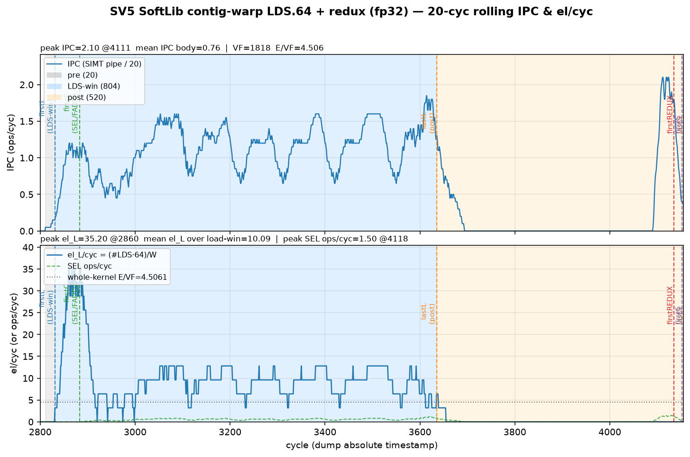

# SV5 analysis — small-block reduce (SIMD VCG vs SIMT RF)

**Date:** 2026-10-22 Asia/Hong_Kong · ST-spine rewrite **2026-10-23** · conclusion arms trimmed **2026-10-23** · **SOC:** Ascend950PR_9599 opsim · **CANN / PTOAS:** cann_92b2 / pins in `config.toml`  
**Format:** [`docs/ST_REPORT_FORMAT.md`](../../docs/ST_REPORT_FORMAT.md) (SV1-order).  
**Primary metric:** **el/cyc = E / VF_cyc** with **E = 8192** fp32 (**TILE8192** = TILE=E).  
**Never invent measured numbers.** Gaps marked **TODO / not-yet-run**.

**Conclusion arms (only these three):**

| # | Path | Best on this tip |
|---|------|------------------|
| 1 | **SIMD PTO-DSL** | VL=128 G=8 VAND **33.44** el/cyc |
| 2 | **SIMT Ascend default** | gate **PASS**; el/cyc **TODO** |
| 3 | **SIMT SoftLib hand-craft** | contig LDS.64 **4.51** el/cyc |

Supporting notes / SoftLib-SIMD archive files may remain on disk; they are **not** part of this ANALYSIS spine.

---

## 1. Aims

Small-block reduce — **SIMD vs SIMT performance sensitivity** analysis, showing **SIMD block-level reduce ISA (VCG / VCGMAX)** vs **SIMT small-block register-per-thread** level performance comparison.

Same **E=8192 fp32** tile: (a) PTO-DSL / VMI schedule that folds the small group with **VCGMAX** + clear-sign **VAND**, vs (b) Ascend-default SimtVF `keep_reg` / `ub_reload`, vs (c) SoftLib SIMT contig-warp + warp redux. Report whole-kernel el/cyc (and mid-window metrics when measured) plus ratios among the three arms.

---

## 2. Test-case design

| Axis | Choices |
|------|---------|
| **Shape SoT** | **E = 8192** fp32, **TILE8192**. Gate shape: R=64, C=128, G=16, T=32 (`config.toml`) |
| **Datatype** | Pure **fp32** in UB for measured SoftLib SIMT / VMI arms below (no Cast / `SIMT_F2F`) |
| **SIMD PTO-DSL** | `sv5d_absmax_vl128_g8.py` — **VL=128**, VCGMAX **G=8**, abs via i32 clear-sign `vand` |
| **SIMT Ascend default** | Gate tags `sv5_r64_c128_g16_t32_keep_reg` / `ub_reload` (`simt-asc`) |
| **SIMT SoftLib** | Contig-warp + `asc_reduce_max`; SoT width **LDS.64** (LDS.32 as width sensitivity only) |
| **Pass criteria** | Gold / verify PASS on opsim; el/cyc from VF cycle count when harvested |

**Kernels:** `sv5_reduce_small_eltwise.py`, `sv5d_absmax_vl128_g8.py` (primary SIMD), SoftLib SIMT contig sources under the SV5 SoftLib / compare OUT (see provenance in [`SV5_REDUCE_SMALL_COMPARE_20261022.md`](SV5_REDUCE_SMALL_COMPARE_20261022.md) for SoftLib SIMT rows only).

**Case matrix (spine arms only):**

| schedule | path | **el/cyc** | PASS |
|----------|------|----------:|:----:|
| **VMI DSL VL=128 G=8 VAND** | PTO-DSL | **33.44** (VF **245**) | ✅ |
| simt-asc gate keep_reg / ub_reload | TileLang Asc default | *(el/cyc **TODO**)* | ✅ gate |
| SoftLib SIMT contig LDS.64 + redux | SoftLib `__simt_vf__` | **4.51** | ✅ |

---

## 3. Layout and schedule (SIMT and SIMD)

### 3.1 SIMD PTO-DSL — block reduce via VCG (VL=128)

- **UB → MRF:** VL=128 vector path; DINTLV splits logical VL128 → 2× phys-64 for issue.
- **Reduce ISA:** **VCGMAX G=8** (SLIDE / EXQ0-class block reduce).
- **Abs:** i32 `vinterpret_cast` + `vand(…, 0x7FFFFFFF)` + cast-back — **not** `vmul`+`vmax`. Mask: `create_mask(VL, size=VL)` (PHYS_VL=64-sized masks left high VCG slots at `-inf` historically).
- **Store:** reduced **Y** only (tiny ST), not full-tile write.
- **Intent:** EXU / SLIDE-bound small-block reduce using **block-level VCG**, not UB-bound full-tile STS.

### 3.2 SIMT Ascend default — register-per-thread

- Gate arms: **`keep_reg`** (force-live G size-1 vregs through absmax) vs **`ub_reload`** (reload from UB each step).
- Small-G work stays at **per-thread / per-lane register** granularity rather than a VCG block reduce.
- Measured Asc-default layout + LDS/STS width mix: **TODO**.

### 3.3 SIMT SoftLib — contig warp + redux

- Contiguous LDS → per-lane absmax → `asc_reduce_max` (`SIMT_REDUX`) → STS broadcast.
- SoT width on this tip: **LDS.64** load-all (**4.51** el/cyc).
- **One-line bank-cliff context (not a conclusion arm):** SoftLib stock stride64 ub_stream sits at **1.65** el/cyc — contig remap is required to leave that cliff; see §6.

### 3.4 Target best schedule

| Path | Target |
|------|--------|
| **SIMD PTO-DSL** | VL=128 + VCGMAX G=8 + VAND abs; mask sized to VL |
| **SIMT Asc** | Correct small-G RF vs UB-reload lowering; T-sensitivity once measured |
| **SIMT SoftLib** | Contig warp; prefer width/schedule **not** LD/ST-bound when possible; LDS.64 is current measured best |

---

## 4. SIMD PTO-DSL performance

**Primary arm:** VL=128 G=8 VAND absmax — **33.44** el/cyc (VF **245**, E=8192). Gold maxabs = 0. Artifacts: opsim pack `sv5_vmi_vand_20261022` (pto-b10 / prior OUT). Kernel: `sv5d_absmax_vl128_g8.py`.

### 4.1 Measured el/cyc

| arm | VF | **el/cyc** | notes |
|-----|---:|----------:|-------|
| **VL=128 G=8 VAND** | **245** | **33.44** | primary · storeA/storeB same |

### 4.2 Abs source (working path)

f32 `vand` fails verify (`requires integer-like VMI element type`). Working path:

```python
clear_u = pto.vmi.vbrc(pto.i32(0x7FFFFFFF), size=VL)
xi = pto.vmi.vinterpret_cast(x, pto.i32)
abs_i = pto.vmi.vand(xi, clear_u, mask)
absx = pto.vmi.vinterpret_cast(abs_i, pto.f32)
```

### 4.3 Instruction mix (VL128 storeB, R=64)

| opcode | per-addr | notes |
|---|---:|---|
| **RV_VAND** | ×2 | DINTLV splits VL128 → 2× phys-64 |
| RV_VLDI DINTLV | ×1 | |
| RV_VCGMAX | ×1 | group=8 |
| RV_VSTI | ×1 | |
| RV_VMAX | ×1 | residual from lowering — **not** source abs |
| RV_VMUL | **0** | |

### 4.4 Theory-bound / rooftop

Qualitative binder for this mix: **VCGMAX (SLIDE) + VAND (ADD)** on the reduced path with tiny ST → **compute / EXU+SLIDE class**, not UB full-tile.  

**Quantitative EXU cyc/row, mid-avg el/cyc, and rooftop % for the VL128 schedule:** **TODO / not-yet-run** on this tip (no VL128 W=20 mid harvest checked into `benches/sv5/ipc/`). Do not reuse SoftLib-SIMD dual64 rooftop numbers as if they were this arm.

### 4.5 Sensitivity

| knob | status on this tip |
|------|--------------------|
| Virtual **VL / G** | SoT fixed at **VL=128 G=8** VAND; other VL/G arms omitted from spine |
| **Tile size** multi-TILE ladder | **TODO** — SoftLib/VMI SoT stays **TILE8192** |
| Running IPC (windowed) + in/out el/cyc | **TODO** for VL128 (no VL128 rolling PNG under `plots/` for this arm) |

### 4.6 SIMD takeaway

PTO-DSL **VL128 G=8 VAND = 33.44** el/cyc is the **primary SIMD** result for SV5 on this tip: block-level **VCGMAX** plus clear-sign **VAND**, whole-kernel PASS.

---

## 5. SIMT (Ascend default) lowering performance

Stock Ascend / SimtVF path: TileLang `simt-asc` gate.

| Tag | Suite | simt-asc verdict | Measured el/cyc |
|-----|-------|------------------|-----------------|
| `sv5_r64_c128_g16_t32_keep_reg` | gate | PASS | **TODO / not-yet-run** |
| `sv5_r64_c128_g16_t32_ub_reload` | gate | PASS | **TODO / not-yet-run** |

- **Layout mapping + instruction mix (LDS/STS 32 vs 64):** **TODO**
- **Theory-bound from Asc lowering:** **TODO**
- **T-dim sensitivity:** gate fixes **T=32**; Asc **T-ladder** el/cyc **TODO**

Pins / gate status: [`VERDICT.md`](VERDICT.md).

---

## 6. SIMT hand-craft (SoftLib) analysis

Handwritten SoftLib SIMT: contig-warp LDS → per-lane absmax → `asc_reduce_max` → STS. Pure fp32. Secondary: **B/cyc** on first→last `SIMT_LDS` wall; LDS-window el/cyc ≈ B/cyc ÷ 4.

### 6.1 Best SoftLib SIMT (SoT)

| arm | VF el/cyc | **B/cyc** | LDS-win el/cyc | notes |
|-----|----------:|----------:|---------------:|-------|
| **contig LDS.64** load-all | **4.51** | **40.76** | **~10.2** | **63.7% of width-64** · SoftLib SIMT best |
| contig LDS.32 interleaved | 3.99 | 35.05 | ~8.8 | width sensitivity |
| contig LDS.32 load-all | 3.46 | 26.62 | ~6.7 | 83% of width-32 |

**Bank-cliff context (one line, not a conclusion arm):** SoftLib stock stride64 ub_stream = **1.65** el/cyc — contig remap recovers **~2.5–3×** whole-VF vs that cliff.



### 6.2 Layout / width choice

Prefer **LDS.64** as SoftLib SIMT SoT on this tip (best measured VF el/cyc). LDS.32 remains width sensitivity; format preference for LDS.32/STS.32 applies when that width is the study SoT (e.g. SV1 ADD) — here **LDS.64** wins the measured table.

### 6.3 Stage-split LD / compute / ST

Partial snapshot only: contig+REDUX membar sparse2 whole **6.35** el/cyc; LD-stage **29.6 B/cyc (23% of 128)**.  

**Full stage rooftop + per-stage IPC pack** aligned to the LDS.64 SoT: **TODO**. Until then, fused contig **LDS.64 @ 4.51** is the SoftLib SIMT conclusion number.

### 6.4 SoftLib SIMT takeaway

Best SoftLib SIMT = **4.51** el/cyc (contig LDS.64). Far below SIMD PTO-DSL **33.44** — warp-redux / RF-per-thread path does not match **VCG** block reduce on this tip.

---

## 7. Conclusion

| arm | best on tip | note |
|-----|------------:|------|
| **SIMD PTO-DSL** | **33.44** | VL=128 G=8 VAND · VF 245 |
| **SIMT Ascend default** | **TODO** | gate PASS · el/cyc not harvested |
| **SIMT SoftLib** | **4.51** | contig LDS.64 |

**Performance ratio (measured pair):**

| | value |
|--|------:|
| SIMD PTO-DSL ÷ SoftLib SIMT | **33.44 / 4.51 ≈ 7.4×** |
| SIMD ÷ Asc default | **TODO** (need Asc el/cyc) |
| SoftLib SIMT ÷ Asc default | **TODO** |

**Story:** SIMD **block-level VCGMAX** (VL128 + VAND abs) delivers **33.44** el/cyc. SoftLib SIMT contig tops out at **4.51** (~7.4× below). Ascend-default simt-asc remains **PASS-only** until an el/cyc (+ T) harvest lands for a true three-way close-out.

**Open gaps (do not invent):**

1. VL128 **mid-IPC / theory rooftop %** for the DSL arm.  
2. simt-asc **el/cyc** + **T-dim** + LDS/STS 32/64 mix.  
3. SoftLib SIMT **full stage-split** rooftop for LDS.64 SoT.

**Related (archive / detail, not spine arms):** [`VMI_VL128_VS_SOFTLIB.md`](VMI_VL128_VS_SOFTLIB.md) · [`VERDICT.md`](VERDICT.md) · [`SV5_REDUCE_SMALL_COMPARE_20261022.md`](SV5_REDUCE_SMALL_COMPARE_20261022.md) · [`docs/ST_REPORT_FORMAT.md`](../../docs/ST_REPORT_FORMAT.md).
