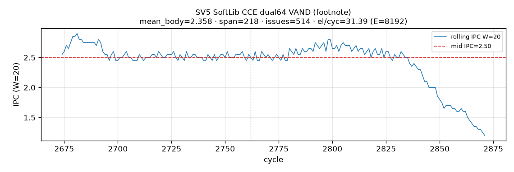
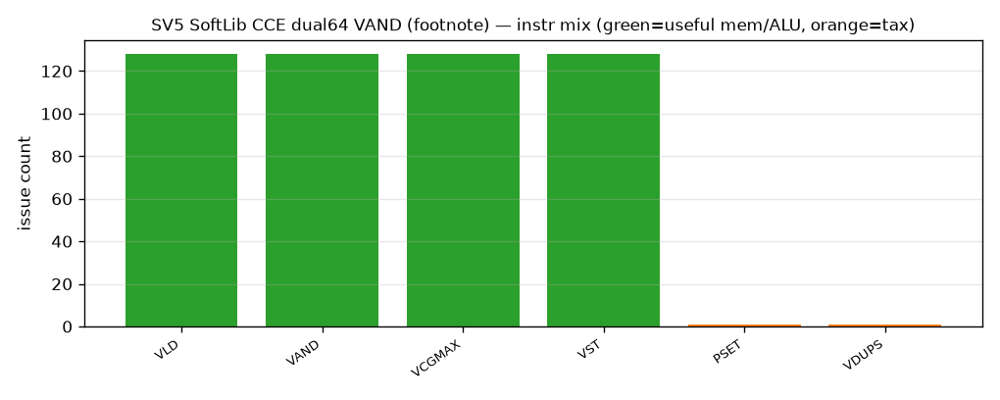
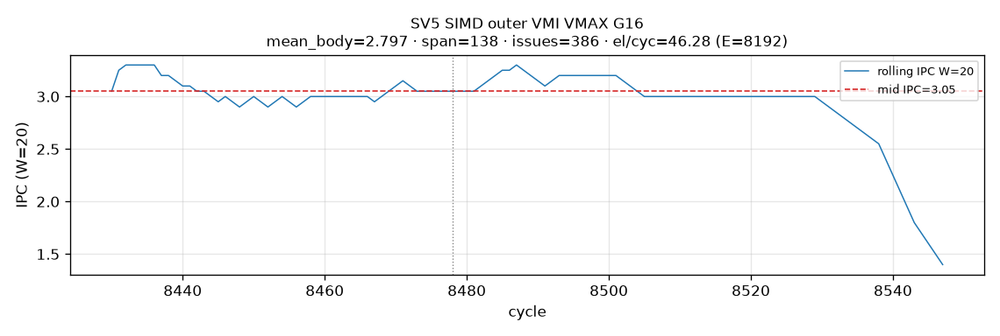
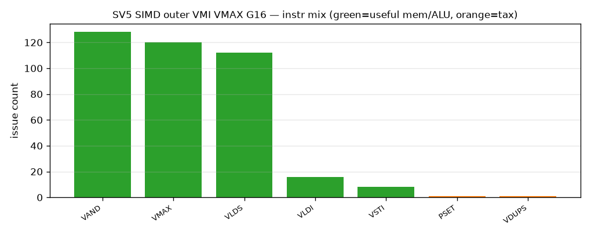
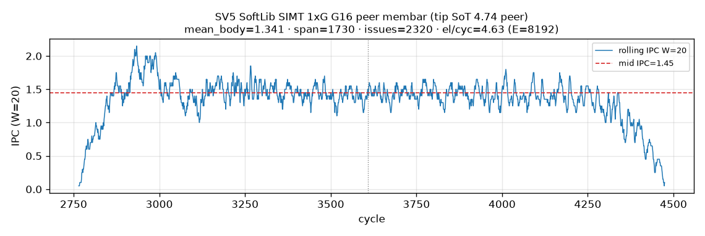
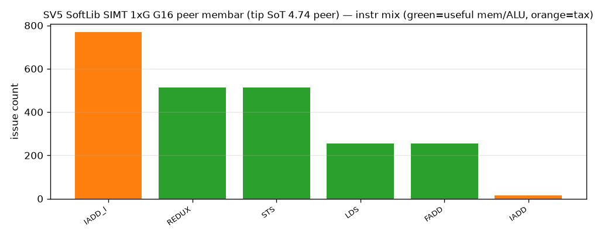
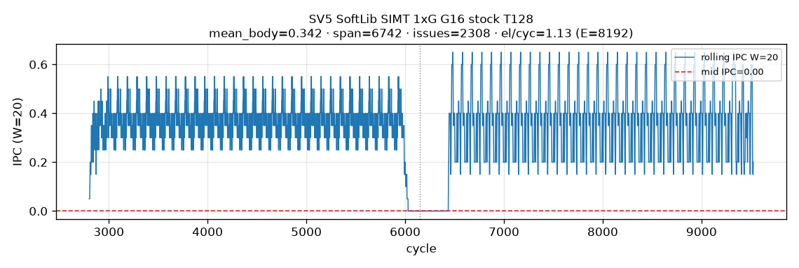
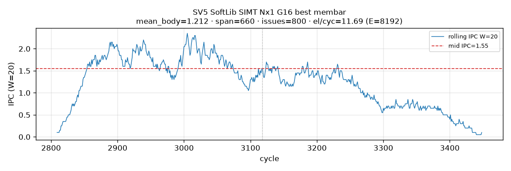
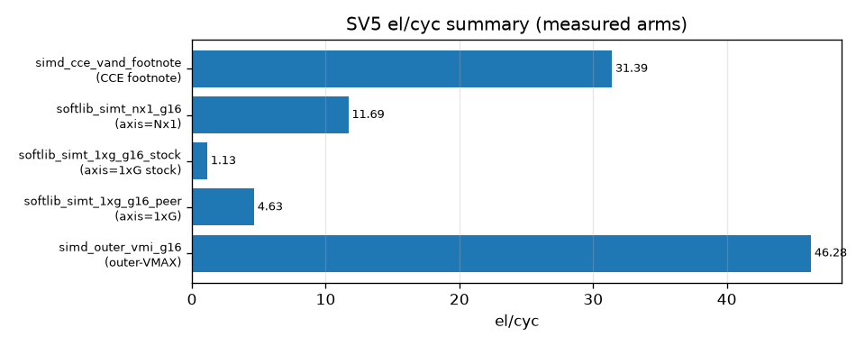

# SV5 analysis — small-block reduce G=16 (inner 1×G + outer N×1)

**Date:** 2026-10-29 Asia/Hong_Kong · ST-spine · tip refresh **t725u** (outer VMAX t720u + Nx1 SIMT t708u) · prior 1×G close t705/t706  
**Format:** [`docs/ST_REPORT_FORMAT.md`](../../docs/ST_REPORT_FORMAT.md) + `tilelanggym-st-report` · companions: softlib-simt-schedule · st-semantics-gate · vmi-gmap-close · simd-per-g-mapping · reduce-dual-issue-recipes  
**Primary metric:** **el/cyc = E / VF_cyc** · **E = 8192** fp32 · **era=fp32-absmax** (Case-1 · no recip).  
**SOC / CANN / PTOAS:** Ascend950PR_9599 · cann_92b2 · pins in `config.toml`.  
**Never invent measured numbers.** SoftLib CCE = footnote only when ≈ VMI (t706u).

**ST map:** SV5 = gold **G=16**. Two reduce axes (Harness §21/§22) — **do not** merge cells across axes.

### Headline — `reduce_axis=inner` (1×G contiguous)

| # | Path | Best on this tip | Era |
|---|------|------------------|-----|
| 1 | **SIMD PTO-DSL / VMI** | VL=128 / datablock G=8 · i32-VAND + **VCGMAX** · **33.44** (VF 245) | fp32-absmax |
| 2 | **SIMT-ASC stock** | SoftLib `__simt_vf__` default @ legacy T128 · wc halfmask LDS.32 · **1.13** (VF 7264) | fp32-absmax |
| 3 | **SIMT SoftLib hand-craft** | `axis=1×G` wc halfmask loadall+absall drain T512 · **4.74** | fp32-absmax |

> Footnote SoftLib CCE dual64 VAND absmax **31.39** (−6% vs VMI) — off main table (t706u).

### Headline — `reduce_axis=outer` (N×1 column)

| # | Path | Best | Era |
|---|------|------|-----|
| 1 | **SIMD PTO-DSL / VMI** | pure **RV_VMAX** fold + i32-VAND · VL256 · **46.28** (VF 177) · tag `outer_g16_vmax_vand_fold_vl256` | fp32-absmax · t720u |
| 2 | **SIMT-ASC stock** | nx1-col LDS.32 fused · T=n_cols=512 · **9.68** (VF 846) | fp32-absmax · t708u |
| 3 | **SIMT SoftLib hand-craft** | nx1-col LDS.32 **membar** · T=512 · **11.69** (VF 701) | fp32-absmax · t708u |

> Pollution callout: t708 VMI column that reused **inner Gmap 33.44** for outer is **wrong-arm** (Harness §22 / #25) — superseded by t720 outer VMAX.

---

## 1. Aims

| Id | Aim |
|----|-----|
| **A1** | Case-1 absmax fp32 · gold G=16 · E=8192 · compare SIMD vs SoftLib SIMT on **both** reduce axes |
| **A2** | VMI / PTO-DSL per-G map closed or explicit stop (`tilelanggym-vmi-gmap-close`); **outer** measured with pure VMAX (§22) |
| **A3** | SoftLib SIMT main SoT labeled `axis=1×G` or `axis=Nx1` (Harness §21); no unlabeled merge |
| **A4** | SoftLib CCE **off main table** when VMI ≥ SoftLib (t646/t706u); optional footnote only |
| **A5** | SoftLib SIMT measured (not silent TODO) on both axes |
| **A6** | Document SIMD schedule/instr, SIMT layout mapping, and running IPC (W=20 mid when dump has series; else honest MISSING) |

---

## 2. Test-case design

| Axis | Choice |
|------|--------|
| Shape | E=8192 · TILE8192 · gold G=16 |
| Datatype | pure fp32 UB · **era=fp32-absmax** · no Cast / recip |
| Inner gold | contiguous groups `[gG, gG+G)` → `C[g]=max\|A[i]\|` |
| Outer gold | view `A` as `(G, n_cols=E/G)`; `C[c]=max_r \|A[r,c]\|` |
| SIMD inner | `sv5d_absmax_vl128_g8.py` · VL=128 · VCGMAX datablock G=8 · i32 VAND |
| SIMD outer | VMI pure VMAX fold · VL256 · i32 VAND · **no** VCGMAX/VCMAX reduce |
| SoftLib SIMT inner | `__simt_vf__` · **wc halfmask** · `axis=1xG` · LDS.32 |
| SoftLib SIMT outer | `__simt_vf__` · **nx1-col** · T=`n_cols` · LDS.32 · **no** warp redux on SoT |
| SoftLib CCE | footnote peer only |
| Pass | gold PASS · VF named · SEMANTICS_GATE |

**Sources:** tip ANALYSIS · [`reports/VMI_GMAP_ABSMAX_CLOSE_t705u.md`](reports/VMI_GMAP_ABSMAX_CLOSE_t705u.md) · [`reports/VMI_ABSMAX_OUTER_VMAX_t720u.md`](reports/VMI_ABSMAX_OUTER_VMAX_t720u.md) · [`reports/SOFTLIB_ABSMAX_4ARM_Nx1_t708u.md`](reports/SOFTLIB_ABSMAX_4ARM_Nx1_t708u.md) · [`reports/SOFTLIB_SIMT_1xG_HARNESS_GATE_t705u.md`](reports/SOFTLIB_SIMT_1xG_HARNESS_GATE_t705u.md).

---

## 3. Layout and schedule (SIMT and SIMD)

### 3.1 SIMD VMI — inner (`reduce_axis=inner`)

- **Schedule:** VL=128 · datablock group=8 → lowering **VCGMAX** · abs = **i32 bitcast + VAND** clear-sign · store reduced Y.
- **Instr class:** VCGMAX + VAND + VLD/VST (EXU/SLIDE-bound motif).
- **Tag / VF:** VL128/NG8 VAND · VF **245** · el/cyc **33.44**.

### 3.2 SIMD VMI — outer (`reduce_axis=outer`)

- **Schedule:** tile columns at VL=256; per column-tile fold **G=16** rows with **elementwise RV_VMAX**; abs = i32-VAND; **VCGMAX=VCMAX=0** (OPPROF confirmed).
- **Instr dump (SoT):** RV_VMAX=120 · RV_VAND=128 · RV_VLDS/VLDI · RV_VSTI · no VCG/VCMAX/VDIV.
- **Tag / VF:** `outer_g16_vmax_vand_fold_vl256` · VF **177** · el/cyc **46.28** · bytes/cyc ≈ **185.12** (8192×4/177) — LD-leaning / input-bytes motif (~36% of dual-VLD ~512 B/cyc roof).

### 3.3 SIMT SoftLib — inner `axis=1×G`

- **Layout:** warp-coop **halfmask** (16-of-32 lanes active) · contiguous LDS.32 loads inside gold G · REDUX within warp · **not** wr Nx1.
- **SIMT-ASC stock** = default `__simt_vf__` lowering @ legacy **T128** · tag `wc_abs_lds32_redux_g16_t128_e8192` · **1.13**.
- **SoftLib best:** loadall+absall drain **T512** · **4.74** (tip / t697u). Peer t698 loadall+membar T512 **4.63**.
- Stock loses on multi-warp latency hide / occupancy.

### 3.4 SIMT SoftLib — outer `axis=Nx1`

- **Layout (SoT):** **1 thread = 1 column** · `a[r] = A0[r * n_cols + tid]` · thread-local scalar abs-max over `r=0..G-1` · `C0[tid]=m` · **no** `asc_reduce_max` on SoT path · **T = n_cols = 512**.
- **Stock:** LDS.32 fused · **9.68**. **Best:** LDS.32 stage **membar** · **11.69**.
- **Not tried (t723–t724):** same-col thread-group + col-stride register mapping + redux for large-G outer — residual for future.

### 3.5 SoftLib CCE (footnote)

dual64 PHYS_VL64×2 · VAND+VCGMAX · **31.39** · same class as VMI 33.44 — not a conclusion arm.

---

## 4. SIMD PTO-DSL performance

### 4.1 Inner

| tag | VF | el/cyc | instr / schedule | gate |
|-----|---:|-------:|------------------|------|
| VL128/NG8 VAND | 245 | **33.44** | VCGMAX + i32-VAND + VLD/VST | PASS · best-sweep DONE |

VMI Gmap G16: **DONE**. SoftLib CCE footnote only.

### 4.2 Outer

| tag | VF | el/cyc | instr / schedule | gate |
|-----|---:|-------:|------------------|------|
| `outer_g16_vmax_vand_fold_vl256` | 177 | **46.28** | RV_VMAX fold + i32-VAND · VL256 · VCG/VCMAX=0 | **PASS** (§22) |

Tried inventory: fold / dual4 / split2 / VABS / VL128 retile — see [`reports/VMI_ABSMAX_OUTER_VMAX_t720u.md`](reports/VMI_ABSMAX_OUTER_VMAX_t720u.md).

**SEMANTICS_GATE (VMI inner):** PASS — S1 gold G=16 · S2 VCGMAX body · S3 VCGMAX family matches inner · S4 VF 245.  
**SEMANTICS_GATE (VMI outer):** PASS — S1 column gold · S3 pure VMAX (VCG=VCMAX=0) · S4 VF 177 · era=fp32-absmax.

---

## 5. SIMT-ASC stock

**Definition:** SoftLib `__simt_vf__` **default lowering** at legacy stock T (= SoftLib SIMT stock column) — not a separate unmeasured Ascend-only arm.

| Axis | el/cyc | T | tag |
|------|-------:|--:|-----|
| inner 1×G | **1.13** | 128 | `wc_abs_lds32_redux_g16_t128_e8192` |
| outer Nx1 | **9.68** | 512 | `nx1_col_lds32_fused_g16_t512_e8192` |

---

## 6. SIMT SoftLib hand-craft (A5)

### 6.1 Inner SoT

| motif | axis | LDS | T | el/cyc | end |
|-------|------|-----|--:|-------:|-----|
| wc halfmask loadall+absall drain | **1×G** | 32 | **512** | **4.74** | **DONE** |

Why stock loses: T128 VF 7264 → 1.13 vs T512 4.74 — higher T hides LD/REDUX latency.

### 6.2 Outer SoT

| motif | axis | LDS | T | el/cyc | end |
|-------|------|-----|--:|-------:|-----|
| nx1-col membar | **Nx1** | 32 | **512** (=n_cols) | **11.69** | **DONE** |

### 6.3 Motifs not SoT

| tag class | el/cyc | note |
|-----------|-------:|------|
| wr LDS.32 membar+sparse2 T512 | **10.98** | **different gold** (warp-level max) — appendix only (§21 #24) |
| historical wr LDS.64 fused T128 | 4.51 | Nx1-peer / polluted prior tip |

**SEMANTICS_GATE (SIMT inner):** PASS — axis=1xG halfmask · no Nx1 pollution in main SoT.  
**SEMANTICS_GATE (SIMT outer):** PASS — column gold · stride-n_cols body · axis=Nx1 labeled.

---

## 7. Running IPC + figures (W=20 mid · enforce list)

Style: left-open right-closed `(t−W, t]` · W=20 · from `core0.veccore0.instr_log.dump` when present.

| Arm | Axis | mid IPC W20 | note |
|-----|------|------------:|------|
| SoftLib CCE dual64 VAND (footnote peer) | inner | **2.50** | mid input el/cyc **41.6** · [`ipc/ABSMAX_VAND_MIDPOINT_IPC.md`](ipc/ABSMAX_VAND_MIDPOINT_IPC.md) |
| VMI outer VMAX SoT | outer | **3.05** | mean body 2.80 · `outer_g16_vmax_vand_fold_vl256` · t725u |
| VMI inner VL128/NG8 | inner | **MISSING** | dig SoT not in `vmi_absmax_gmap_t699u` out/; next: re-opsim `sv5d_absmax_vl128_g8.py` → `_harvest_mid_ipc_t725u_v2.py` |
| SoftLib SIMT inner stock T128 | inner | MID_IDLE_GAP | mean_body **0.34** · see harvest doc |
| SoftLib SIMT inner best peer (membar 4.63) | inner | **1.45** | tip SoT **4.74** exact t697 dump MISSING; peer IPC |
| SoftLib SIMT outer stock/best | outer | **1.55** | mean 1.21 · nx1 fused/membar T512 |
| Full matrix | — | — | [`../../SV567_IPC_HARVEST_t725u.md`](../../SV567_IPC_HARVEST_t725u.md) |

---

### Figures (PR9-style — enforce list)

**MISSING (enforce):** VMI inner VL128/NG8 G16 IPC — dump not in `vmi_absmax_gmap_t699u` out/.  
**Next-cmd:** re-opsim `benches/sv5/sv5d_absmax_vl128_g8.py` on pto-b10 → `python3 /workspace/_harvest_mid_ipc_t725u_v2.py out.json g16_inner $OUTDIR` → `scripts/gen_enforce_plots_t739u.py`.

---

## 8. Conclusion

### Inner 1×G

| Arm | Best el/cyc | Ratio vs VMI |
|-----|------------:|-------------:|
| VMI PTO-DSL | **33.44** | 1.00× |
| SoftLib SIMT 1×G best | **4.74** | 0.14× |
| SIMT-ASC stock | **1.13** | 0.034× |

### Outer N×1

| Arm | Best el/cyc | Ratio vs VMI |
|-----|------------:|-------------:|
| VMI outer VMAX | **46.28** | 1.00× |
| SoftLib SIMT nx1 best | **11.69** | 0.25× |
| SIMT-ASC stock | **9.68** | 0.21× |

> SoftLib CCE dual64 **31.39** — footnote only (t706u).

**COMPARE harvest:** SoftLib SIMT tip 1×G **4.74** wc (axis fix vs prior wr 4.51). Outer VMI **46.28** supersedes polluted inner-reuse cell. Gate docs + RESULT in `reports/`.

**PR:** https://github.com/PTO-ISA/tilelangGym/pull/8 · branch `sv5-softlib-vand-absmax-analysis`
