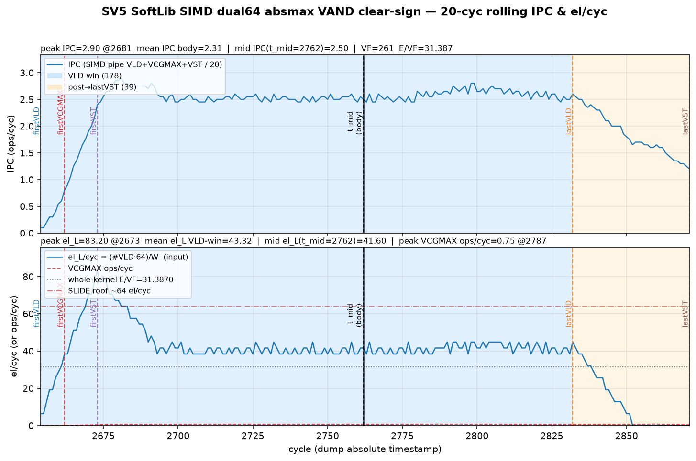
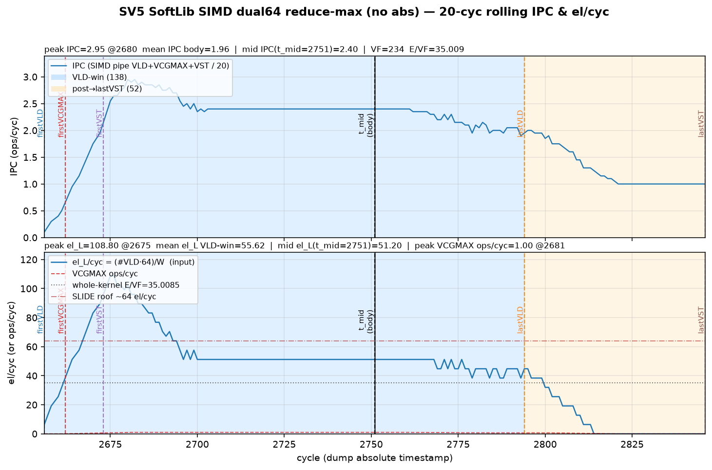
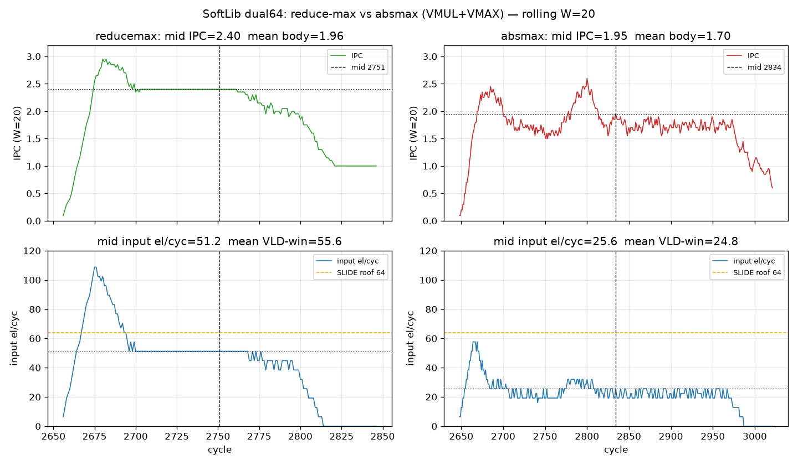

# SV5 SoftLib SIMD absmax — VAND clear-sign ANALYSIS

**Date:** 2026-10-22 Asia/Hong_Kong  
**Abs impl (primary):** `VAND(~0x80000000)` clear-sign — **not** legacy `VMUL(-1)+VMAX`.  
**Shape:** E=8192 fp32 · SoftLib `__simd_vf__` dual64 · VCGMAX G=8 + pair-max → gold G=16.

## Headline

| arm | status | VF | **el/cyc** | mid IPC (W=20) | mid input el/cyc | % EXU roof |
|---|---|---:|---:|---:|---:|---:|
| SoftLib reduce-max | PASS | 234 | **35.01** | ~2.40 | **51.2** | ~80% of **64** |
| **SoftLib absmax VAND** | PASS | 261 | **31.39** | **2.50** | **41.6** | **~97% of ~42.7** |
| SoftLib absmax VMUL+VMAX *(legacy)* | PASS | 417 | 19.65 | ~1.95 | 25.6 | ~80% of **32** |
| **VMI DSL VL=128 G=8 VAND** *(i32 clear-sign)* | PASS | 245 | **33.44** | — | — | **beats SoftLib ~1.07×** |
| VMI DSL VL=128 G=8 *(prior VMUL abs)* | PASS | 394 | 20.79 | — | — | superseded |
| VMI DSL FA dual64 VAND | PASS | 689 | **11.89** | — | — | still behind SoftLib |
| VMI DSL FA dual64 *(prior VMUL)* | PASS | 912 | 8.98 | — | — | superseded |

Source: `softlib/sv5_ccs_softlib_absmax_vand.asc` · gold maxabs = 0.  
VMI VAND path: `vinterpret_cast(f32→i32)` → `vand(…, 0x7FFFFFFF)` → cast-back (f32 `vand` rejected: integer-like VMI type required). Artifacts: `out/sv5_vmi_vand_20261022/SUMMARY.md`.

**VL128 VAND closes the prior SoftLib gap:** 20.79 → **33.44** (+60.8%), now **above** SoftLib handwritten **31.39**. See [VMI DSL VL128 VAND](#vmi-dsl-vl128-g8-vand--closes-the-softlib-gap).

## Avg-window / running IPC (SIMD)

Style: W=20, `(t−W, t]` — same as SoftLib mid-IPC SoT.

**VAND primary:** mid IPC **2.50**, mid input **41.6** el/cyc, mean body IPC ~2.31–2.41, mean VLD-win el_L **43.3**, peak el_L **83.2**. Mid VAND/cyc ~0.60 · mid VCGMAX/cyc ~0.65.

### Running-IPC plots (inline)







Detail: [`SIMD_RUNNING_IPC.md`](SIMD_RUNNING_IPC.md), [`ipc/ABSMAX_VAND_MIDPOINT_IPC.md`](ipc/ABSMAX_VAND_MIDPOINT_IPC.md), [`ipc/ROLLING20_IPC.md`](ipc/ROLLING20_IPC.md).

## Rooftop — **not UB-bound**

Per dual64 row (128 el):

| resource | cyc/row | theory el/cyc |
|---|---:|---:|
| UB LD (dual VLD) | 1 | **128** |
| ST (2× VST) | 2 | **64** |
| **EXU** = `ceil(2/2)+2` (2×VAND + 2×VCGMAX) | **3** | **~42.7** |

```
el/cyc_theory = 128 / max(LD=1, EXU=3, ST=2) = 128/3 ≈ 42.67
```

| metric | value | vs EXU ~42.7 | vs UB 128 |
|---|---:|---:|---:|
| mid input el/cyc | **41.6** | **~97%** | ~32% |
| whole-kernel el/cyc | **31.39** | **~73%** | ~25% |

Binding resource is **EXU**, not UB. Adding VAND drops EXU roof 64→42.7 and mid 51→41.6 (compute step-down). See [`ROOFTOP_NOT_UB.md`](ROOFTOP_NOT_UB.md).

## VMI DSL VL=128 G=8 VAND — closes the SoftLib gap

| | SoftLib VAND (handwritten) | VMI DSL VL=128 G=8 **VAND** | VMI prior (VMUL abs) |
|---|---|---|---|
| status | PASS | PASS (`create_mask(VL,size=VL)`) | PASS |
| **el/cyc** | **31.39** | **33.44** | 20.79 |
| Δ vs SoftLib | — | **beats ~1.07×** (+2.05) | SoftLib +10.6 (~1.51×) |
| abs | **2× VAND** clear-sign | **i32 VAND** + `vinterpret_cast` | VMUL+VMAX (legacy) |
| load / row | **2×** RV_VLD NORMAL | **1×** RV_VLDI **DINTLV_B32** | same DINTLV |
| reduce / row | **2×** VCGMAX (G=8) + scalar pair-max | **1×** VCGMAX group=8 | same |
| store / row | **2×** VST + pack | **1×** VSTI compact | same |
| instr mix abs | RV_VAND | **RV_VAND ×2/row** (DINTLV split); **no RV_VMUL**; residual RV_VMAX ×1/row from lowering | RV_VMUL + RV_VMAX |

### What changed

1. **Abs cost was the ~10 gap:** swapping VL128 source from `vmax(x, vmul(x,-1))` to i32 clear-sign VAND lifted **20.79 → 33.44** (+12.65 el/cyc, **+60.8%**). That alone closed SoftLib’s +10.6 lead.
2. **f32 `vand` rejected** (`requires integer-like VMI element type`); working path is `vinterpret_cast` → i32 `vand(…, 0x7FFFFFFF)` → cast-back. Gold maxabs=0.
3. **Schedule still ≠ SoftLib dual64** (single-trip DINTLV + one VCGMAX + one VSTI), yet VL128 VAND now **slightly beats** SoftLib whole-kernel el/cyc — SoftLib mid still sits higher on EXU (~97% of ~42.7).
4. **FA dual64 VAND** improved 8.98 → **11.89** (+32%) but remains ~2.6× behind SoftLib; harden FA separately if dual64 schedule is the target.
5. Residual **RV_VMAX ×1/row** on VL128 is lowering, not source abs (source is VAND-only).

**Bottom line:** VL128 + VAND is now the VMI SoT for this absmax shape (**33.44**, beats SoftLib **31.39**). SoftLib handwritten remains the dual64 EXU-roof reference (~97% mid). FA dual64 still needs schedule work.

Artifacts: `out/sv5_vmi_vand_20261022/SUMMARY.md`, prior mask/schedule notes in `out/sv5_vl128_g8_bug_20261022/`.

## Related notes

- SoftLib SIMD **fused** VAND remains the SoftLib SIMD SoT (~31 mid-roof); membar SoftLib (~12.7) is stage-diagnostic only.
- Simt contig+REDUX upgrade band is separate (membar 6.35 / aicore-misched=0 clean stages 5.08) — not this ANALYSIS’s primary.
