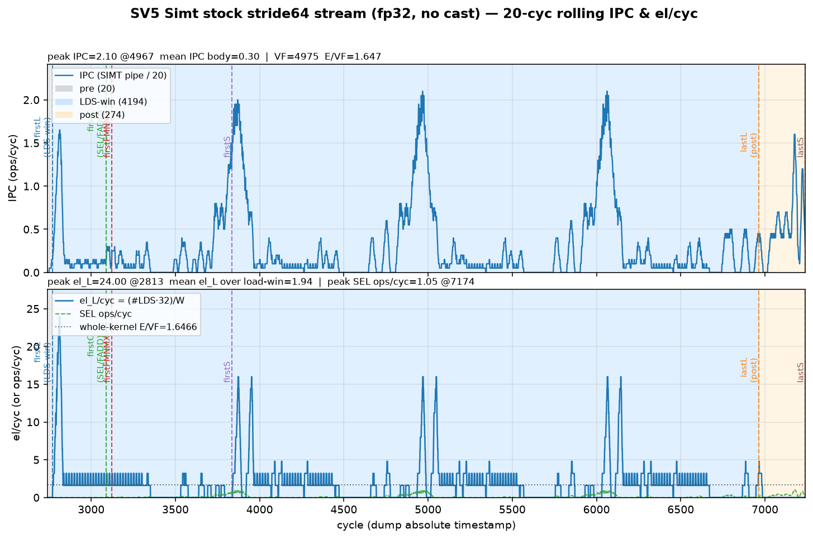
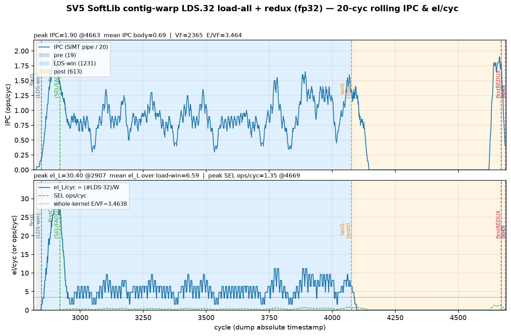
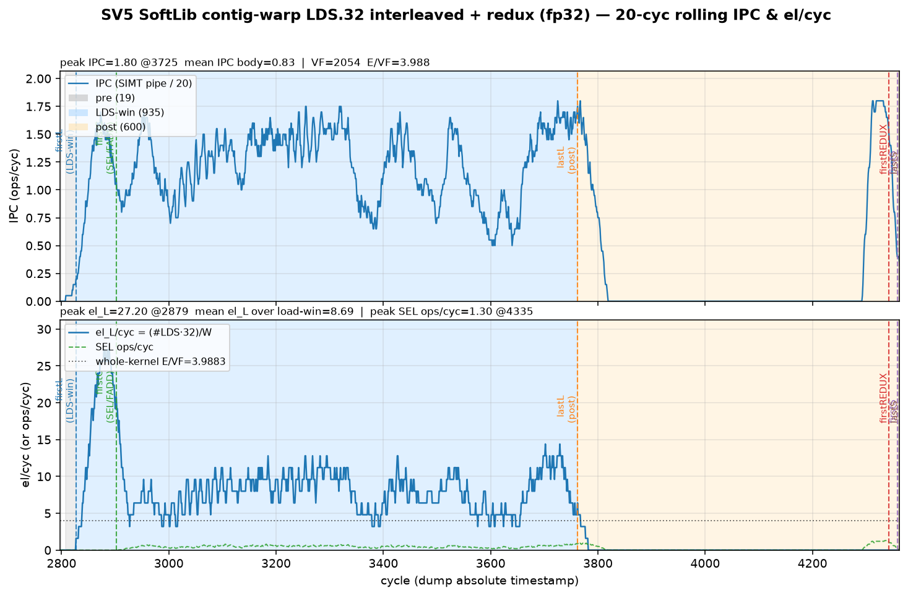

# SV5 analysis — small-block reduce (SIMD VCG vs SIMT RF)

**Date:** 2026-10-22 Asia/Hong_Kong · ST-spine rewrite **2026-10-23** · **SOC:** Ascend950PR_9599 opsim · **CANN / PTOAS:** cann_92b2 / pins in `config.toml`  
**Format:** [`docs/ST_REPORT_FORMAT.md`](../../docs/ST_REPORT_FORMAT.md) (SV1-order). Supporting notes stay beside this file; this ANALYSIS is the stand-alone SoT.  
**Primary metric:** **el/cyc = E / VF_cyc** with **E = 8192** fp32 (**TILE8192** = TILE=E). SoftLib SIMD mid SoT: rolling **W=20**, left-open right-closed `(t−W, t]`.  
**Never invent measured numbers.** Gaps below are marked **TODO / not-yet-run**.

---

## 1. Aims

Small-block reduce — **SIMD vs SIMT performance sensitivity** analysis, showing **SIMD block-level reduce ISA (VCG / VCGMAX)** vs **SIMT small-block register-per-thread** level performance comparison.

In practice: same **E=8192 fp32** tile, contrast (a) SIMD schedules that fold a small group with **VCGMAX** (block reduce) against (b) SIMT paths that keep the group in **per-thread registers** (or reload from UB) and reduce lane-wise / warp-redux. Report whole-kernel el/cyc, mid-window IPC / in–out el/cyc, and % of the binding rooftop for each arm that has measured data.

---

## 2. Test-case design

| Axis | Choices |
|------|---------|
| **Shape SoT** | **E = 8192** fp32, **TILE8192** (TILE=E). Gate shape in `config.toml`: R=64, C=128, G=16, T=32 (`sv5_r64_c128_g16_t32_*`) |
| **Datatype** | Pure **fp32** in UB — **no** Cast / `SIMT_F2F` in the measured SoftLib / VMI arms below |
| **SIMD SoftLib** | `__simd_vf__` dual64 (PHYS_VL=64 × 2), VCGMAX **G=8** + scalar pair-max → gold G=16. Arms: **reduce-max**, **absmax VAND**, legacy absmax VMUL+VMAX |
| **SIMD PTO-DSL / VMI** | `sv5d_absmax_vl128_g8.py` (VL=128 G=8 VAND), FA dual64 VAND twin, prior VL128 VMUL abs |
| **SIMT Ascend default** | Gate tags `keep_reg` / `ub_reload` (`simt-asc`) — **PASS** status only on this tip; **no el/cyc ladder yet** |
| **SIMT SoftLib** | Stock **stride64** ub_stream (bank cliff); contig-warp + `asc_reduce_max` with **LDS.64 / LDS.32** (load-all / interleaved) |
| **Pass criteria** | Gold maxabs / reduce verify PASS on opsim; el/cyc from VF cycle count |

**Kernels / sources (in-tree):** `sv5_reduce_small_eltwise.py`, `sv5d_reduce_small.py`, `sv5d_absmax_vl128_g8.py`, `sv5d_absmax_amaxstyle.py`, `sv5d_absmax_vcg.py`, SoftLib `softlib/sv5_ccs_softlib_absmax_vand.asc`. Full compare dump: [`SV5_REDUCE_SMALL_COMPARE_20261022.md`](SV5_REDUCE_SMALL_COMPARE_20261022.md).

**Case matrix (measured el/cyc on this tip):**

| schedule | path | **el/cyc** | PASS |
|----------|------|----------:|:----:|
| SoftLib SIMD reduce-max dual64 | `__simd_vf__` | **35.01** | ✅ |
| SoftLib SIMD absmax VAND dual64 | `__simd_vf__` | **31.39** | ✅ |
| SoftLib SIMD absmax VMUL+VMAX *(legacy)* | `__simd_vf__` | 19.65 | ✅ |
| VMI DSL VL=128 G=8 VAND | PTO-DSL | **33.44** | ✅ |
| VMI DSL VL=128 G=8 prior VMUL abs | PTO-DSL | 20.79 | ✅ |
| FA dual64 VAND | PTO-DSL FA | 11.89 | ✅ |
| SoftLib SIMT stock stream stride64 | `__simt_vf__` | **1.65** | ✅ |
| SoftLib SIMT contig LDS.64 + redux | SoftLib SIMT | **4.51** | ✅ |
| SoftLib SIMT contig LDS.32 interleaved | SoftLib SIMT | **3.99** | ✅ |
| SoftLib SIMT contig LDS.32 load-all | SoftLib SIMT | **3.46** | ✅ |
| simt-asc gate keep_reg / ub_reload | TileLang Asc default | *(status PASS; el/cyc **TODO**)* | ✅ gate |

---

## 3. Layout and schedule (SIMT and SIMD)

### 3.1 SIMD — block reduce via VCG

- **UB → MRF:** dual64 (or VL=128) vector loads of the input tile; tiny reduced **Y** store (not full-tile write).
- **Reduce ISA:** **VCGMAX G=8** per trip (SLIDE / EXQ0-only). Device scalar pair-max stitches G8 → G16 gold where needed.
- **Abs (when present):** clear-sign **VAND** (ADD, dual-issueable) preferred over legacy `VMUL(−1)+VMAX`. SoftLib: `asc_and` / `~0x80000000`; VMI: i32 `vinterpret_cast` + `vand(…, 0x7FFFFFFF)` + cast-back.
- **Intended pipeline:** per dual64 row ≈ `2×VLD + 2×(VAND|∅) + 2×VCGMAX + 2×VST` — **compute / EXU+SLIDE bound**, not UB-bound (ST is reduced-only).

### 3.2 SIMT — register-per-thread / warp redux

- **Stock small-G map:** `A[i·(T·G) + tid·G + t]` with G=16 fp32 → concurrent lanes stride **64 B** → bank conflict (32 banks × 8 B → 4 unique banks / 8-way). Motif is **UB bank-bound**.
- **Contig-warp remap:** contiguous LDS → per-lane absmax → `asc_reduce_max` (`SIMT_REDUX` × warps) → STS broadcast. Width choice **LDS.64 vs LDS.32** (and load-all vs interleaved) is the SoftLib schedule knob.
- **Ascend default (`simt-asc`):** gate arms `keep_reg` (force-live G size-1 vregs) vs `ub_reload` — register-per-thread vs UB reload for the small group. **Measured layout + el/cyc for Asc default: TODO** (gate PASS only on this tip).

### 3.3 Target best schedule (intent)

| Path | Target |
|------|--------|
| **SIMD** | Keep **VCGMAX** as the reduce; abs via **VAND** if needed; dual64 or VL128 interleave so EXU/SLIDE binds, not UB |
| **SIMT** | Escape stride64 bank cliff via **per-warp contig** loads; prefer a width/schedule that is **not LD/ST-bound** when possible; stage-split LD / compute / ST for SoftLib hand-craft |

---

## 4. SIMD PTO-DSL performance

Two measured SIMD families share the VCG story: **SoftLib `__simd_vf__` dual64** (best IPC + rooftop write-up on this tip) and **VMI / PTO-DSL** (VL / G sensitivity). SoftLib dual64 is the mid-IPC **W=20** SoT.

### 4.1 SoftLib dual64 — measured el/cyc + theory bound

Per dual64 row = **128 el**. A5 EXU model: `EXU_cyc/row = ceil(n_non_SLIDE/2) + n_SLIDE` (VCGMAX = SLIDE, EXQ0-only).

| arm | n_non | n_SLIDE | EXU cyc/row | **resource el/cyc** | VF | **whole el/cyc** | mid in el/cyc (W=20) | mid % of roof |
|-----|------:|--------:|------------:|--------------------:|---:|-----------------:|---------------------:|--------------:|
| **reduce-max** | 0 | 2 | 2 | **64** (SLIDE) | 234 | **35.01** | **51.2** | **~80%** mid |
| **absmax VAND** | 2 | 2 | **3** | **~42.7** (EXU) | 261 | **31.39** | **41.6** | **~97%** mid |
| absmax VMUL+VMAX *(legacy)* | 4 | 2 | 4 | **32** | 417 | 19.65 | 25.6 | ~80% mid |

**Binding resource:** reduce-max → **SLIDE @ 64**; VAND absmax → **EXU @ ~42.7** (UB LD roof 128 and ST roof 64 both sit above). Claim detail: [`ROOFTOP_NOT_UB.md`](ROOFTOP_NOT_UB.md).

| metric (VAND) | value | vs EXU ~42.7 |
|---------------|------:|-------------:|
| mid input el/cyc | **41.6** | **~97.4%** |
| whole-kernel el/cyc | **31.39** | **~73.5%** |
| mid IPC (W=20) | **2.50** | — |

Whole-kernel sits below mid because of head/tail; mid already hugs the EXU roof for VAND.

```
el/cyc_theory (VAND) = 128 / max(LD=1, EXU=3, ST=2) = 128/3 ≈ 42.67
```

### 4.2 Instruction mix (SoftLib dual64)

| arm | whole-kernel counts |
|-----|---------------------|
| reduce-max | VLD×128, VCGMAX×128, VST×128 |
| **absmax VAND** | VLD×128, **VAND×128**, VCGMAX×128, VST×128 |
| absmax VMUL+VMAX | VLD×128, VMUL×128, VMAX×128, VCGMAX×128, VST×128 |

### 4.3 Running IPC (W=20) + in/out el/cyc

| arm | mid IPC | mid input el/cyc | mean body IPC | mean el_L (VLD-win) | whole el/cyc |
|-----|--------:|-----------------:|--------------:|--------------------:|-------------:|
| reduce-max | **2.40** | **51.2** | 1.96 | 55.6 | **35.01** |
| **absmax VAND** | **2.50** | **41.6** | 2.31 | 43.3 | **31.39** |
| absmax VMUL+VMAX | 1.95 | 25.6 | 1.70 | 24.8 | 19.65 |

Output store is reduced-only (~8–16 el / ~32–64 B per row) — **not** reported as a full-tile out el/cyc; ST issue ties SLIDE on reduce-max but is not the BW binder for VAND.


Detail: [`ipc/ABSMAX_VAND_MIDPOINT_IPC.md`](ipc/ABSMAX_VAND_MIDPOINT_IPC.md), [`ipc/REDUCEMAX_MIDPOINT_IPC.md`](ipc/REDUCEMAX_MIDPOINT_IPC.md), [`SOFTLIB_ABSMAX_VAND_SUMMARY.md`](SOFTLIB_ABSMAX_VAND_SUMMARY.md).

### 4.4 Sensitivity — virtual VL / G (PTO-DSL VMI)

Same absmax VAND story under VMI; **VL / group** is the named knob (tile-size multi-TILE ladder for SIMD absmax: **TODO / not-yet-run** on this tip — SoftLib SoT stays **TILE8192**).

| arm | VF | **el/cyc** | notes |
|-----|---:|----------:|-------|
| **VL=128 G=8 VAND** | 245 | **33.44** | primary PTO-DSL · `create_mask(VL, size=VL)` |
| prior VL=128 G=8 VMUL abs | 394 | 20.79 | superseded (+60.8% with VAND) |
| FA dual64 VAND | 689 | 11.89 | separate schedule track |

**Instr mix (VL128 storeB, R=64):** RV_VAND ×2/addr (DINTLV splits VL128 → 2× phys-64), RV_VLDI DINTLV ×1, RV_VCGMAX ×1, RV_VSTI ×1, residual RV_VMAX ×1 (lowering artifact — **not** source abs), RV_VMUL **0**. See tip notes in prior ANALYSIS / [`VMI_VL128_VS_SOFTLIB.md`](VMI_VL128_VS_SOFTLIB.md).

**Gap vs SoftLib dual64 VAND 31.39:** VL128 VAND **33.44** is in the same band (both EXU-class after clear-sign abs); prior VMUL abs **20.79** was the large gap case.

### 4.5 SIMD takeaway

- Best whole-kernel SoftLib SIMD: **reduce-max 35.01** (~55% of SLIDE 64 overall; mid **80%**).
- Best abs SoftLib SIMD: **VAND 31.39** (mid **~97%** of EXU **~42.7**).
- Best PTO-DSL abs: **VL128 G=8 VAND 33.44**.
- Motif: **block-level VCGMAX** + dual-issueable abs → compute-bound small-block reduce, not UB-bound.

---

## 5. SIMT (Ascend default) lowering performance

**Stock Ascend / SimtVF path** for SV5 is the TileLang `simt-asc` gate (`keep_reg` / `ub_reload`).

| Tag | Suite | simt-asc verdict | Measured el/cyc |
|-----|-------|------------------|-----------------|
| `sv5_r64_c128_g16_t32_keep_reg` | gate | PASS | **TODO / not-yet-run** on this tip |
| `sv5_r64_c128_g16_t32_ub_reload` | gate | PASS | **TODO / not-yet-run** on this tip |

**Layout mapping + LDS/STS 32 vs 64 + theory-bound from Asc default lowering:** **TODO** — no harvested Asc-default instr-mix / rooftop table checked into `benches/sv5/` yet. Pins and gate status: [`VERDICT.md`](VERDICT.md).

**Sensitivity (mainly thread dim T):** gate fixes **T=32**; an Asc-default **T-ladder** (e.g. 32/64/128/…) with el/cyc is **TODO / not-yet-run**.

**Related bank-cliff map (SoftLib `__simt_vf__` stock stream — not Asc TileLang lowering):** stride64 G=16 → **1.65** el/cyc (VF 4975, LDS-wall **7.81** B/cyc). Useful as the “small-G map without contig remap” reference; do **not** treat as simt-asc SoT.



---

## 6. SIMT hand-craft (SoftLib) analysis

Handwritten SoftLib SIMT (`__simt_vf__` / contig-warp + `asc_reduce_max`). Pure fp32. Secondary metric: **B/cyc** on first→last `SIMT_LDS` wall; LDS-window el/cyc ≈ B/cyc ÷ 4.

### 6.1 Stock vs contig (escape LD bank-bound)

| arm | VF el/cyc | **B/cyc** | LDS-win el/cyc | notes |
|-----|----------:|----------:|---------------:|-------|
| stock stream stride64 | **1.65** | **7.81** | ~2.0 | bank-bound; STK=LDK=F2F=0 |
| **contig LDS.64** load-all | **4.51** | **40.76** | **~10.2** | **63.7% of width-64**; SoftLib SIMT headline |
| contig LDS.32 interleaved | **3.99** | **35.05** | **~8.8** | schedule yes (+32% B vs load-all.32) |
| contig LDS.32 load-all | **3.46** | **26.62** | **~6.7** | **83% of width-32** |

vs stock **1.65:** contig is **~2.5–3×** whole-VF el/cyc and **~4–5×** on LDS-window bytes.  
vs SV1 SoftLib A-only LDS.32 load-only roof **~101 B/cyc ≈ 25 el/cyc:** redux + abs/SEL still sit at **~35–41 B/cyc** — **not** that load-only ceiling.

**Width SoT for SoftLib SIMT reduce:** prefer **LDS.64** headline (~64% of width roof). LDS.32 remains useful for width sensitivity; format preference for LDS.32/STS.32 applies when that width is the binding SoT (SV1 ADD-class) — here LDS.64 wins the measured SoftLib SIMT table.






### 6.2 Stage-split LD / compute / ST

Partial stage / membar notes already measured (see compare § “Membar stages”):

| variant | whole el/cyc | LD-stage note |
|---------|-------------:|---------------|
| contig+REDUX membar sparse2 (warp=32, 2 writers/warp intent) | **6.35** | LD-stage **29.6 B/cyc (23% of 128)** — not ~50%; measured STS=4 (1/warp) |
| SoftLib SIMD membar (ST separated) | ~12.7 | ST visible ~0.66 VST/cyc but spill; **fused 35/31 remains SIMD primary** |

**Full SoftLib SIMT stage rooftop rewrite** (LD / compute / ST binding resource updated to the same layout + instr, with per-stage IPC plots like SV1 SoftLib ADD): **TODO** — only the sparse2 / membar snapshots above are on this tip. Prefer fused contig **LDS.64 @ 4.51** as SoftLib SIMT SoT until a complete stage table lands.

### 6.3 SoftLib SIMT takeaway

Best SoftLib SIMT on tip: **contig LDS.64 = 4.51** el/cyc (~10.2 LDS-win). Still **far below** SIMD VCG arms (**31–35**). Motif: after leaving the bank cliff, **warp redux + abs** dilate the LDS wall; schedule is no longer pure LD-bound, but also not yet at an SV1-class SoftLib hand-craft roof.

---

## 7. Conclusion

| arm | best measured el/cyc | binder / note |
|-----|---------------------:|---------------|
| **SIMD SoftLib reduce-max** | **35.01** | SLIDE roof 64 · mid 51.2 (~80%) |
| **SIMD SoftLib absmax VAND** | **31.39** | EXU ~42.7 · mid 41.6 (~97%) |
| **SIMD PTO-DSL VL128 G=8 VAND** | **33.44** | VCG + clear-sign abs |
| **SIMT Ascend default** | **TODO** | gate PASS only |
| **SIMT SoftLib stock stride64** | **1.65** | bank-bound |
| **SIMT SoftLib contig LDS.64** | **4.51** | best SoftLib SIMT on tip |

**Performance ratios (SIMD ÷ SIMT), whole-kernel el/cyc:**

| SIMD arm | ÷ SoftLib SIMT LDS.64 (4.51) | ÷ SoftLib stock (1.65) |
|----------|-----------------------------:|-----------------------:|
| SoftLib reduce-max **35.01** | **~7.8×** | **~21.2×** |
| SoftLib VAND **31.39** | **~7.0×** | **~19.0×** |
| VMI VL128 VAND **33.44** | **~7.4×** | **~20.3×** |

**Story:** SIMD **block-level VCGMAX** (with VAND abs when needed) lands in the **31–35 el/cyc** band and is **EXU/SLIDE-bound**. SoftLib SIMT, even after contig remap, tops out near **~4.5** el/cyc on this tip — small-block **register / warp-redux** path does not match VCG block reduce. Ascend-default simt-asc **el/cyc + T-sensitivity** remain **TODO** before a three-way Asc / SoftLib / SIMD close-out.

**Open gaps (do not invent):**

1. simt-asc **el/cyc** + **T-dim** ladder + LDS/STS 32/64 mix from Asc lowering.  
2. SoftLib SIMT **full stage-split** rooftop + stage IPC pack (beyond sparse2 6.35 snapshot).  
3. SIMD **multi-TILE** sensitivity ladder (SoftLib/VMI stay TILE8192 SoT here).

**Related:** [`SV5_REDUCE_SMALL_COMPARE_20261022.md`](SV5_REDUCE_SMALL_COMPARE_20261022.md) · [`ROOFTOP_NOT_UB.md`](ROOFTOP_NOT_UB.md) · [`VERDICT.md`](VERDICT.md) · [`docs/ST_REPORT_FORMAT.md`](../../docs/ST_REPORT_FORMAT.md).
