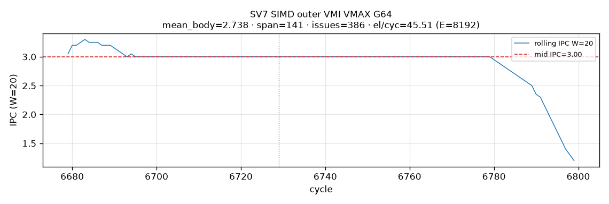
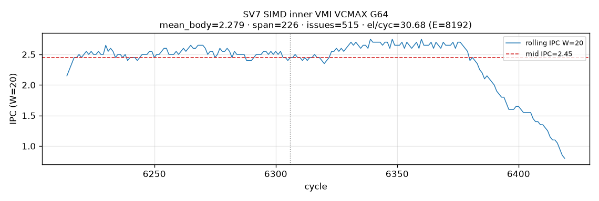
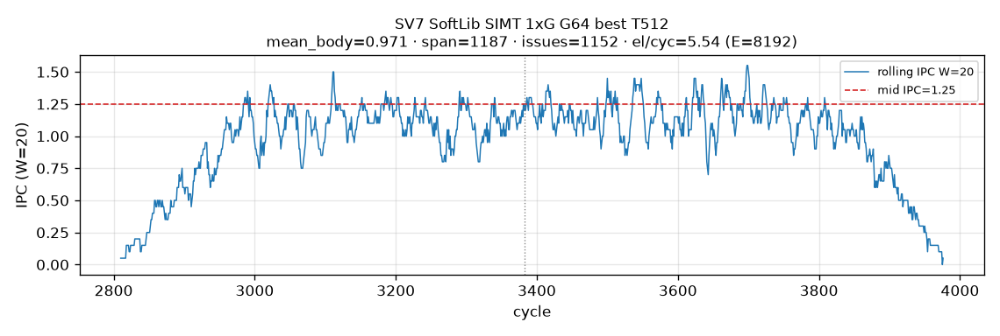
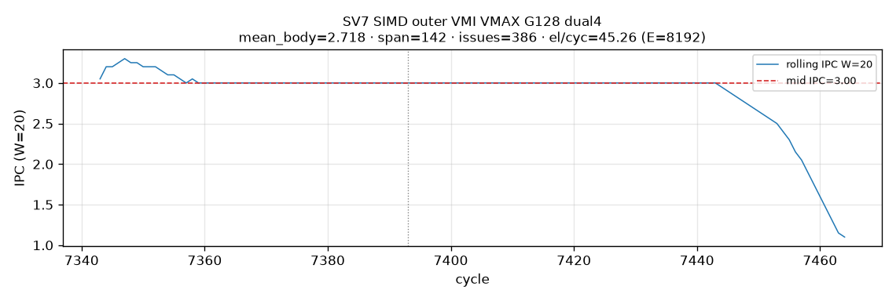
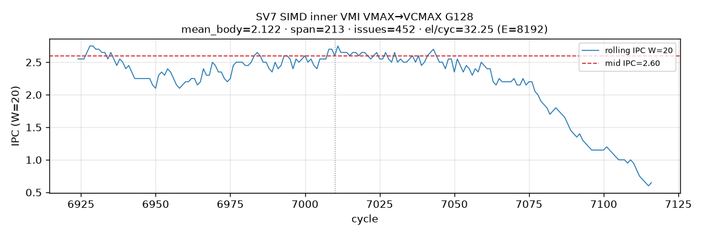
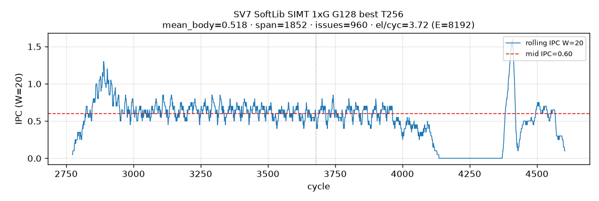
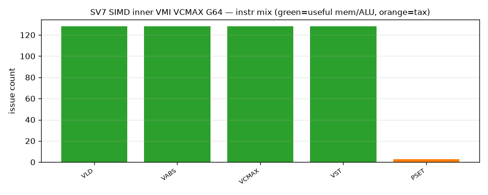
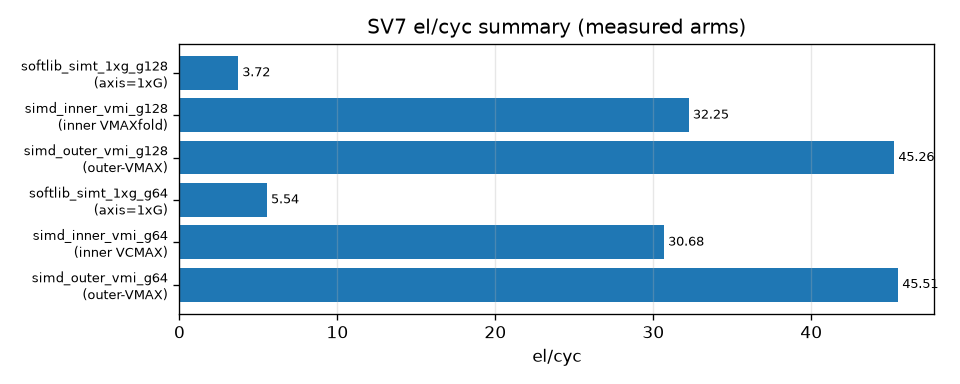

# SV7 analysis — large-block reduce G=64 / G=128 (inner 1×G + outer N×1)

**Date:** 2026-10-29 Asia/Hong_Kong · ST-spine · tip refresh **t725u** (outer VMAX t720u + Nx1 SIMT t708u) · prior live Gmap close t705/t706  
**Format:** ST spine · st-report + softlib-simt-schedule · st-semantics-gate · vmi-gmap-close · reduce-dual-issue-recipes  
**Metric:** el/cyc = E/VF · E=8192 · **era=fp32-absmax** · Case-1 · no recip.

**ST map:** SV7 = gold **G∈{64,128}**. Inner VC/VCG vs outer pure VMAX kept separate (§22).

### Headline — `reduce_axis=inner` (1×G)

| G | VMI SoT | SoftLib SIMT 1×G best | **SIMT-ASC stock** |
|--:|--------:|----------------------:|--------------------|
| 64 | **30.68** whole-VL **VCMAX** + VABS (VF 267) · VAND peer 30.57 | **5.54** wc-multi per=2 T512 | **2.39** wc-multi T128 (VF 3434) |
| 128 | **32.25** **VMAX→VCMAX** / VL128 (VF 254) | **3.72** wc-multi per=4 T256 | **1.67** wc-multi T64 (VF 4916) |

> Tip wins on VMI G64/G128 (vs t698 OPEN). SoftLib CCE footnote: G64 **30.68** tied; G128 **32.38** (+0.4% vs VMI) — not a required arm (t706u).

### Headline — `reduce_axis=outer` (N×1)

| G | VMI outer VMAX | SIMT-ASC stock (nx1 fused) | SoftLib SIMT best (nx1 membar) |
|--:|---------------:|---------------------------:|-------------------------------:|
| 64 | **45.51** `outer_g64_vmax_vand_fold_vl128` VF180 | **3.46** | **6.08** |
| 128 | **45.26** `outer_g128_vmax_vand_dual4_vl64` VF181 | **2.15** | **2.19** |

Outer VMI: pure RV_VMAX + i32-VAND · VCGMAX=VCMAX=0. G128 SoT needs **dual4 ILP** (serial fold only 26.77).

---

## 1. Aims

| Id | Aim |
|----|-----|
| **A1** | Case-1 absmax · gold G∈{64,128} · E=8192 · both axes |
| **A2** | VMI Gmap DONE (was OPEN dig @ t698); outer pure VMAX measured |
| **A3** | SoftLib SIMT **axis=1×G** wc-multi · §20/§21 COMPLETE vs residual; outer Nx1 labeled |
| **A4** | SoftLib CCE off main when ≈ VMI (tie / ≤0.5% → footnote; t706u) |
| **A5** | SoftLib SIMT measured |
| **A6** | SIMD schedule/instr · SIMT layout · running IPC |

---

## 2. Test-case design

| Axis | Choice |
|------|--------|
| G64 VMI inner | whole-VL **VCMAX** VL64 · VAND + VABS_FP (SoT = VABS) |
| G128 VMI inner | **VMAX-fold→VCMAX** and whole-VL VCMAX VL128 · VAND |
| G64/128 VMI outer | VMAX fold · VL128 / VL64 · G128 dual4 |
| SoftLib SIMT G64 inner | wc-multi **per=2** · LDS.32 · T512 |
| SoftLib SIMT G128 inner | wc-multi **per=4** · LDS.32 · T256 |
| SoftLib SIMT outer | nx1-col · T=`n_cols` · membar |
| WC-only (per=1) | **no path** for G>32 — need in-warp fold (t704u) |
| SoftLib CCE | footnote peer only |

Live RESULT: tip `benches/sv7/reports/RESULT_absmax_vmi.tsv` · outer `/workspace/RESULT_outer_vmax_t720u.tsv`.

---

## 3. Layout and schedule

### 3.1 VMI G64 inner

Whole-VL VCMAX · abs VAND or VABS · mix VCMAX:128 + ABS:128 + VLD/VST:128 · SoT **VABS 30.68**.

### 3.2 VMI G128 inner

VMAX pre-fold + VCMAX · mix VCMAX:64 VMAX:64 VAND:128 VLD:128 VST:64 · both tags same VF **254** · el/cyc **32.25**.

### 3.3 VMI outer G64 / G128

| G | tag | VL | mode | VF | el/cyc | dump mix |
|--:|-----|---:|------|---:|-------:|----------|
| 64 | `outer_g64_vmax_vand_fold_vl128` | 128 | fold | 180 | **45.51** | VMAX=126 VAND=128 · VCG=VCMAX=0 |
| 128 | `outer_g128_vmax_vand_dual4_vl64` | 64 | **dual4** | 181 | **45.26** | VMAX=127 VAND=128 · VCG=VCMAX=0 |

### 3.4 SoftLib SIMT inner 1×G (wc-multi)

- G64: per_thread=2 elems inside gold G · T512 best among {128,256,512}.
- G128: per_thread=4 · T256 best among {64,128,256}; **T512 never measured** (residual).
- Why not small-T + WC-only: measured T-sweep + structural per≥2 — t704u / harness gate.

### 3.5 SoftLib SIMT outer Nx1

- **Layout:** `a[r]=A0[r*n_cols+tid]` · T=`n_cols` (G64→128, G128→64) · thread-local scalar vmax · **no** warp redux.
- **Large-G cliff:** fixed E=8192 → G↑ shrinks T → fewer warps + longer per-thread fold; G128 only **2 warps** → launch-width bound (SIMT best **2.19** vs VMI **45.26** ~20×).
- **Not tried:** same-col thread-group + **col stride** inside group + redux (t723–t724) — would keep T large while staying Case-1 outer gold.

---

## 4. SIMD PTO-DSL / VMI Gmap

| G | Functional | Tried | Best-sweep | Inner SoT |
|--:|------------|-------|------------|----------:|
| 64 | PASS | vand + vabs VCMAX VL64 | **DONE** | **30.68** VABS |
| 128 | PASS | vmaxfold + vcmax_vl128 | **DONE** | **32.25** |

Outer SoT: **45.51 / 45.26** (t720u). SEMANTICS_GATE **PASS** both axes.

SoftLib CCE: **tied** @G64; **+0.4%** @G128 → footnote peer only (t706u).

Close: [`../sv5/reports/VMI_GMAP_ABSMAX_CLOSE_t705u.md`](../sv5/reports/VMI_GMAP_ABSMAX_CLOSE_t705u.md) · [`../sv5/reports/VMI_ABSMAX_OUTER_VMAX_t720u.md`](../sv5/reports/VMI_ABSMAX_OUTER_VMAX_t720u.md).

---

## 5. SIMT-ASC stock

| G | Axis | el/cyc | stock T | tag |
|--:|------|-------:|--------:|-----|
| 64 | inner | **2.39** | 128 | `wc_abs_lds32_redux_g64_t128_e8192` |
| 128 | inner | **1.67** | 64 | `wc_abs_lds32_redux_g128_t64_e8192` |
| 64 | outer | **3.46** | 128 | `nx1_col_lds32_fused_g64_t128_e8192` |
| 128 | outer | **2.15** | 64 | `nx1_col_lds32_fused_g128_t64_e8192` |

---

## 6. SoftLib SIMT (A5)

| G | Axis | motif | T | el/cyc | why stock loses | end |
|--:|------|-------|--:|-------:|-----------------|-----|
| 64 | inner | wc-multi per2 | **512** | **5.54** | T128=2.39 latency hide | **DONE** |
| 128 | inner | wc-multi per4 | **256** | **3.72** | T64=1.67 / T128=3.36 | **DONE** (T512 residual) |
| 64 | outer | nx1-col membar | **128** | **6.08** | fused 3.46 | **DONE** |
| 128 | outer | nx1-col membar | **64** | **2.19** | fused 2.15 ~tied | **DONE** |

wg ~0.98 both G — not SoT. **SEMANTICS_GATE PASS** · axes labeled.

---

## 7. Running IPC + figures (W=20 mid · enforce list)

| Arm | Axis | G | mid IPC W20 | note |
|-----|------|--:|------------:|------|
| VMI outer fold | outer | 64 | **3.00** | mean 2.74 |
| VMI outer dual4 | outer | 128 | **3.00** | mean 2.72 |
| VMI inner VABS VCMAX | inner | 64 | **2.45** | mean 2.28 · SoT |
| VMI inner vmaxfold | inner | 128 | **2.60** | mean 2.12 · SoT |
| SoftLib SIMT inner best | inner | 64 | **1.25** | mean 0.97 · T512 |
| SoftLib SIMT inner best | inner | 128 | **0.60** | mean 0.52 · T256 |
| SoftLib SIMT outer best | outer | 64 | **0.85** | mean 0.59 |
| SoftLib SIMT outer best | outer | 128 | MID_IDLE_GAP | mean_body **0.24** |
| Full matrix | — | — | — | [`../../SV567_IPC_HARVEST_t725u.md`](../../SV567_IPC_HARVEST_t725u.md) |

---

### Figures (PR9-style — enforce list)

---

## 8. Conclusion

### Inner 1×G

| G | VMI | SoftLib SIMT best | SIMT-ASC stock |
|--:|----:|------------------:|---------------:|
| 64 | **30.68** | **5.54** | **2.39** |
| 128 | **32.25** | **3.72** | **1.67** |

### Outer N×1

| G | VMI outer VMAX | SoftLib SIMT best | SIMT-ASC stock |
|--:|---------------:|------------------:|---------------:|
| 64 | **45.51** | **6.08** | **3.46** |
| 128 | **45.26** | **2.19** | **2.15** |

> SoftLib CCE footnote: G64 **30.68** (tie); G128 **32.38** (+0.4% peer).

**COMPARE:** VMI G64/G128 OPEN dig → live **DONE**. Outer VMAX supersedes wrong-arm inner Gmap reuse in Nx1 VMI cells. SoftLib SIMT main SoT = multi-warp wc-multi (inner) / nx1-col membar (outer). SoftLib CCE ≈ VMI → off main headline.

**PR:** https://github.com/PTO-ISA/tilelangGym/pull/8
