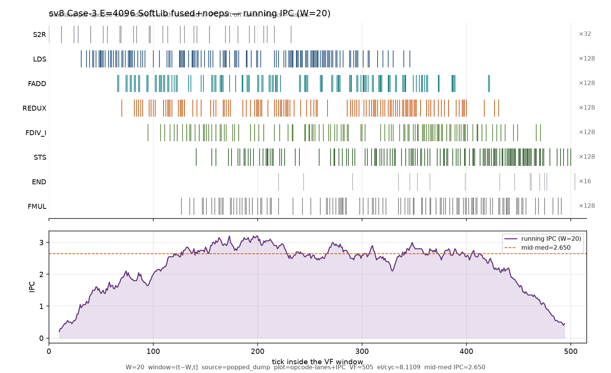
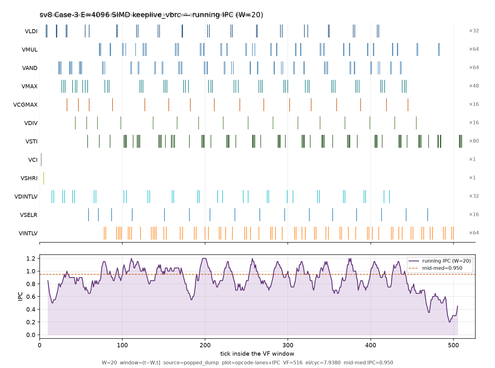
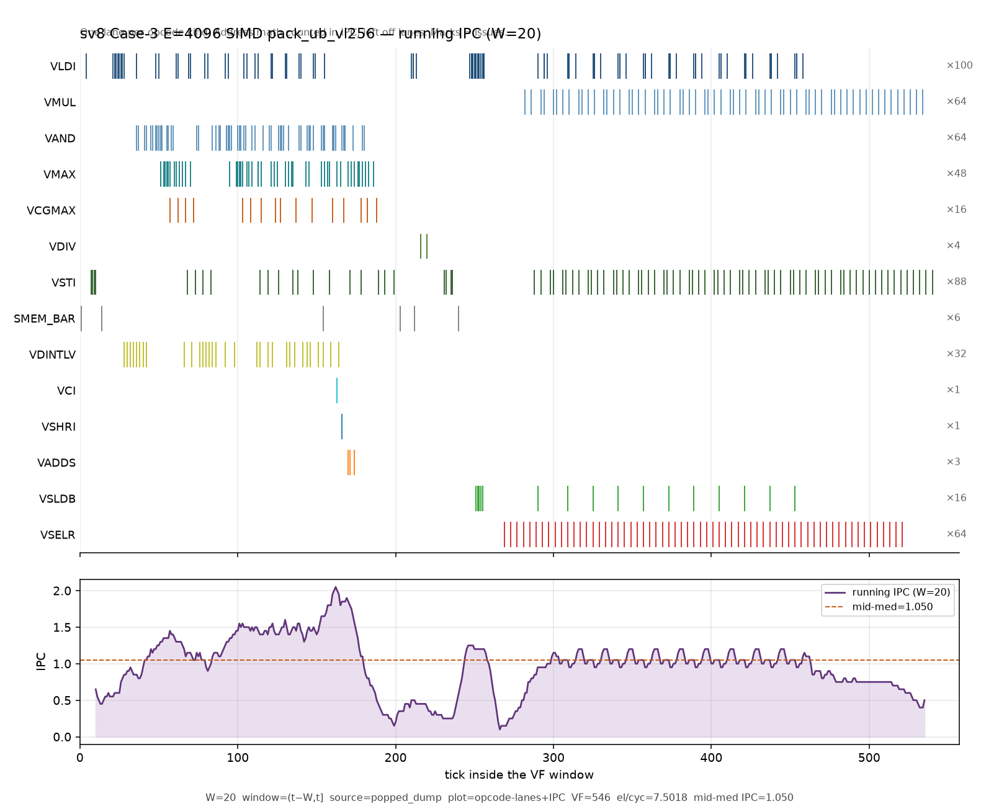

# ANALYSIS — SV8 Case-3 G32 SoftLib ≻ SIMD

**ST id:** `sv8`  
**When:** Asia/Hong_Kong 2026-10-30 · tip redo + pack-scale PR9 (t566u) + **E=4k SoftLib turning-point (t584u)**  
**Authorized:** Lok t542u → t548u/t565u/t566u → t573u–t582u → **t584u** → PTO-ISA  
**Pack / tip:** `/workspace/sv8_g32_sb8_t772u/` + dig `/workspace/sv8_simd_pack_scale_t548u/` + `/workspace/sv8_e4k_simt_win_ipc_t582u/` · plots under `benches/sv8/plots/`  
**Prior segment harvest (supporting, not replaced):** `ANALYSIS_SB8_SEGMENT_IPC_G32.md` · `sb8_g32_segment_harvest.json`  
**Arch KS lock (Lok t540u):** npu_skills **`3101`** = default truth; SoftLib **`3510`** = microbench verify layer  
**Harness cite:** `/workspace/research_topup_2026-10-25/HARNESS_REBUILD.md` + `SKILLS_REBUILD.md` — onesu §6.0* **N/A** for pure VF Case-3 (keep VF el/cyc + IPC primary)  
**PRC index:** `REGRESSION_salvage_2026-09-17/perf-review-knowledge/perf-review-checklist.md` (gate OK 2026-10-30)

**Pack-scale update (Lok t566u / dig t548u):** SIMD `pack_ub_vl256` **8.4541** / `keeplive_vbrc_vl256` **7.6920** measured on peanut; PR9 `*_running_ipc_pr9.png` added for both. SoftLib dual_drain **6.7702** leave alone. **No SoT crown / no merge** without Lok yes. Dig: `/workspace/sv8_simd_pack_scale_t548u/` · cite **PRC-SCH-003** · **PRC-IPC-001**.

**E=4k SoftLib turning-point (Lok t584u / digs t573u–t582u):** fused+noeps SoftLib vs SIMD keep/pack tile matrix 1k–8k; SoftLib wins **only E=4096** (7.543 vs keep 7.420 / pack 7.038). PR9 mid-IPC SoftLib **2.65** vs keep **0.95** / pack **1.05** — cause = **dual_drain IPC density**, not 1/32-vs-1/64 wastage; pack SMEM_BAR valley noted but SoftLib also beats keep. See **§6.1**. Dig: `/workspace/sv8_e4k_simt_win_ipc_t582u/` · cite **PRC-IPC-001** · **PRC-SCH-003** · **PRC-MEM-002**. **No SoftLib DONE crown / no merge.**

**Do not touch:** REGRESSION-2 SV5–7 Nx1 outer (`glm53_sv567_*` / t788u_r2).

---

## 1. Aims

| id | Aim |
|----|-----|
| **A1** | Case-3 quant-bcast e2e (absmax → scale → mul) at **G32**, E=8192, `era=case3-quant-bcast`. |
| **A2** | SoftLib SIMT dual_drain vs SIMD: explain via **per-segment mix + PR9 running-IPC+opcode overlay** (not IPC-only). Prior SoftLib≻**paint** SIMD (4.1711); pack_ub measured raw-beats SoftLib — **no crown** until Lok yes. |
| **A3** | SIMD schedules: VL-resident KEEP-X paint; **pack_ub / keeplive** Legal Case-3 scale (t548u/t565u); recip+VMUL≡VL-res; UB-reload falsified; optional VDIV(x,absmax). Crown only on Lok yes. |
| **A4** | Case-3 SIMD close must cover `pack_ub_vl256` + `keeplive_vbrc_vl256` (or COMPILE_CLIFF) + **stage×VL-util** (**PRC-SCH-003**). |

Every measured claim below cites `A#`.

---

## 2. Test-case design

| Field | Value |
|-------|-------|
| Shape | R64×C128 · **G=32** · E=**8192** · TILE8192 |
| Era | `era=case3-quant-bcast` (Case-3 recip ≠ absmax-only) |
| Dtype | f32 |
| Host / model | pto-b10 · Ascend950PR_9599 camodel · verify-layer label SoftLib **3510**; primary arch tag **3101** (npu_skills) |
| Pass | functional `np.allclose` vs `Out = X * (1/max(absmax,eps))` · maxabs ~1e-7 class |
| Primary KPI | el/cyc = E / VF_cyc (name VF row: SoftLib `VF_SIMT` · SIMD `VF`) |
| IPC | Running W=20 `(t−W,t]`; body proxy `body_calls/VF_cyc`; segment proxy `calls/sum_cycles` (pipe-overlapped; cyc% need not sum 100%) |

**Conclusion arms (3 + pack measured, uncrowned):**

1. **SIMD PTO-DSL** — paint VL-resident KEEP-X **4.1711** (prior SIMD_best cell); **pack_ub_vl256 8.4541** / **keeplive 7.6920** measured (A3/A4) — **no crown**
2. **SIMT Ascend default** — stock simt-asc (~0.14 class)
3. **SIMT SoftLib hand-craft** — dual_drain T512 KEEP-X `axis=1xG` **6.7702** leave alone (A2)

Dropped from headline: G16 SoftLib/size-1 pair (superseded), spill_dist (t756 optional unfinished), FA/membar trail tags.

---

## 3. Layout and schedule (SIMT and SIMD)

| Arm | Layout | Reduce | Scale → mul | Sync walls |
|-----|--------|--------|-------------|------------|
| SoftLib SIMT dual_drain | T512 · loadall+absall · **KEEP-X RF** · `axis=1xG` | warp REDUX / SEL / FSETP | sparse **FDIV_I** → **FMUL** | **3×** `asm volatile("" ::: "memory")` compiler clobber (LD · ABS · REDUX/recip→mul) — **not** HW SMEM_BAR (**PRC-SCH-001**) |
| SIMD VL-res (paint) | VL=64 · KEEP X in VL · **VLDS=0** | `VCMAX(group=1)×NG` + VMAX/VAND | size-1 **VDIV** + VSEL/VDUP paint + **VMUL** | no asm clobber; `S_sync=0%` |
| **SIMD pack_ub_vl256** | VL=256 · `vcmax(group=NG)` → compact NG · **pack UB** | `VCGMAX×32` + VAND/VMAX | **VDIV×4** + expand (`VSELR` residual) + **VMUL** | `SMEM_BAR×2` in dump; **PRC-SCH-003** |
| **SIMD keeplive_vbrc_vl256** | VL=256 · keeplive scale ladder | `VCGMAX×32` | **VDIV×32** + VINTLV/VSELR + **VMUL** | **PRC-SCH-003** |
| SIMD UB-reload (falsified) | size-1 reduce + scratch expand + X reload | — | reload mul | **VLDS=8192** · **SMEM_BAR=256** (**PRC-MEM-001** / **PRC-MEM-002**) |
| SIMT Asc stock | stock Ascend SimtVF | stock stream | — | not SoftLib best |

SoftLib SoT motif: **`axis=1xG` only** (Harness §21) · tag `wc_c3e2e_back_loadall_absall_dual_drain_g32_t512_e8192`.

---

## 4. SIMD PTO-DSL performance (A3)

### 4.1 Measured table (`era=case3-quant-bcast` · G32 · E=8192)

| arm | el/cyc | VF | note |
|-----|-------:|---:|------|
| **SIMD pack_ub_vl256** (t548u) | **8.4541** | **969** | measured · beats SoftLib raw · **no crown** · **PRC-SCH-003** |
| **SIMD keeplive_vbrc_vl256** (t548u) | **7.6920** | **1065** | measured · beats SoftLib raw · **no crown** |
| SIMD pack_ub_vl64 | NA | NA | **COMPILE_CLIFF** (VMI-RESIDUAL-OP) |
| SIMD VL-resident KEEP-X (paint) | **4.1711** | **1964** | prior SIMD_best cell (paint SoT) |
| SIMD recip+VMUL (t779) | **4.1711** | **1964** | ≡ VL-res paint (not a new schedule) |
| SIMD VL VDIV(x,absmax) contrast (t779) | **4.9799** | **1645** | +19.4% vs recip paint |
| SIMD UB-reload (t756) | **0.066739** | **122747** | falsified — VLDS=8192 |

Sources: `/workspace/sv8_simd_pack_scale_t548u/RESULT.md` · tip harvest · `RESULT_simd_recip_vmul_g32.md` · `/workspace/sv8_ubreload_g32_t756u/RESULT_t756u.md`.

**Paint SIMD_best cell = 4.1711 (VL-resident).** Pack/keeplive raw-max = **8.4541** — **CONTINUE / no SoT crown** without Lok yes. SoftLib **6.7702** leave alone.  
**PRC-MEM-001:** KEEP-X / VL-resident beats UB-reload on this shape.  
**PRC-SCH-002:** scale forms A (recip+VMUL) ≡ VL-res paint; B (VL VDIV) faster inside paint-SIMD.  
**PRC-SCH-003:** pack/keeplive kill VSEL paint (TSV-VSEL=0; VDIV 4/32 ≪ 256) → el/cyc **8.45 / 7.69** vs paint **4.17**.

### 4.0 SEMANTICS_GATE (pack arms · t548u)

```
SEMANTICS_GATE: PASS arms pack_ub_vl256 + keeplive_vbrc_vl256 (gold maxabs=1.192e-07); pack_ub_vl64 COMPILE_CLIFF (VMI-RESIDUAL-OP)
```

### 4.0b Stage×VL-util (SIMD Case-3 · FORCED t565u · harness §2b)

| stage | paint VL-res | pack_ub_vl256 | keeplive_vbrc_vl256 |
|-------|--------------|---------------|---------------------|
| `S_reduce` working size | VL | VL → compact **NG** | VL → compact **NG** |
| `S_scale` recip | size=**1** (VDIV×256) | size=**NG** (VDIV×**4**) | size≈**NG** (VDIV×**32**) |
| `S_scale` expand | VSEL/VDUP paint (VL) | `VSELR` residual×128 | `VSELR`×32 + VINTLV |
| `S_eltwise` | VL | VL | VL |

### 4.0c Body / mid IPC (pack arms · PR9)

| arm | VF | body_calls | body IPC | PR9 mid-med | PR9 plot |
|-----|---:|-----------:|---------:|------------:|----------|
| pack_ub_vl256 | 969 | 1089 | **1.1238** | **1.1** | [`plots/simd_pack_ub_vl256_running_ipc_pr9.png`](plots/simd_pack_ub_vl256_running_ipc_pr9.png) |
| keeplive_vbrc_vl256 | 1065 | 983 | **0.9230** | **0.9** | [`plots/simd_keeplive_vbrc_vl256_running_ipc_pr9.png`](plots/simd_keeplive_vbrc_vl256_running_ipc_pr9.png) |

`plot_style=opcode_lanes_ipc` · pack lanes include VCGMAX/VDIV/VSELR/VDINTLV/VSLDB (**PRC-IPC-001**). Note: pack mid-IPC (~1.1) < SoftLib (~3.4) but el/cyc higher via **ops/N collapse** on scale (ISA §9.4).

### 4.2 SEMANTICS_GATE (SIMD VL-res)

```
SEMANTICS_GATE: PASS — G32 gold matches A1; VF body uses VCMAX/VMAX/VAND (inner reduce_axis); era=case3-quant-bcast; el/cyc from VF=1964
```

### 4.3 Body / mid IPC (SIMD_best)

| metric | value |
|--------|------:|
| body_calls | 2581 |
| body IPC≈ | 1.3142 |
| official mid IPC W=20 | **1.45** |
| PR9 mid-med (15–85%) | **1.35** |

PR9: [`plots/simd_vlres_g32_running_ipc_pr9.png`](plots/simd_vlres_g32_running_ipc_pr9.png) · `plot_style=opcode_lanes_ipc` · lanes VLDI/VAND/VMAX/VCMAX/VDIV/VDUP/VSEL/VMUL/VSTI (**PRC-IPC-001**).

---

## 5. SIMT (Ascend default) lowering performance

| arm | el/cyc | VF | note |
|-----|-------:|---:|------|
| SoftLib SIMT-ASC stock | **~0.14 class** | — | stock Ascend SimtVF; **not** SoftLib best (A2) |
| (G16 footnote only) simt-asc | 0.2864 | 28603 | superseded SoftLib headline target — do **not** use as G32 SoftLib≻SIMD pair |

Stock path is LD/ST-bound / low density vs dual_drain hand-craft; kept as conclusion arm 2 only.

---

## 6. SIMT hand-craft (SoftLib) analysis (A2)

| arm | schedule | VF row | VF_cyc | el/cyc | body IPC≈ | mid IPC W=20 | PR9 mid-med |
|-----|----------|--------|-------:|-------:|----------:|-------------:|------------:|
| **SoftLib SIMT dual_drain T512 KEEP-X** | loadall+absall · `axis=1xG` | `VF_SIMT` | **1210** | **6.7702** | 2.6182 | **3.30** | **3.40** |

**Ratio SoftLib÷paint-SIMD el/cyc = 1.623×** (VF gap ≈ 754 cyc). Raw pack÷SoftLib = **8.4541/6.7702 ≈ 1.249×** (pack ahead) — **uncrowned**.

### SEMANTICS_GATE (SoftLib SIMT)

```
SEMANTICS_GATE: PASS — axis=1xG (not Nx1/wr merge); G32 gold; era=case3-quant-bcast; dual_drain motif; el/cyc from VF_SIMT=1210
```

### Driver (re-verified on dumps / harvest)

1. **Issue density** — SoftLib PR9 mid-med **~3.4** vs SIMD **~1.35** (**PRC-IPC-001**).
2. **Cheap S_scale** — SoftLib `FDIV_I:256` vs SIMD VSEL/VDIV/VDUP tax (**PRC-SCH-002**); Δcyc(SIMD−Soft) on S_scale = **+8746**.
3. **RF-resident KEEP-X** — SoftLib few FDIV; SIMD already VLDS=0 so win is **not** “avoid second VLDS” alone (**PRC-MEM-001**).
4. **Compiler clobber ≠ HW bar** — SoftLib 3× `asm ::: memory`; both arms `S_sync=0%` (**PRC-SCH-001**). Cite `asm_clobber_check/REPORT_ASM_MEMORY_CLOBBER.md`.

PR9: [`plots/softlib_simt_c3e2e_dual_drain_g32_running_ipc_pr9.png`](plots/softlib_simt_c3e2e_dual_drain_g32_running_ipc_pr9.png) · lanes LDS→REDUX/SEL/FSETP→FDIV→FMUL→STS.

## 6.1 Tile sensitivity — SoftLib fused+noeps vs SIMD keep/pack (Lok t573u–t582u / t584u)

**Era:** `case3-quant-bcast-noeps1` · SoftLib = **fused Abs** on `SIMT_REDUX` (`asc_reduce_max(__fabsf)`) + bare `1/wm` (no eps clamp) · SIMD = `pack_ub_vl256` / `keeplive_vbrc_vl256` also no-eps · G=32 · VL=256 · SoftLib T=512 dual_drain `axis=1xG`.  
**Not** a SoftLib DONE crown — appendix turning-point only. Digs: `sv8_no_eps1_t576u` · `sv8_fused_noeps_show_t579u` · `sv8_e4k_simt_win_ipc_t582u`. Cite **PRC-IPC-001** · **PRC-SCH-003** · **PRC-MEM-002**.

### Tile matrix (el/cyc · higher better)

| E | SoftLib fused+noeps | SIMD keeplive | SIMD pack_ub | Winner |
|---:|--------------------:|--------------:|-------------:|--------|
| 1024 | 1.333 (VF 768) | **5.224** (VF 196) | 3.631 (VF 282) | **SIMD keeplive** |
| 2048 | 5.020 (VF 408) | **6.440** (VF 318) | 5.347 (VF 383) | **SIMD keeplive** |
| **4096** | **7.543** (VF 543) | 7.420 (VF 552) | 7.038 (VF 582) | **SoftLib fused+noeps** |
| 8192 | 8.167 (VF 1003) | 8.031 (VF 1020) | **8.472** (VF 967) | **SIMD pack** |

Source: t579u SHOW · `pad_N_SCALE_lt_VL` on pack for E&lt;8192 (N_SCALE=E/32); at E=8192 N_SCALE==VL=256.

### E=4096 PR9 mid-IPC (FORCED · `opcode_lanes_ipc`)

| arm | mid-med IPC | peak | PR9 plot |
|-----|------------:|-----:|----------|
| SoftLib fused+noeps | **2.65** | 3.2 | [`plots/softlib_fused_noeps_e4096_running_ipc_pr9.png`](plots/softlib_fused_noeps_e4096_running_ipc_pr9.png) |
| SIMD keeplive | **0.95** | 1.2 | [`plots/simd_keeplive_vbrc_vl256_e4096_running_ipc_pr9.png`](plots/simd_keeplive_vbrc_vl256_e4096_running_ipc_pr9.png) |
| SIMD pack_ub | **1.05** | 2.05 | [`plots/simd_pack_ub_vl256_e4096_running_ipc_pr9.png`](plots/simd_pack_ub_vl256_e4096_running_ipc_pr9.png) |







### Cause at E=4k (confirm / refute)

1. **Cause = dual_drain IPC density**, not “1/32 SIMT vs 1/64 SIMD wastage.” SoftLib mid-med **2.65** ≈2.5× SIMD (~0.95–1.05) with LDS∥REDUX∥FDIV∥STS∥FMUL overlap. SoftLib fills 16×32 warps cleanly (rounds=8); pack pad at 4k is **N_SCALE/VL=128/256=50%**, not 1/64.
2. **Pack SMEM_BAR valley noted** — pack PR9 shows SMEM_BAR + IPC dip ~0.2 mid-window (compact store→reload) + 50% pad. That hurts pack vs SoftLib.
3. **SoftLib also beats keeplive** (7.54 > 7.42) with **no SMEM_BAR** on keep — so SoftLib’s 4k win is **not** “only because SIMD-best must pack-in-UB and pay membar.”
4. At E=8k pack wins el/cyc despite still-low mid-IPC (~1.1) via **ops/N collapse** (VDIV×4, N_SCALE==VL) — **PRC-SCH-003**. SoftLib fused+noeps **not DONE**; E=8192 with-eps dual_drain **6.7702** remains SoftLib SoT cell in §6 (different eps/era than this noeps tile matrix).

**Status:** CONTINUE · **no SoftLib DONE crown** · **no merge** without Lok yes.

---

## 7. Running IPC + PR9 overlay figures (FORCED · both arms · A2)

| arm | PR9 `*_running_ipc_pr9.png` | `plot_style` | `meta.lane_opcodes` (non-empty) | staged |
|-----|----------------------------|--------------|----------------------------------|--------|
| SoftLib dual_drain | [`plots/softlib_simt_c3e2e_dual_drain_g32_running_ipc_pr9.png`](plots/softlib_simt_c3e2e_dual_drain_g32_running_ipc_pr9.png) | **opcode_lanes_ipc** | S2R,LDS,FADD,SEL,FSETP_I,REDUX,FDIV_I,STS,END,MOVI,FMUL | [`…_pr9_staged.png`](plots/softlib_simt_c3e2e_dual_drain_g32_running_ipc_pr9_staged.png) |
| SIMD VL-res (paint) | [`plots/simd_vlres_g32_running_ipc_pr9.png`](plots/simd_vlres_g32_running_ipc_pr9.png) | **opcode_lanes_ipc** | VLDI,VMUL,VAND,VMAX,VCMAX,VDIV,VDUP,VSTI,VCI,VCMP_GE,VCMP_LT,VSEL | [`…_pr9_staged.png`](plots/simd_vlres_g32_running_ipc_pr9_staged.png) |
| **SIMD pack_ub_vl256** | [`plots/simd_pack_ub_vl256_running_ipc_pr9.png`](plots/simd_pack_ub_vl256_running_ipc_pr9.png) | **opcode_lanes_ipc** | VLDI,VMUL,VAND,VMAX,VCGMAX,VDIV,VSTI,VDINTLV,VCI,VSHRI,VADDS,SMEM_BAR,VSLDB,VSELR | — (t566u) |
| **SIMD keeplive_vbrc_vl256** | [`plots/simd_keeplive_vbrc_vl256_running_ipc_pr9.png`](plots/simd_keeplive_vbrc_vl256_running_ipc_pr9.png) | **opcode_lanes_ipc** | VLDI,VMUL,VAND,VMAX,VCGMAX,VDIV,VSTI,VCI,VSHRI,VDINTLV,VSELR,VINTLV | — (t566u) |
| SoftLib fused+noeps E4096 | [`plots/softlib_fused_noeps_e4096_running_ipc_pr9.png`](plots/softlib_fused_noeps_e4096_running_ipc_pr9.png) | **opcode_lanes_ipc** | S2R,LDS,FADD,REDUX,FDIV_I,STS,END,FMUL | — (t582u/t584u) mid-med **2.65** |
| SIMD keeplive E4096 | [`plots/simd_keeplive_vbrc_vl256_e4096_running_ipc_pr9.png`](plots/simd_keeplive_vbrc_vl256_e4096_running_ipc_pr9.png) | **opcode_lanes_ipc** | VLDI,VMUL,VAND,VMAX,VCGMAX,VDIV,VSTI,VCI,VSHRI,VDINTLV,VSELR,VINTLV | — (t582u/t584u) mid-med **0.95** |
| SIMD pack_ub E4096 | [`plots/simd_pack_ub_vl256_e4096_running_ipc_pr9.png`](plots/simd_pack_ub_vl256_e4096_running_ipc_pr9.png) | **opcode_lanes_ipc** | VLDI,VMUL,VAND,VMAX,VCGMAX,VDIV,VSTI,SMEM_BAR,VDINTLV,VCI,VSHRI,VADDS,VSLDB,VSELR | — (t582u/t584u) mid-med **1.05** · SMEM_BAR valley |

**PRC-IPC-001:** SoftLib + paint + pack + keeplive PR9 PRESENT (+ **E4096 fused+noeps / keep / pack** t584u) — reject any IPC-only `*_running_ipc.png` without `_pr9`. Dump source pack/keeplive: peanut `OPPROF_*/dump/core0.veccore0.instr_log.dump` (OUT-root 0-byte copies are stale).

Remake (if needed):
```bash
PYTHONPATH=/workspace/tilelangGym-pr8-tip \
  python /workspace/REGRESSION_salvage_2026-09-17/scripts/make_pr9_running_ipc_overlay.py \
    --dump /workspace/sv8_g32_sb8_t772u/dumps/softlib_dual_drain_g32.instr_log.dump \
    --out-png /workspace/sv8_g32_sb8_t772u/plots/softlib_simt_c3e2e_dual_drain_g32_running_ipc_pr9.png \
    --title "sv8 / SoftLib SIMT Case-3 e2e dual_drain G32 T512 (axis=1xG) — running IPC (W=20)" --E 8192
# same for dumps/vlres_g32.instr_log.dump → simd_vlres_g32_running_ipc_pr9.png
# pack / keeplive (t566u):
PYTHONPATH=/workspace/tilelangGym-pr8-tip \
  python /workspace/REGRESSION_salvage_2026-09-17/scripts/make_pr9_running_ipc_overlay.py \
    --dump /workspace/sv8_simd_pack_scale_t548u/dumps/pack_ub_vl256.instr_log.dump \
    --out-png benches/sv8/plots/simd_pack_ub_vl256_running_ipc_pr9.png \
    --title "sv8 Case-3 / SIMD pack_ub_vl256 — running IPC (W=20)" --E 8192
# keeplive_vbrc_vl256.instr_log.dump → simd_keeplive_vbrc_vl256_running_ipc_pr9.png
```

Rooftop % vs named resource: **N/A** this turn (VF el/cyc primary; no named A5 roof lock applied to Case-3 e2e beyond measured VF).

---

## 8. Per-segment instr mix + IPC + stage mid-IPC (SIMD and SoftLib · A2)

### 8.1 Per-segment (CSV call aggregates · both arms)

| segment | SIMD opcodes (top) | SIMD IPC | SIMD cyc% | SoftLib opcodes (top) | SoftLib IPC | SoftLib cyc% | winner | note |
|---------|--------------------|---------:|----------:|----------------------|------------:|-------------:|--------|------|
| `S_load` | MOV_ALIGNv2(MTE2)x1, RV_VLDI:128 | 0.0487 | 134.9% | SIMT_LDS:256, MOV_ALIGNv2(MTE2)x1 | 0.0232 | 914.1% | **SIMD** | Δcyc(SIMD−Soft)=-8412 |
| `S_reduce` | RV_VCMAX:256, RV_VMAX:256, RV_VAND:128, … | 0.1004 | 327.7% | SIMT_REDUX:256, IADD/FSETP/SEL/FADD | 0.1159 | 1459.8% | **SIMD** | Δcyc=-11227 |
| `S_scale` | RV_VSEL:1024, RV_VDIV:256, RV_VDUP:256 | 0.1155 | 679.9% | SIMT_FDIV_I:256 | 0.0556 | 380.8% | **SoftLib** | Δcyc=**+8746** · **PRC-SCH-002** |
| `S_eltwise` | RV_VMUL:128 | 0.1250 | 52.1% | SIMT_FMUL:256 | 0.1111 | 190.4% | **SIMD** | Δcyc=-1280 |
| `S_store` | MOV_ALIGNv2(MTE3)x1, RV_VSTI:128 | 0.0510 | 128.9% | SIMT_STS:256, MTE3x1 | 0.0388 | 547.4% | **SIMD** | Δcyc=-4092 |
| `S_sync` | (none) | N/A | 0.0% | (none) | N/A | 0.0% | **N/A** | HW bar 0; SoftLib still has compiler clobber **PRC-SCH-001** |

**Winner metric:** SoftLib if SIMD `sum_cyc` ≫ SoftLib on that segment (SoftLib cheaper cycle tax); reverse → SIMD. SoftLib mid IPC≈3.3 ⇒ high pipe-overlap — SoftLib `sum_cyc` can exceed VF while finishing wall VF sooner. Overall race = **VF / el/cyc**.

**Gap driver #1:** `S_scale` (SoftLib wins on cycle tax) + SoftLib denser issue across overlapped stages (PR9).

JSON: [`sb8_g32_segment_harvest.json`](sb8_g32_segment_harvest.json).

### 8.2 Stage mid-IPC (defining-opcode windows · W=20 mid 15–85%)

**STAGE_TAXONOMY SoT:** [`scripts.st_report.stage_taxonomy.STAGE_TAXONOMY`](../../scripts/st_report/stage_taxonomy.py) · export [`plots/stage_taxonomy.json`](plots/stage_taxonomy.json) (shared with §8.1 seg names + staged PR9). ISA-mix §9 stays ops/N-orthogonal.

Window = first..last issue of defining opcodes (**overlap OK**). SoftLib dual_drain overlaps heavily; SIMD VL-res is a **fused** loop → every stage mid ≈ body mid (~1.35) — written explicitly, not invented walls.

#### SoftLib SIMT (official mid 3.30 / PR9 mid-med 3.40)

| segment | defining opcodes | VF-local ticks | mid_med IPC | mid_mean IPC | n_defining |
|---------|------------------|---------------:|------------:|-------------:|-----------:|
| `S_load` | LDS | 51–695 | **3.25** | 3.0724 | 256 |
| `S_reduce` | REDUX, FADD, SEL, FSETP_I | 190–1037 | **3.5** | 3.4901 | 1536 |
| `S_scale` | FDIV_I | 320–1065 | **3.5** | 3.4719 | 256 |
| `S_eltwise` | FMUL | 369–1137 | **3.45** | 3.3511 | 256 |
| `S_store` | STS | 421–1177 | **3.4** | 3.2209 | 256 |

#### SIMD VL-res (official mid 1.45 / PR9 mid-med 1.35) — fused ⇒ mid≈body

| segment | defining opcodes | VF-local ticks | mid_med IPC | mid_mean IPC | n_defining |
|---------|------------------|---------------:|------------:|-------------:|-----------:|
| `S_load` | VLDI | 13–1857 | **1.35** | 1.363 | 128 |
| `S_reduce` | VCMAX, VMAX, VAND | 16–1889 | **1.35** | 1.3639 | 640 |
| `S_scale` | VSEL, VDIV, VDUP | 18–1918 | **1.35** | 1.3627 | 1536 |
| `S_eltwise` | VMUL | 77–1922 | **1.35** | 1.365 | 128 |
| `S_store` | VSTI | 84–1929 | **1.35** | 1.3651 | 128 |

JSON: [`plots/sb8_g32_stage_mid_ipc.json`](plots/sb8_g32_stage_mid_ipc.json).

---

## 9. ISA mix SIMT vs SIMD (per 32×4B → el/cyc) (A2 · Lok t546u)

**Unit:** N=**32** elements × 4B · E=**8192** · units = E/N = **256**.  
**IPC def:** body IPC = `body_calls / VF_cyc` (prefer over mid for the bridge).  
**Bridge:** `pred_el/cyc ≈ IPC × (N / ops_per_N)` with `ops_per_N = call_count / units` (family sum or body_calls/units).

Measured harvest JSON: [`plots/sb8_g32_isa_mix_per32.json`](plots/sb8_g32_isa_mix_per32.json).

### 9.1 Family ops / 32×4B (both arms)

| family | SoftLib ops/N (opcodes) | SIMD ops/N (opcodes) |
|--------|-------------------------|----------------------|
| load | **1.0** (LDS×256) | **0.5** (VLDI×128) |
| store | **1.0** (STS×256) | **0.5** (VSTI×128) |
| reduce | **2.0** (REDUX+FADD) | **2.5** (VCMAX+VMAX+VAND) |
| scale | **1.0** (FDIV_I) | **6.0** (VSEL×1024 + VDIV+VDUP) |
| eltwise | **1.0** (FMUL) | **0.5** (VMUL×128) |
| pred_tax | **6.0** (IADD+FSETP+SEL ×512 each) | **0.0** |
| **listed total** | **12.0** | **10.0** |
| body_calls/units | **12.375** (3168/256) | **10.082** (2581/256) |

Raw `call_count` (opcode_detail in JSON): SoftLib LDS/STS/REDUX/FADD/FDIV/FMUL=256; IADD/FSETP/SEL=512. SIMD VLDI/VSTI/VMUL/VAND=128; VCMAX/VMAX/VDIV/VDUP=256; VSEL=1024.

### 9.2 Bridge: pred el/cyc ↔ measured

| arm | VF_cyc | body_calls | body IPC | mid W20 | ops/N (body) | pred el/cyc | measured el/cyc |
|-----|-------:|-----------:|---------:|--------:|-------------:|------------:|----------------:|
| SoftLib dual_drain | 1210 | 3168 | **2.618** | 3.30 | 12.375 | **6.7702** | **6.7702** |
| SIMD VL-res | 1964 | 2581 | **1.314** | 1.45 | 10.082 | **4.1711** | **4.1711** |

`pred_ratio_body` ≈ **1.623** ≈ SoftLib÷SIMD measured **1.623**.

### 9.3 Attribution (one line · SoftLib vs paint)

ops/N is **close** (12.4 vs 10.1) → SoftLib win vs **paint** ≈ **IPC density** (~2.62 vs ~1.31, ~2×), not fewer ISA ops; SIMD **VSEL scale paint** inflates scale ops/N (6.0 vs SoftLib 1.0 FDIV_I). SoftLib pays pred_tax (6.0) but still wins on issue density (PR9 mid ~3.4 vs ~1.35).

### 9.4 Pack / keeplive ISA bridge (measured · uncrowned · t566u)

JSON: [`sb8_g32_pack_isa_mix_per32.json`](sb8_g32_pack_isa_mix_per32.json) · N=32 · E=8192 · units=256.

| arm | VF | body_calls | body IPC | ops/N (body) | pred el/cyc | measured el/cyc |
|-----|---:|-----------:|---------:|-------------:|------------:|----------------:|
| pack_ub_vl256 | 969 | 1089 | **1.1238** | **4.2539** | **8.4541** | **8.4541** |
| keeplive_vbrc_vl256 | 1065 | 983 | **0.9230** | **3.8398** | **7.6920** | **7.6920** |
| SoftLib dual_drain (ref) | 1210 | 3168 | 2.618 | 12.375 | 6.7702 | 6.7702 |
| paint VL-res (ref) | 1964 | 2581 | 1.314 | 10.082 | 4.1711 | 4.1711 |

**Attribution:** pack mid-IPC (~1.1) is **below** SoftLib (~3.4), but **ops/N collapses** (~4.25 vs SoftLib 12.4 / paint 10.1) via scale tax kill (VDIV 4 + VSELR 128 vs paint VSEL 1024+VDIV 256) → el/cyc **8.45** (**PRC-SCH-003**). Bridge `|pred/meas−1|=0` on pack/keeplive body definition.

Balanced opcode totals: pack body_calls **1089** / keeplive **983** (instr_exe; VF excluded) — see dig dumps CSVs.

---

## 10. Conclusion (3 arms + pack measured uncrowned)

| # | Arm | el/cyc | VF | one-liner |
|---|-----|-------:|---:|-----------|
| 1a | **SIMD pack_ub_vl256** | **8.4541** | 969 | measured · raw > SoftLib · **no crown** (**A3/A4 · PRC-SCH-003**) |
| 1b | **SIMD keeplive_vbrc_vl256** | **7.6920** | 1065 | measured · raw > SoftLib · **no crown** |
| 1c | **SIMD paint VL-res KEEP-X** | **4.1711** | 1964 | prior SIMD_best cell; recip+VMUL≡same; UB-reload falsified (**A3**) |
| 2 | **SIMT Ascend default** | **~0.14** | — | stock; not SoftLib best |
| 3 | **SIMT SoftLib hand-craft** (dual_drain T512 `axis=1xG`) | **6.7702** | 1210 | SoftLib SoT **leave alone**; vs paint SoftLib÷SIMD **1.623×** (**A2**) |

**E=4k appendix (§6.1):** fused+noeps SoftLib mid-IPC **2.65** beats keep/pack (~1.0) at E=4096 only — dual_drain density, not 1/32-vs-1/64; **CONTINUE / no SoftLib DONE**.

**Headline:** SoftLib ≻ **paint** SIMD on G32 Case-3 (PR9 mid ~3.4 vs ~1.35 + S_scale) citing **PRC-IPC-001 · PRC-SCH-001 · PRC-SCH-002 · PRC-MEM-001**. Pack/keeplive Legal schedule raw-beats SoftLib on el/cyc via ops/N collapse (**PRC-SCH-003**) with lower mid-IPC — **CONTINUE / no SoT crown / no merge** without Lok yes.

### COMPARE harvest

| vs | status |
|----|--------|
| KPI vs REGRESSION-2 tip numbers (handoff table) | **MATCH** SoftLib 6.7702 / paint SIMD 4.1711 / t779 / t756 |
| Pack dig RESULT (t548u) | **MATCH** pack 8.4541 / keeplive 7.6920 / vl64 COMPILE_CLIFF |
| Motif-seed Coverage COMPARE | SoftLib dual_drain ✓ · VL-res paint ✓ · **pack_ub_vl256 ✓** · **keeplive_vbrc_vl256 ✓** · pack_ub_vl64 COMPILE_CLIFF ✓ · recip≡VL-res ✓ · UB-reload falsified ✓ · stage×VL-util ✓ |
| KPI N/A rows | none for primary pair; crown = N/A until Lok yes |

### Checklist (st-report SoftLib≻SIMD + Case-3 pack bar)

- [x] Aims `A1…` cited (+ A4 pack coverage)
- [x] SEMANTICS_GATE SoftLib + paint + pack/keeplive PASS; vl64 cliff
- [x] SoftLib SIMT measured (not silent TODO); SoftLib SoT leave alone
- [x] `era=case3-quant-bcast` on rows
- [x] PR9 SoftLib + paint + **pack** + **keeplive** `*_running_ipc_pr9.png` + `opcode_lanes_ipc` + non-empty lanes
- [x] Per-segment mix+IPC table SoftLib vs paint (pack PR9 mid recorded; full pack↔SoftLib segment CSV optional next)
- [x] Stage mid-IPC SoftLib + paint; pack/keeplive PR9 mid-med recorded
- [x] ISA-mix per 32×4B → el/cyc bridge SoftLib↔paint + **pack/keeplive §9.4**
- [x] Stage×VL-util column (§4.0b) · **PRC-SCH-003**
- [x] Ready PRC-ids cited (incl. PRC-SCH-003 · PRC-IPC-001)
- [ ] Pack vs SoftLib full per-segment CSV harvest — **optional**
- [ ] Tip `EXPLORATION_TRACE.md` — optional (dig TRACE present)

---

## 11. Trace pointer

**Tip TRACE:** still optional for the SoftLib≻paint redo (`/workspace/sv8_g32_sb8_t772u/EXPLORATION_TRACE.md` MISSING).  
**Dig TRACE (pack):** PRESENT at `/workspace/sv8_simd_pack_scale_t548u/EXPLORATION_TRACE.md` (t548u explore).  
**Why tip TRACE optional:** SoftLib/paint ANALYSIS was a tip-skill redo, not explore-from-prompt; pack dig carries its own TRACE.

---

## 12. G16 footnote (superseded SoftLib target)

| arm | el/cyc | VF | note |
|-----|-------:|---:|------|
| G16 simt-asc | 0.2864 | 28603 | stock — **not** SoftLib |
| G16 size-1 SIMD | 0.06361 | 128790 | not VL-res SoT |
| **G32 SoftLib dual_drain (this ANALYSIS)** | **6.7702** | **1210** | **primary SoftLib≻SIMD pair** |
| **G32 VL-resident SIMD** | **4.1711** | **1964** | SIMD_best |

---

## 13. MISSING / next

| item | status | next-cmd |
|------|--------|----------|
| PR9 SoftLib + paint | **PRESENT** | — |
| PR9 pack_ub + keeplive | **PRESENT** (t566u) | — |
| Per-segment + stage mid-IPC (SoftLib↔paint) | **PRESENT** | — |
| Stage×VL-util (Case-3 SIMD) | **PRESENT** §4.0b | — |
| ISA-mix per-32 SoftLib↔paint + pack | **PRESENT** | — |
| Pack vs SoftLib full per-segment harvest | optional | harvest pack instr_exe windows vs SoftLib CSV |
| Dig EXPLORATION_TRACE.md | **PRESENT** | `/workspace/sv8_simd_pack_scale_t548u/EXPLORATION_TRACE.md` |
| Tip EXPLORATION_TRACE.md | optional | leave |
| tilelangGym PR #11 pack+PR9 + E4k §6.1 | this push (t584u) | tip SHA in commit — **no merge** |
| E=4k SoftLib turning-point §6.1 + 3× E4096 PR9 | **PRESENT** (t584u) | dig `/workspace/sv8_e4k_simt_win_ipc_t582u/` — **no SoftLib DONE** |
| SoftLib fused+noeps DONE across tiles | **not done** | SoftLib wins only E=4096 in noeps matrix; E=8192 pack still ahead — CONTINUE |
| SoftLib SMEM half-warp / shared-mem LDS-STS (t556u wait → t568u scaffold / t567u) | **MISSING** PASS KPI (peanut dig empty reports; box has ASC+TAGS) | `bash /mnt/fluxdata/happybot/sv8_softlib_smem_t568u/scripts/run_t568u.sh` → read `reports/RESULT_t568u.tsv` vs dual_drain **6.7702** |
| SIMD vdiv_x PR9 overlay | optional | `make_pr9… --dump simd_recip_vmul_t779u/vdiv_x_g32.instr_log.dump` |
| spill_dist (t756) | unfinished · not needed | leave |
| SoT crown pack over SoftLib | **not done** | needs Lok yes |
