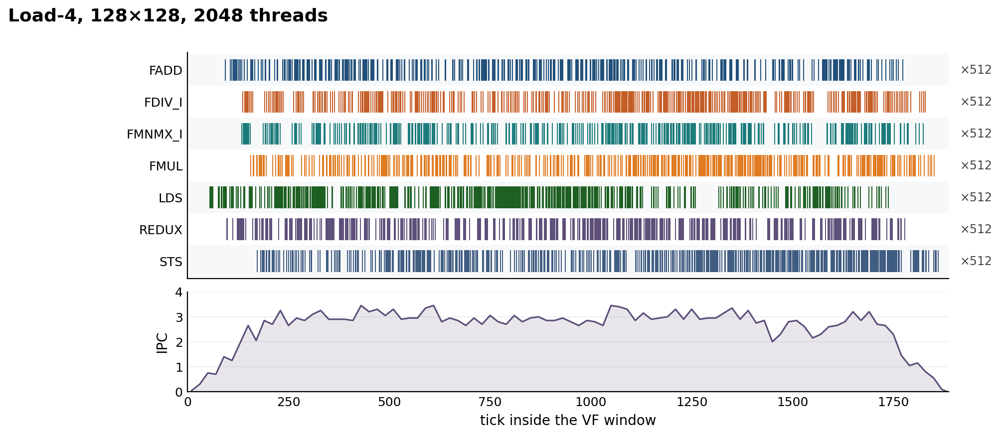
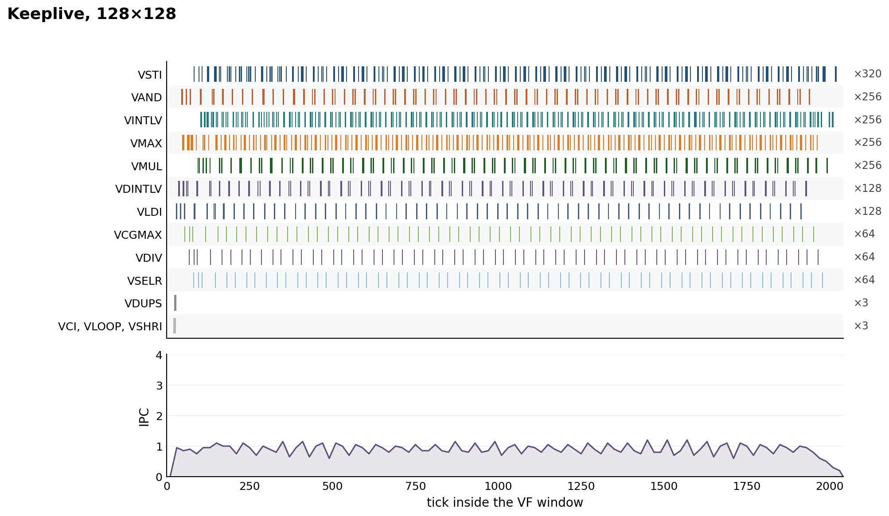
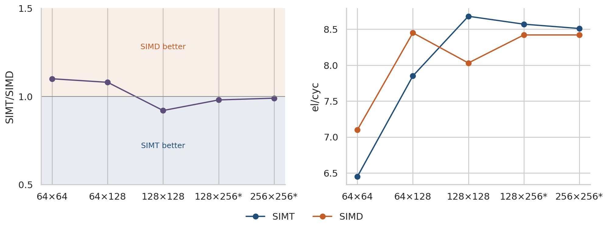

# SV8 — one scale per group, multiply in the register

## 1. Test-case design

`G` is 32. A group is 32 adjacent columns. `N` is `rows × cols`. Storage is float32.

```text
scale[row, g] = max(eps, absmax(X[row, g*G : (g+1)*G]))
Out[row, j] = X[row, j] * (1 / scale[row, j // G])
```

The scale stays live. The multiply uses a value that was already loaded. el/cyc is output elements per cycle, `N / VF`. One element is one result in `Out`.

The shapes are 64×64, 64×128, and 128×128. `N` is 4096, 8192, and 16384. Pass is max abs error 1e-4. The runs land near 1e-7.

## 2. Layout and schedule

### 2.1 SIMD

Three schedules. The multiply uses `X` already in the register.

**Paint.** 64 columns, two groups.

```text
load X
mask group 0, max, paint that scale back
mask group 1, max, paint that scale back
Out = X * scale
```

**Keeplive.** 256 columns, eight groups.

```text
scales = absmax of each group of 32
broadcast each scale across its group
Out = X * scale
```

**Pack.** The same 256-wide max.

```text
scales = absmax of each group of 32
store the scales, reload them, expand each across its group
Out = X * scale
```

### 2.2 SIMT

Four schedules, in the order the ownership changes.

**Reload.** One thread owns one group. Neighboring threads are 32 columns apart.

```text
walk the 32 values, keep the scale, drop the values
load those columns again
Out = X * (1 / scale)
```

**Keep.** The same ownership.

```text
held[0 .. 31] = X[group]
scale = max(eps, absmax(held))
Out = held * (1 / scale)
```

**Dual-drain.** One warp owns one group. Lane `t` reads element `t`.

```text
load every group this warp owns
absolute value of each
max, then Out = x * (1 / scale)
```

**Load-4.** The same warp ownership.

```text
held[0 .. 3] = element t of groups A, B, C, D
max of A, of B, of C, of D
store those four
```

## 3. SIMD

Bold is the lowest VF on that shape.

**Table 1. SIMD, three shapes.**

<table align="center">
<thead>
<tr>
<th align="center" rowspan="2">Schedule</th>
<th align="center" colspan="3">64×64</th>
<th align="center" colspan="3">64×128</th>
<th align="center" colspan="3">128×128</th>
</tr>
<tr>
<th align="center">VF</th>
<th align="center">el/cyc</th>
<th align="center">IPC</th>
<th align="center">VF</th>
<th align="center">el/cyc</th>
<th align="center">IPC</th>
<th align="center">VF</th>
<th align="center">el/cyc</th>
<th align="center">IPC</th>
</tr>
</thead>
<tbody>
<tr>
<td align="center">Paint</td>
<td align="center">1017</td>
<td align="center">4.03</td>
<td align="center">1.28</td>
<td align="center">1964</td>
<td align="center">4.17</td>
<td align="center">1.32</td>
<td align="center">3839</td>
<td align="center">4.27</td>
<td align="center">1.34</td>
</tr>
<tr>
<td align="center">Keeplive</td>
<td align="center"><b>577</b></td>
<td align="center">7.10</td>
<td align="center">0.81</td>
<td align="center">1065</td>
<td align="center">7.69</td>
<td align="center">0.86</td>
<td align="center"><b>2041</b></td>
<td align="center">8.03</td>
<td align="center">0.89</td>
</tr>
<tr>
<td align="center">Pack</td>
<td align="center">587</td>
<td align="center">6.98</td>
<td align="center">0.91</td>
<td align="center"><b>969</b></td>
<td align="center">8.45</td>
<td align="center">1.04</td>
<td align="center"></td>
<td align="center"></td>
<td align="center"></td>
</tr>
</tbody>
</table>

**Takeaway:** Keeplive is shortest on both squares. Pack is shortest on 64×128. Pack does not run on 128×128: the scale step holds 256 group scales, and that shape has 512. On 64×64 the same step holds 128 scales in that 256-wide vector.

## 4. SIMT

Reload, then keep, then dual-drain, then load-4. On 64×64 at 2048 threads, four groups do not divide the walk, so that load-4 cell is two groups.

**Table 2. SIMT, 64×64.** `N = 4096`. VF.

<table align="center">
<thead>
<tr>
<th align="center" rowspan="2">Schedule</th>
<th align="center" colspan="4">Threads</th>
</tr>
<tr>
<th align="center">128</th>
<th align="center">512</th>
<th align="center">1024</th>
<th align="center">2048</th>
</tr>
</thead>
<tbody>
<tr>
<td align="center">Reload</td>
<td align="center">8272</td>
<td align="center">8282</td>
<td align="center">9358</td>
<td align="center">15277</td>
</tr>
<tr>
<td align="center">Keep</td>
<td align="center">8272</td>
<td align="center">8282</td>
<td align="center">9358</td>
<td align="center">15182</td>
</tr>
<tr>
<td align="center">Dual-drain</td>
<td align="center"><b>941</b></td>
<td align="center">665</td>
<td align="center">691</td>
<td align="center">1055</td>
</tr>
<tr>
<td align="center">Load-4</td>
<td align="center">1352</td>
<td align="center"><b>645</b></td>
<td align="center"><b>635</b></td>
<td align="center"><b>1044</b></td>
</tr>
</tbody>
</table>

Load-4 does not scale with the thread count. The trace has 128 loads at every launch. 128 threads is VF 1352. 512 threads is VF 645. 1024 threads stays at VF 635. 2048 threads is two groups, VF 1044. Next is the same four schedules on 64×128.

**Table 3. SIMT, 64×128.** `N = 8192`. VF.

<table align="center">
<thead>
<tr>
<th align="center" rowspan="2">Schedule</th>
<th align="center" colspan="4">Threads</th>
</tr>
<tr>
<th align="center">256</th>
<th align="center">512</th>
<th align="center">1024</th>
<th align="center">2048</th>
</tr>
</thead>
<tbody>
<tr>
<td align="center">Reload</td>
<td align="center">16592</td>
<td align="center">16994</td>
<td align="center">18115</td>
<td align="center">21425</td>
</tr>
<tr>
<td align="center">Keep</td>
<td align="center">16592</td>
<td align="center">16994</td>
<td align="center">18154</td>
<td align="center">21135</td>
</tr>
<tr>
<td align="center">Dual-drain</td>
<td align="center"><b>1405</b></td>
<td align="center">1214</td>
<td align="center">1239</td>
<td align="center">1202</td>
</tr>
<tr>
<td align="center">Load-4</td>
<td align="center">1555</td>
<td align="center"><b>1208</b></td>
<td align="center"><b>1044</b></td>
<td align="center"><b>1111</b></td>
</tr>
</tbody>
</table>

At 256 threads dual-drain is shortest, VF 1405. From 512 threads load-4 is shorter. The shortest cell is load-4 at 1024 threads, VF 1044. Next is the same four schedules on 128×128.

**Table 4. SIMT, 128×128.** `N = 16384`. VF.

<table align="center">
<thead>
<tr>
<th align="center" rowspan="2">Schedule</th>
<th align="center" colspan="3">Threads</th>
</tr>
<tr>
<th align="center">512</th>
<th align="center">1024</th>
<th align="center">2048</th>
</tr>
</thead>
<tbody>
<tr>
<td align="center">Reload</td>
<td align="center">33984</td>
<td align="center">35824</td>
<td align="center">42329</td>
</tr>
<tr>
<td align="center">Keep</td>
<td align="center">33984</td>
<td align="center">35825</td>
<td align="center">41510</td>
</tr>
<tr>
<td align="center">Dual-drain</td>
<td align="center">2683</td>
<td align="center">2624</td>
<td align="center">3208</td>
</tr>
<tr>
<td align="center">Load-4</td>
<td align="center"><b>2140</b></td>
<td align="center"><b>2010</b></td>
<td align="center"><b>1887</b></td>
</tr>
</tbody>
</table>

Load-4 is shorter in every column. The shortest cell is 2048 threads, VF 1887. Dual-drain spills here: `LDK` and `STK` are 48, 96, and 192 at 512, 1024, and 2048 threads. Reload and keep spill from 1024 threads up. Load-4 does not spill.

Load-4 is the SIMT schedule. Its shortest cell on each shape is VF 635 at 1024 threads on 64×64, VF 1044 at 1024 threads on 64×128, and VF 1887 at 2048 threads on 128×128.

### 4.1 Operation breakdown

128×128, load-4, 2048 threads. This is the shortest SIMT cell. `N` is 16384. One launch. VF is 1887.

**Whole kernel.** el/cyc is output elements per cycle, `N / VF`.

**Operator window.** From the first issue of that opcode to its last issue. `LDS` counts input bytes, `4 × N`, the float32 values of `X`. `FMNMX`, `REDUX`, `FDIV`, `FMUL`, and `FADD` count output elements, `N`. One issue writes 32 of them, one per lane. `STS` counts output bytes, `4 × N`. Address math is left out of the opcode column.

**Table 5.** Operation breakdown, whole kernel. 128×128, load-4, 2048 threads.

<table align="center">
<thead>
<tr>
<th align="center">VF</th>
<th align="center">el/cyc</th>
<th align="center">IPC</th>
<th align="center">Opcodes</th>
</tr>
</thead>
<tbody>
<tr>
<td align="center">1887</td>
<td align="center">8.68</td>
<td align="center">2.61</td>
<td align="center">512 LDS, 512 FMNMX, 512 REDUX, 512 FDIV, 512 FMUL, 512 FADD, 512 STS</td>
</tr>
</tbody>
</table>

**Table 6.** Operation breakdown, operator window. 128×128, load-4, 2048 threads. Per cycle uses the count in that row.

<table align="center">
<thead>
<tr>
<th align="center">Operator</th>
<th align="center">Counted</th>
<th align="center">Ticks</th>
<th align="center">Per cycle</th>
</tr>
</thead>
<tbody>
<tr>
<td align="center">LDS</td>
<td align="center">input bytes</td>
<td align="center">5936–7619</td>
<td align="center">38.94</td>
</tr>
<tr>
<td align="center">FMNMX</td>
<td align="center">output elements</td>
<td align="center">6015–7705</td>
<td align="center">9.69</td>
</tr>
<tr>
<td align="center">REDUX</td>
<td align="center">output elements</td>
<td align="center">5978–7659</td>
<td align="center">9.75</td>
</tr>
<tr>
<td align="center">FDIV</td>
<td align="center">output elements</td>
<td align="center">6018–7710</td>
<td align="center">9.68</td>
</tr>
<tr>
<td align="center">FMUL</td>
<td align="center">output elements</td>
<td align="center">6037–7733</td>
<td align="center">9.66</td>
</tr>
<tr>
<td align="center">FADD</td>
<td align="center">output elements</td>
<td align="center">5974–7655</td>
<td align="center">9.75</td>
</tr>
<tr>
<td align="center">STS</td>
<td align="center">output bytes</td>
<td align="center">6054–7742</td>
<td align="center">38.82</td>
</tr>
</tbody>
</table>

The seven spans sit on top of each other, each about 1690 cycles inside the 1887-cycle window. The multiply does not add a separate pass.

The single-op programs at 2048 threads take 27 cycles for `LDS`, 7 for `FMNMX`, 17 for `REDUX`, 18 for `FDIV`, 9 for `FMUL`, 8 for `FADD`, and 20 for `STS`. Active cycles are completion minus issue. The rate columns use the same counts as Table 6. The single-op rates are the whole launch, with that op running alone.

**Table 7.** Single-op check against load-4. 128×128, 2048 threads.

<table align="center">
<thead>
<tr>
<th align="center">Instruction</th>
<th align="center">Single-op cycles</th>
<th align="center">Low</th>
<th align="center">Average</th>
<th align="center">High</th>
<th align="center">Counted</th>
<th align="center">Single-op rate</th>
<th align="center">Case rate</th>
</tr>
</thead>
<tbody>
<tr>
<td align="center">LDS</td>
<td align="center">27</td>
<td align="center">27</td>
<td align="center">37.7</td>
<td align="center">73</td>
<td align="center">input B/cycle</td>
<td align="center">98.35</td>
<td align="center">38.94</td>
</tr>
<tr>
<td align="center">FMNMX</td>
<td align="center">7</td>
<td align="center">7</td>
<td align="center">7.0</td>
<td align="center">7</td>
<td align="center">elements/cycle</td>
<td align="center">150.98</td>
<td align="center">9.69</td>
</tr>
<tr>
<td align="center">REDUX</td>
<td align="center">17</td>
<td align="center">17</td>
<td align="center">17.0</td>
<td align="center">17</td>
<td align="center">elements/cycle</td>
<td align="center">40.98</td>
<td align="center">9.75</td>
</tr>
<tr>
<td align="center">FDIV</td>
<td align="center">18</td>
<td align="center">18</td>
<td align="center">18.0</td>
<td align="center">18</td>
<td align="center">elements/cycle</td>
<td align="center">58.13</td>
<td align="center">9.68</td>
</tr>
<tr>
<td align="center">FMUL</td>
<td align="center">9</td>
<td align="center">9</td>
<td align="center">9.0</td>
<td align="center">9</td>
<td align="center">elements/cycle</td>
<td align="center">103.40</td>
<td align="center">9.66</td>
</tr>
<tr>
<td align="center">FADD</td>
<td align="center">8</td>
<td align="center">8</td>
<td align="center">8.0</td>
<td align="center">8</td>
<td align="center">elements/cycle</td>
<td align="center">127.04</td>
<td align="center">9.75</td>
</tr>
<tr>
<td align="center">STS</td>
<td align="center">20</td>
<td align="center">20</td>
<td align="center">28.7</td>
<td align="center">71</td>
<td align="center">output B/cycle</td>
<td align="center">112.20</td>
<td align="center">38.82</td>
</tr>
</tbody>
</table>

`FMNMX`, `REDUX`, `FDIV`, `FMUL`, and `FADD` match the single-op time on every issue. The low `LDS` is still 27. The average is 37.7, and the load moves 38.94 input bytes per cycle. The low `STS` is still 20. The average is 28.7, and the store moves 38.82 output bytes per cycle.

## 5. Running IPC

128×128. The line is IPC in bins of 20 ticks. Address math stays in the line and off the rows.

### 5.1 SIMT

Load-4, 2048 threads. VF 1887. `LDS`, `FMNMX`, `REDUX`, `FDIV`, `FMUL`, `FADD`, and `STS` each issue 512 times, one per group. The line rises to about 3 and falls off at both ends. The scalar IPC is 2.61.

**Figure 1.** Load-4 instructions. 128×128, 2048 threads. VF 1887.



### 5.2 SIMD

Keeplive. Pack does not run on this shape. VF 2041. `VCGMAX`, `VDIV`, and `VSELR` issue 64 times. `VAND`, `VMAX`, `VMUL`, and `VINTLV` issue 256 times. `VSTI` issues 320 times. `VCI`, `VLOOP`, and `VSHRI` share one row. The line stays near 1. The scalar IPC is 0.89.

**Figure 2.** Keeplive instructions. 128×128. VF 2041.



## 6. Conclusion

Best SIMT is load-4. Best SIMD is keeplive on the squares and pack on 64×128. The ratio is the SIMT VF divided by the SIMD VF.

**Table 8.** Head-to-head. Best SIMT against best SIMD.

<table align="center">
<thead>
<tr>
<th align="center" rowspan="2">Shape</th>
<th align="center" colspan="4">SIMT</th>
<th align="center" colspan="4">SIMD</th>
<th align="center" rowspan="2">SIMT/SIMD</th>
</tr>
<tr>
<th align="center">Schedule</th>
<th align="center">VF</th>
<th align="center">el/cyc</th>
<th align="center">IPC</th>
<th align="center">Schedule</th>
<th align="center">VF</th>
<th align="center">el/cyc</th>
<th align="center">IPC</th>
</tr>
</thead>
<tbody>
<tr>
<td align="center">64×64</td>
<td align="center">load-4, 1024</td>
<td align="center">635</td>
<td align="center">6.45</td>
<td align="center">2.07</td>
<td align="center">keeplive</td>
<td align="center"><b>577</b></td>
<td align="center">7.10</td>
<td align="center">0.81</td>
<td align="center">1.10</td>
</tr>
<tr>
<td align="center">64×128</td>
<td align="center">load-4, 1024</td>
<td align="center">1044</td>
<td align="center">7.85</td>
<td align="center">2.36</td>
<td align="center">pack</td>
<td align="center"><b>969</b></td>
<td align="center">8.45</td>
<td align="center">1.04</td>
<td align="center">1.08</td>
</tr>
<tr>
<td align="center">128×128</td>
<td align="center">load-4, 2048</td>
<td align="center"><b>1887</b></td>
<td align="center">8.68</td>
<td align="center">2.61</td>
<td align="center">keeplive</td>
<td align="center">2041</td>
<td align="center">8.03</td>
<td align="center">0.89</td>
<td align="center">0.92</td>
</tr>
<tr>
<td align="center">128×256*</td>
<td align="center">load-4, 2048</td>
<td align="center"><b>3824</b></td>
<td align="center">8.57</td>
<td align="center">2.58</td>
<td align="center">pack</td>
<td align="center">3892</td>
<td align="center">8.42</td>
<td align="center">1.04</td>
<td align="center">0.98</td>
</tr>
<tr>
<td align="center">256×256*</td>
<td align="center">load-4, 2048</td>
<td align="center"><b>7702</b></td>
<td align="center">8.51</td>
<td align="center">2.56</td>
<td align="center">pack</td>
<td align="center">7784</td>
<td align="center">8.42</td>
<td align="center">1.04</td>
<td align="center">0.99</td>
</tr>
</tbody>
</table>

128×256* and 256×256* do not fit in the 248 KB buffer. The mark means the VF is the sum of row slabs. Load-4 uses a 64×256 slab, two slabs for 128×256* and four for 256×256*. Pack holds 256 group scales, so its slab is 32×256: four slabs and eight slabs.

Keeplive is shorter on 64×64, and pack is shorter on 64×128. Load-4 is shorter on 128×128, on 128×256*, and on 256×256*.

**Figure 3.** Best SIMT and best SIMD. SIMT/SIMD is the VF ratio. The starred shapes are several launches.



## Appendix

Run these from `benches/sv8`. A case lands in `runs/` as `kernel.cpp`, `kernel.so`, and `npusim/`. Record every launch with `npusim record -s Ascend950 -o <case>/npusim -g -n 0 "..."`. The quoted command is the `python` line below. VF is the sum of the `VF` or `VF_SIMT` windows in that trace.

### Tables 2–4

`reload32` and `keep32` are reload and keep. `warp32u4` is load-4. `warp32u2` is the 64×64 cell at 2048 threads, where four groups do not divide. The launch is float32.

```bash
python compile.py <kind> <rows> <cols> <threads>
python launch.py runs/simt/<dir>/<kind>-r<rows>c<cols>-g32-t<threads>/kernel.so <rows> <cols> 32
```

`<dir>` is `reload`, `keep`, or `load4`. `<kind>` for load-4 is `warp32u4`, except `warp32u2` on 64×64 at 2048 threads.

| Shape | Threads |
| --- | --- |
| 64×64 | 128, 512, 1024, 2048 |
| 64×128 | 256, 512, 1024, 2048 |
| 128×128 | 512, 1024, 2048 |

Reload, keep, and load-4 use every cell. One compile and one launch per cell.

### Dual-drain

`python kernels/dual/gen_dual_drain.py` writes one `.asc` per cell, next to the `.so`. `N` is `rows × cols`.

| Shape | N | Threads |
| --- | ---: | --- |
| 64×64 | 4096 | 128, 512, 1024, 2048 |
| 64×128 | 8192 | 256, 512, 1024, 2048 |
| 128×128 | 16384 | 512, 1024, 2048 |

```bash
python kernels/dual/launch_softlib.py kernels/dual/dual_drain_t<threads>_e<N>.so <N>
```

### Table 1

Pack and keeplive are `kernels/simd/sv8d_pack_ub_scale_case3.py`. Paint is `kernels/simd/sv8d_vl_resident_case3.py`. Shapes are 64×64, 64×128, and 128×128. Pack on 128×128 does not run.

```bash
python kernels/simd/sv8d_pack_ub_scale_case3.py <rows> <cols> 32 32 pack_ub_vl256
python kernels/simd/sv8d_pack_ub_scale_case3.py <rows> <cols> 32 32 keeplive_vbrc_vl256
python kernels/simd/sv8d_vl_resident_case3.py <rows> <cols> 32
```

Record under `runs/simd/pack/`, `runs/simd/keeplive/`, and `runs/simd/paint/`.

### Tables 5, 6, and 7

128×128, load-4, 2048 threads. The trace is `runs/simt/load4/warp32u4-r128c128-g32-t2048`. Table 6 is the issue span of each opcode. `LDS` divides `4 × N` input bytes by that span. `FMNMX`, `REDUX`, `FDIV`, `FMUL`, and `FADD` divide `N` by that span. `STS` divides `4 × N` output bytes by that span. Table 7 is completion minus issue inside the VF window. The single-op rates are the 2048-thread programs in `simt-uarch/`.

### Table 8, starred rows

One recording covers both shapes. The 256×256* VF is every window. The 128×256* VF is the first half of those windows: two of the four load-4 calls, four of the eight pack calls.

```bash
python launch_slabs.py runs/simt/load4/warp32u4-r128c128-g32-t2048/kernel.so 16384 4
python kernels/simd/launch_slabs.py pack_ub_vl256 64 128 8
```

### Figures

```bash
python plot_charts.py
```

Figure 1 reads the 128×128 load-4 trace at 2048 threads. Figure 2 reads the 128×128 keeplive trace. Figure 3 draws Table 8.
