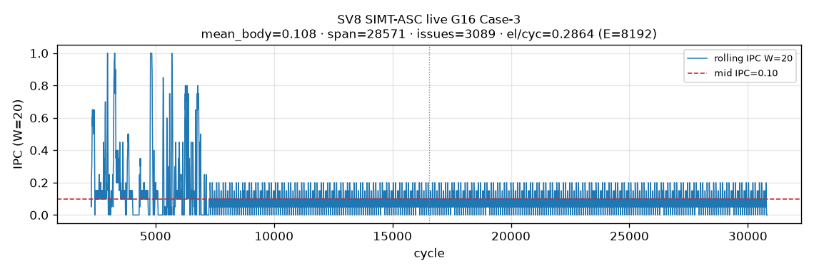
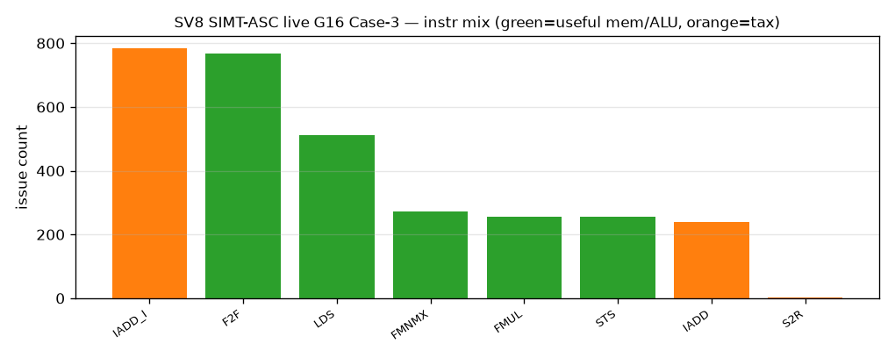
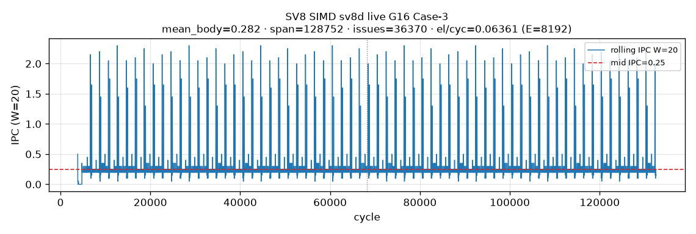
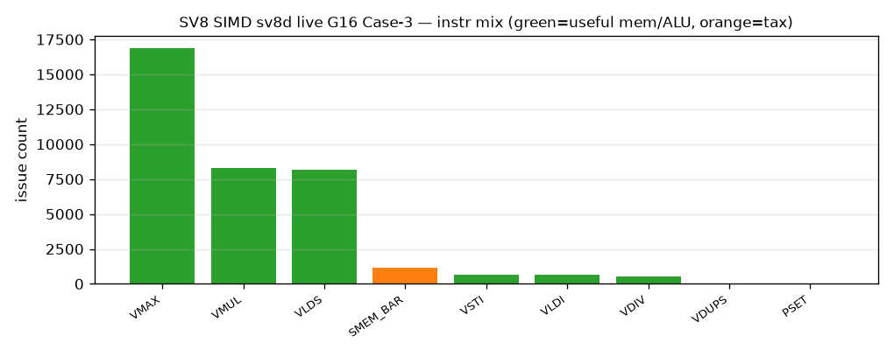
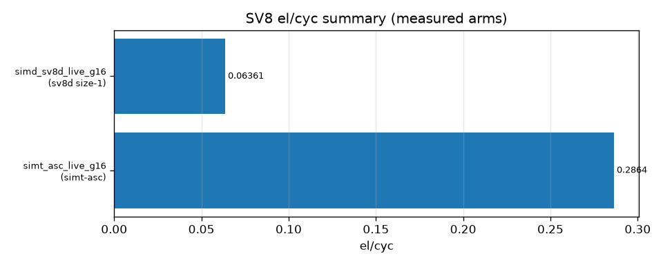

# SV8 analysis — Case-3 quant e2e bcast G=16 (inner 1×G)

**Date:** 2026-10-29 Asia/Hong_Kong · ST-spine · pack **t726u/t727u** (simt-asc live + sv8d DSL live)  
**Format:** [`docs/ST_REPORT_FORMAT.md`](../../docs/ST_REPORT_FORMAT.md) + `tilelanggym-st-report` · companions: `tilelanggym-st-semantics-gate` · softlib-simt-schedule (A5 blocker)  
**Primary metric:** **el/cyc = E / VF_cyc** · **E = R×C = 8192** · fp16 in/out · **`era=case3-quant-bcast`** (Case-3 · reduce + recip + bcast mul).  
**SOC / CANN / PTOAS:** Ascend950PR_9599 camodel · **cann_92b2** (simt-asc live PASS) · pins in `config.toml`.  
**Host / OPPROF:** pto-b10 · sv8d opsim `OPPROF_20261029104314_PTJNJUBYPNEYDPUI`.  
**Truth source:** pack `RESULT.md` (authoritative). **Never invent measured numbers.**  
**Never merge** with SV5–7 **`era=fp32-absmax`** SoT (Harness §13). SoftLib CCE = off main / N/A this pack (t646).

**ST map:** SV8 = Case-3 e2e · gold **G=16** · `reduce_axis=inner` SoftLib_axis=`1xG`. Gate shape **R64×C128 G16 T32**.

### Headline — `reduce_axis=inner` · `era=case3-quant-bcast`

| # | Path | Best on this tip | Era |
|---|------|------------------|-----|
| 1 | **SIMD PTO-DSL (sv8d handwritten)** | size-1 `RV_VMAX` reduce + scratch expand · **0.06361** (VF **128790**) | case3-quant-bcast |
| 2 | **SIMT-ASC stock** | `__simt_vf__` default · live · **0.2864** (VF **28603**) | case3-quant-bcast |
| 3 | **SIMT SoftLib hand-craft** | **not measured** this pack — A5 blocker + next-cmd (§6) | — |

> SoftLib CCE: **N/A / off main** (t646) — not measured this pack.  
> simd-pto **sv8v** (AscendSimdVFLowerParallel): **COMPILE FAIL** (2D Parallel stride=0/0) — not a measured arm.  
> **Ratio (measured):** SIMT÷SIMD el/cyc = 0.2864 / 0.06361 ≈ **4.50×** (SIMT faster). Hypothesis “SIMD ~2× SIMT” **FALSIFIED** (opposite).

---

## 1. Aims

| Id | Aim |
|----|-----|
| **A1** | Measure SV8 G16 Case-3 e2e (reduce+recip+bcast mul) SIMT-ASC vs SIMD on shape R64×C128 G16 T32 E=8192 |
| **A2** | Test H2: fused path keeps X in RF → SIMD ~2× SIMT (el/cyc) |
| **A3** | Quantify small-shape membar/SMEM_BAR vs VF body on SIMD |
| **A4** | Classify bound: outer UB-BW vs EX/schedule vs size-1-reduce+reload |
| **A5** | SoftLib SIMT hand-craft Case-3: measured or blocker+next-cmd |
| **A6** | Document layout/schedule + RF residency (X vs scale) for both arms |

---

## 2. Test-case design

| Axis | Choice |
|------|--------|
| Shape | R=64 · C=128 · G=16 · T=32 · **E=8192** (TILE8192 when E aligns) |
| Datatype | **fp16** X/Out · f32 scale path · **`era=case3-quant-bcast`** · Case-3 recip + bcast mul (≠ absmax-only) |
| Gold | e2e `Out[i,j] = X[i,j] * (1 / max(absmax(X[i, g*G:(g+1)*G]), 1e-6))` with `g=j//G` |
| Reduce axis | **`reduce_axis=inner`** contiguous 1×G along C (Harness §22 → absmax expects VC/VCGMAX family when VL-wide) |
| SoftLib axis label | **`axis=1xG`** (§21) — not Nx1 wr |
| SIMT-ASC | `sv8_case3_bcast.py` · `T.SimtVF(threads=32)` · arms `live` \| `spill_dist` |
| SIMD PTO-DSL | `sv8d_case3_bcast.py` · handwritten VMI · VL=64 · size∈{1,64} |
| SIMD VMI twin | `sv8v_case3_bcast.py` · Ascend SimdVF — compile-blocked this pack |
| SoftLib SIMT hand-craft | **deferred** — A5 blocker (§6) |
| SoftLib CCE | optional/off main (t646) — **N/A** |
| Pass | gold PASS · named VF · SEMANTICS_GATE one-liner |

**Sources:** pack `/workspace/sv8_g16_e2e_t726u/RESULT.md` · kernels under `benches/sv8/` · `config.toml`.

---

## 3. Layout and schedule (SIMT and SIMD)

### 3.1 SIMT-ASC (`sv8_case3_bcast.py`) — A6

- **Layout:** `x_ub`/`out_ub` shared fp16; `sf_inv[R, CG]` fragment f32 (`CG=C/G=8`).
- **live schedule:** `Parallel(R,CG)` absmax+recip → `sf_inv` stays in fragment; consumer `Parallel(R,CG)+serial(G)` reads live `sf_inv` (avoid `j//G` InverseAffine).
- **spill_dist:** expand `sf_inv` → `scale_ub[R,C]` shared, then consumer reloads `scale_ub[i,j]` (layout-transform spill, not capacity spill).
- **RF residency (live, ASC):**
  - `sf_inv` / `float sf_inv[16]` — **stays in RF** across reduce→recip→mul.
  - **X does NOT stay in RF.** Both absmax and mul reload from `__ubuf__ half*` (`x_ub`):
    - reduce: `Cast(x_ub[i, g*G+t])`
    - mul: `Cast(x_ub[i,j]) * s`
- **Instr (live call_count-weighted):** `SIMT_LDS=512`, `SIMT_STS=256`, `SIMT_FMUL=256`, `SIMT_F2F=768`, `SIMT_FMNMX=240`. RVECLD≈529 vs RVECEX≈2837 → **EX/schedule-dominated** inside VF + full X re-load for mul.

### 3.2 SIMD PTO-DSL (`sv8d_case3_bcast.py`) — A6

- **Schedule (live):** per-group **size-1** absmax (`vload` size=1 + `vmax` fold) → size-1 recip (`vdiv`) → scratch `vstore`/`mem_bar(VST_VLD)`/`vload` expand into VL=64 scale via `vsel` range masks → second **VL** load of X for `vmul` → store Out in VL=64 chunks.
- **RF residency:**
  - Scale after expand lives in V-reg for the mul.
  - **X tile is not held in V-reg across reduce→mul:** size-1 reduce path + `RV_VLDS` calls=**8192** (=E) second X load from UB.
  - Scratch expand: `RV_VSTI`/`RV_VLDI` 640 each; `RV_SMEM_BAR` **1160** (`type:VST_VLD` + `type:VLD_VST`).
- **Not** a VL-wide `VCGMAX` keep-X motif — see SEMANTICS_GATE on this arm.

### 3.3 SIMD VMI twin (`sv8v`) — compile fail

`AscendSimdVFLowerParallel`: 2D Parallel stride=0/0 (f16→f32 issues historically). **No measured el/cyc.**

### 3.4 SoftLib CCE (footnote)

**N/A** this pack (t646 optional/off main). Not a conclusion arm.

---

## 4. SIMD PTO-DSL performance

| tag | status | VF_cyc | VF_us | wall_us | el/cyc | instr / schedule | gate |
|-----|--------|-------:|------:|--------:|-------:|------------------|------|
| **sv8d live** | **PASS** gold maxabs=1.192e-07 | **128790** | 71.55 | 72.39 | **0.06361** | size-1 VMAX (16896) + VLDS=8192 + scratch expand + SMEM_BAR=1160 | see gate |
| sv8d spill_dist | honest skip | — | — | — | — | not harvested this turn | — |
| sv8v live/spill | COMPILE FAIL | NA | NA | NA | NA | LowerParallel stride=0/0 | n/a |

Prefer VF instr row over block_delta (132818) / total_tick (134268).

**Opcode cycle shares vs VF=128790** (pipe-overlapped; shares do **not** sum to 100%):

| opcode | calls | sum_cycles | share_VF |
|--------|------:|-----------:|---------:|
| RV_VMAX | 16896 | 101376 | 78.7% |
| RV_VLDS | 8192 | 74807 | 58.1% |
| RV_VMUL | 8320 | 66560 | 51.7% |
| RV_SLDI | 6592 | 59454 | 46.2% |
| RV_SSTI | 6695 | 46282 | 35.9% |
| RV_SMEM_BAR | 1160 | 18743 | **14.6%** |
| RV_VLDI | 640 | 13952 | 10.8% |
| RV_VDIV | 512 | 8704 | 6.8% |
| RV_VSEL | 1024 | 6144 | 4.8% |
| RV_VSTI | 640 | 5760 | 4.5% |

**A3 membar:** ~**14.6%** of SIMD VF — real small-shape cost from scratch scale expand, **not** enough alone to explain 4.5× vs SIMT. Dominant cost = size-1 `VMAX` + full X `VLDS` reload + scalar LD/ST (`SLDI`/`SSTI`).

**SEMANTICS_GATE:** INCONCLUSIVE as inner VC/VCGMAX SoT — handwritten size-1 RV_VMAX + scratch expand, not VL VCGMAX motif; valid as measured e2e DSL arm only (A1)

---

## 5. SIMT (Ascend default) lowering performance

**Definition:** TileLang Ascend `__simt_vf__` / SimtVF default lowering (`sv8_case3_bcast.py`) — stock path for Case-3 e2e.

| arm | compile | gold | VF_cyc | VF_us | wall_us | el/cyc | notes |
|-----|---------|------|-------:|------:|--------:|-------:|-------|
| **live** | OK | PASS maxabs=0 | **28603** | 15.89 | 17.16 | **0.2864** | cann_92b2; LDS:512 STS:256 FMUL:256 |
| spill_dist | OK | PASS maxabs=0 | 29445 | 16.36 | 17.62 | 0.2782 | +842 cyc vs live; LDS:768 STS:512 |

Historical green (2026-09-23, cann_91b3+deps-native) for compare: live VF=28402 / 17.04 µs wall; spill 30545 / 18.23 µs — same RF pattern (X from UB).

**Outer sync vs VF (A3):** SET_FLAG+WAIT_FLAG = 2+2; **no** intra-VF `RV_SMEM_BAR`. MTE2 copy X ≈1023 cyc. Outer flags wait on VF duration (pipeline), not extra sync work inside VF.

**SEMANTICS_GATE:** PASS — gold G16 Case-3 e2e measured; era=case3-quant-bcast; not claiming multi-G sensitivity

---

## 6. SIMT hand-craft (SoftLib) analysis — A5

**Status: blocker — not measured in this pack.**

| Item | Detail |
|------|--------|
| Aim | A5 SoftLib SIMT hand-craft Case-3 (motif classes per `tilelanggym-softlib-simt-schedule`) |
| Measured | **none** — no SoftLib `__simt_vf__` hand-craft Case-3 el/cyc this tip |
| SoftLib CCE | N/A / off main (t646) — also unmeasured |
| Do **not** | invent SoftLib el/cyc; rank SoftLib÷VMI without `era=`; reuse SV5 absmax numbers |

**SEMANTICS_GATE:** INCONCLUSIVE — SoftLib Case-3 hand-craft not measured this pack (A5 blocker)

**Next-cmd (do not run unless asked):**
```bash
# SoftLib SIMT Case-3 staging (when A5 opens):
#   bash scripts/softlib_simt_stage.sh   # or pack-local SoftLib Case-3 motif matrix
# Motifs to try under SoftLib_axis=1xG, era=case3-quant-bcast:
#   - contig warp-coop absmax+recip+bcast mul (keep scale RF; measure X residency)
#   - stock_stream vs membar expand
# Harvest named VF + gold e2e PASS before any SoftLib÷sv8d ratio.
```

---

## 7. Running IPC + figures (enforce list)

Style: W=20 left-open right-closed `(t−W, t]` from `core0.veccore0.instr_log.dump`. G16 measured arms only this tip; **G32 retarget in flight** (Lok t737) — prefer G32 plots when RESULT lands.

| Arm | mid IPC W20 | mean_body | el/cyc | figure |
|-----|------------:|----------:|-------:|--------|
| SIMT-ASC live G16 | **0.1** | 0.1081 | **0.2864** | [`plots/simt_asc_live_g16_running_ipc.png`](plots/simt_asc_live_g16_running_ipc.png) |
| SIMD sv8d live G16 | **0.25** | 0.2825 | **0.06361** | [`plots/simd_sv8d_live_g16_running_ipc.png`](plots/simd_sv8d_live_g16_running_ipc.png) |
| SoftLib SIMT hand-craft | **MISSING** | — | unmeasured | A5 blocker — no dump |
| G32 VL-resident / retarget | **MISSING** this tip | — | — | next: land G32 RESULT then re-run `gen_enforce_plots_t739u.py` |











**Next-cmd (G32):** when `/mnt/fluxdata/happybot/sv8_*g32*` RESULT + OPPROF exist, add arms to `scripts/gen_enforce_plots_t739u.py` and re-plot.

---

## 8. Conclusion

### Three arms (measured-only ratios)

| Arm | Best el/cyc | VF_cyc | vs SIMT live |
|-----|------------:|-------:|-------------:|
| **SIMT-ASC live** | **0.2864** | 28603 | 1.00× |
| **SIMD PTO-DSL sv8d live** | **0.06361** | 128790 | 0.222× (SIMT÷SIMD ≈ **4.50×**) |
| **SIMT SoftLib hand-craft** | **unmeasured** | — | A5 blocker |

> SoftLib CCE: N/A. sv8v: COMPILE FAIL. spill_dist SIMT: 0.2782 (secondary).

### Hypothesis verdicts

| Id | Claim | Verdict |
|----|-------|---------|
| **H1** | UB-BW is G16 major drawback on this e2e | **Not the live bottleneck.** Outer 32 KiB / 512 B/cyc roof ≥64 cyc; both VF ≫ 64 → **EX/schedule** (SIMT) or **size-1-reduce + UB-reload + membar expand** (sv8d) bound (**A4**). |
| **H2** | Fused path keeps X in RF → SIMD ~2× SIMT | **FALSIFIED** both arms (**A2**). Only scale/`sf_inv` RF-resident; X reloads from UB on SIMT and SIMD. |
| **H3** | membar/sync dominates small shape | **FALSE** as sole bottleneck (**A3**). SIMD SMEM_BAR ≈**14.6%** VF (secondary to VMAX/VLDS/VMUL); SIMT no intra-VF MEMBAR. |
| **~2× SIMD** | SIMD el/cyc ≈ 2× SIMT | **FALSIFIED** — SIMT **4.50×** faster on this sv8d motif. |

### Bound class (A4)

- Outer UB: satisfied easily on both arms.  
- Inner SIMD LD volume large **because of size-1 / reload motif**, not outer dual-VLD roof.  
- Verdict: small-shape Case-3 e2e is **EX / schedule bound** (SIMT) or **size-1-reduce + UB-reload + membar expand bound** (sv8d), **not** outer-UB-BW bound.

### Next path (do **not** implement unless asked)

VL-load X **once** → group absmax / scale / mul **in vreg** (no size-1 reduce + scratch expand). Re-test H2/~2× only after that motif exists and is gold-PASS.

### COMPARE harvest

| Prior | Note |
|-------|------|
| SV5–7 `era=fp32-absmax` | **N/A cross-era** — do not merge el/cyc (Harness §13) |
| Hist SV8 simt (2026-09-23) | live VF≈28402 — same RF pattern; this tip cann_92b2 live **28603** / **0.2864** |
| This pack RESULT | authoritative numbers above; RESULT.tsv refreshed from RESULT.md |

**Pack paths:** box `/workspace/sv8_g16_e2e_t726u/` · flux `/mnt/fluxdata/happybot/sv8_g16_e2e_t726u/` (when mounted).

**PR:** ask Lok to review — **do not merge**.
