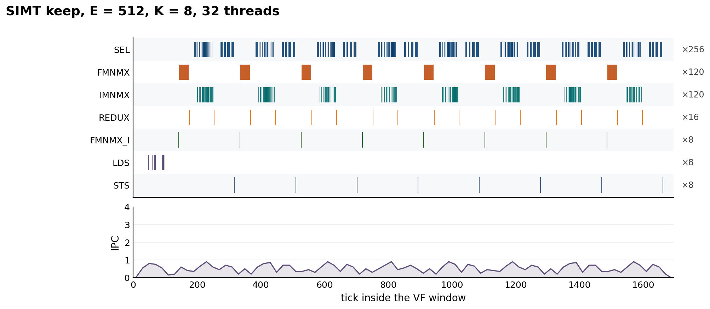
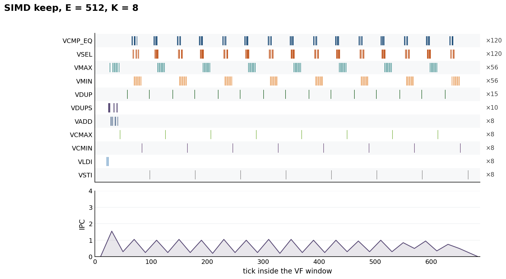

# SV9 — stable top-K

## 1. Test-case design

One row of `E` scores. `K` indices come out. A tie goes to the smaller index. Storage of the scores is float32. The indices are int32.

```text
for round in 0 .. K-1:
    m = max(scores)
    best = min index whose score is m
    Out[round] = best
    scores[best] = -3.402823e38
```

`N` is `E`. el/cyc is `N / VF`. The length sweep holds `K` at 8 and sets `E` to 256, 512, 1024, and 2048. The second sweep holds `E` at 2048 and sets `K` to 4, 8, 16, and 32. Pass is the index list, including one forced tie.

The rounds stay in order. Round `k+1` reads the score that round `k` killed.

## 2. Layout and schedule

One schedule on each side. Both load the row once. The kill writes the live score, so the next round does not load it again.

### 2.1 SIMD

Keep. One instruction is 64 scores. A row of `E` is `E / 64` chunks. The scores and the indices stay live.

```text
chunk i = scores[i*64 : (i+1)*64]
index of each lane stays next to that chunk

for each round:
    fold the chunks with vmax, then vcmax          -> one max
    where the score equals that max, keep the index, else 2147483647
    fold those with vmin, then vcmin               -> smallest index
    that lane's score = -3.402823e38
```

256 is 4 chunks. 512 is 8. Both keep every chunk in a register.

1024 is 16 chunks and 2048 is 32. Those two do not fit that way. The scores stay in the shared row, and the loop carries one chunk.

```text
for each round:
    load chunk 0
    for each later chunk: load it, vmax into the carry
    vcmax                                          -> one max
    same loop, vmin into the carry                 -> smallest index
    for each chunk: load, kill the winner, store the chunk back
```

### 2.2 SIMT

Keep. 32 threads, one warp. Lane `t` holds a pair from every band of 64. Each load is 64 bits on the lane, and the warp covers 64 scores.

```text
lane t, band i:   i*64 + 2*t,  i*64 + 2*t + 1

for each round:
    scalar max of this lane's scores
    warp max
    scalar min of the indices at that max
    warp min
    the lane that owns the winner writes -3.402823e38 into its register
```

A lane holds `E / 32` scores: 8, 16, 32, and 64.

## 3. SIMD

**Table 1. SIMD keep, K = 8.**

<table align="center">
<thead>
<tr>
<th align="center">E</th>
<th align="center">Chunks</th>
<th align="center">VF</th>
<th align="center">el/cyc</th>
<th align="center">IPC</th>
</tr>
</thead>
<tbody>
<tr>
<td align="center">256</td>
<td align="center">4</td>
<td align="center">536</td>
<td align="center">0.48</td>
<td align="center">0.43</td>
</tr>
<tr>
<td align="center">512</td>
<td align="center">8</td>
<td align="center">687</td>
<td align="center">0.75</td>
<td align="center">0.62</td>
</tr>
<tr>
<td align="center">1024</td>
<td align="center">16</td>
<td align="center">1154</td>
<td align="center">0.89</td>
<td align="center">1.73</td>
</tr>
<tr>
<td align="center">2048</td>
<td align="center">32</td>
<td align="center">1965</td>
<td align="center">1.04</td>
<td align="center">2.00</td>
</tr>
</tbody>
</table>

256 and 512 keep every chunk in registers. 1024 and 2048 loop one chunk at a time. All four pass.

`E` fixed at 2048. `K` is 4, 8, 16, and 32. The same loop.

**Table 2. SIMD keep, looped, E = 2048.**

<table align="center">
<thead>
<tr>
<th align="center">K</th>
<th align="center">VF</th>
<th align="center">el/cyc</th>
<th align="center">IPC</th>
</tr>
</thead>
<tbody>
<tr>
<td align="center">4</td>
<td align="center">1007</td>
<td align="center">2.03</td>
<td align="center">1.95</td>
</tr>
<tr>
<td align="center">8</td>
<td align="center">1965</td>
<td align="center">1.04</td>
<td align="center">2.00</td>
</tr>
<tr>
<td align="center">16</td>
<td align="center">3881</td>
<td align="center">0.53</td>
<td align="center">2.02</td>
</tr>
<tr>
<td align="center">32</td>
<td align="center">7713</td>
<td align="center">0.27</td>
<td align="center">2.03</td>
</tr>
</tbody>
</table>

The window about doubles with `K`. el/cyc falls because `N` is fixed.

## 4. SIMT

32 threads. Both reduces stay inside the warp.

**Table 3. SIMT keep, K = 8, 32 threads.**

<table align="center">
<thead>
<tr>
<th align="center">E</th>
<th align="center">Scores on a lane</th>
<th align="center">VF</th>
<th align="center">el/cyc</th>
<th align="center">IPC</th>
</tr>
</thead>
<tbody>
<tr>
<td align="center">256</td>
<td align="center">8</td>
<td align="center">1102</td>
<td align="center">0.23</td>
<td align="center">0.43</td>
</tr>
<tr>
<td align="center">512</td>
<td align="center">16</td>
<td align="center">1695</td>
<td align="center">0.30</td>
<td align="center">0.52</td>
</tr>
<tr>
<td align="center">1024</td>
<td align="center">32</td>
<td align="center">3329</td>
<td align="center">0.31</td>
<td align="center">0.51</td>
</tr>
<tr>
<td align="center">2048</td>
<td align="center">64</td>
<td align="center">30749</td>
<td align="center">0.07</td>
<td align="center">0.13</td>
</tr>
</tbody>
</table>

256, 512, and 1024 pass with no spill. At 2048 the lane holds 64 scores and 64 indices, and the trace has 656 `SIMT_LDK` and 42 `SIMT_STK`.

`E` fixed at 2048. `K` is 4, 8, 16, and 32. The spill stays.

**Table 4. SIMT keep, E = 2048, 32 threads.**

<table align="center">
<thead>
<tr>
<th align="center">K</th>
<th align="center">VF</th>
<th align="center">el/cyc</th>
<th align="center">IPC</th>
<th align="center">LDK</th>
<th align="center">STK</th>
</tr>
</thead>
<tbody>
<tr>
<td align="center">4</td>
<td align="center">16065</td>
<td align="center">0.13</td>
<td align="center">0.14</td>
<td align="center">328</td>
<td align="center">42</td>
</tr>
<tr>
<td align="center">8</td>
<td align="center">30749</td>
<td align="center">0.07</td>
<td align="center">0.13</td>
<td align="center">656</td>
<td align="center">42</td>
</tr>
<tr>
<td align="center">16</td>
<td align="center">60166</td>
<td align="center">0.03</td>
<td align="center">0.13</td>
<td align="center">1312</td>
<td align="center">42</td>
</tr>
<tr>
<td align="center">32</td>
<td align="center">118997</td>
<td align="center">0.02</td>
<td align="center">0.13</td>
<td align="center">2624</td>
<td align="center">42</td>
</tr>
</tbody>
</table>

Each step of `K` about doubles the window, and `SIMT_LDK` doubles with it. `SIMT_STK` stays at 42. el/cyc falls because `N` is fixed while the window grows.

### 4.1 Operation breakdown

`E = 512`, `K = 8`, 32 threads. `N` is 512. One kernel, the keep. The window runs from the first issue of that opcode to the last. el/cyc is `N` divided by that span.

**Table 5.** Operation breakdown, operator window. SIMT keep, E = 512, K = 8, 32 threads.

<table align="center">
<thead>
<tr>
<th align="center">Step</th>
<th align="center">Operator</th>
<th align="center">Issues</th>
<th align="center">Ticks</th>
<th align="center">el/cyc</th>
</tr>
</thead>
<tbody>
<tr>
<td align="center">load</td>
<td align="center">LDS</td>
<td align="center">8</td>
<td align="center">48–100</td>
<td align="center"><b>9.85</b></td>
</tr>
<tr>
<td align="center">max</td>
<td align="center">FMNMX</td>
<td align="center">120</td>
<td align="center">145–1517</td>
<td align="center">0.37</td>
</tr>
<tr>
<td align="center">reduce</td>
<td align="center">REDUX</td>
<td align="center">16</td>
<td align="center">176–1598</td>
<td align="center">0.36</td>
</tr>
<tr>
<td align="center">min index</td>
<td align="center">IMNMX</td>
<td align="center">120</td>
<td align="center">202–1595</td>
<td align="center">0.37</td>
</tr>
<tr>
<td align="center">store</td>
<td align="center">STS</td>
<td align="center">8</td>
<td align="center">318–1662</td>
<td align="center">0.38</td>
</tr>
</tbody>
</table>

The eight loads finish before the first round. The max, the two reduces, the min index, and the store of the winner run once per round, so those windows cover the whole kernel. The keep itself is VF 1695.

## 5. Running IPC

`E = 512`, `K = 8`. This is the longest row both keeps ran. The line is IPC in bins of 20 ticks. Address math stays in the line and off the rows.

### 5.1 SIMT

32 threads. VF 1695. `LDS` issues 8 times, in one burst at the start. `FMNMX` and `IMNMX` issue 120 times, eight bursts. `REDUX` issues 16 times, two per round. `STS` issues 8 times, one index per round. The line stays under 1. The scalar IPC is 0.52.

**Figure 1.** SIMT keep instructions. E = 512, K = 8, 32 threads. VF 1695.



### 5.2 SIMD

VF 687. `VLDI` issues 8 times, one burst at the start. `VMAX` and `VMIN` issue 56 times. `VCMAX` and `VCMIN` issue 8 times. `VCMP_EQ` and `VSEL` issue 120 times. `VSTI` issues 8 times. The line peaks near 1.6 at the load and then repeats under 1 for the eight rounds. The scalar IPC is 0.62.

**Figure 2.** SIMD keep instructions. E = 512, K = 8. VF 687.



## 6. Conclusion

One keep on each side. The ratio is the SIMT VF divided by the SIMD VF.

**Table 6.** Head-to-head. SIMT keep, 32 threads, against SIMD keep.

<table align="center">
<thead>
<tr>
<th align="center" rowspan="2">E</th>
<th align="center" colspan="3">SIMT</th>
<th align="center" colspan="3">SIMD</th>
<th align="center" rowspan="2">SIMT/SIMD</th>
</tr>
<tr>
<th align="center">VF</th>
<th align="center">el/cyc</th>
<th align="center">IPC</th>
<th align="center">VF</th>
<th align="center">el/cyc</th>
<th align="center">IPC</th>
</tr>
</thead>
<tbody>
<tr>
<td align="center">256</td>
<td align="center">1102</td>
<td align="center">0.23</td>
<td align="center">0.43</td>
<td align="center"><b>536</b></td>
<td align="center">0.48</td>
<td align="center">0.43</td>
<td align="center">2.06</td>
</tr>
<tr>
<td align="center">512</td>
<td align="center">1695</td>
<td align="center">0.30</td>
<td align="center">0.52</td>
<td align="center"><b>687</b></td>
<td align="center">0.75</td>
<td align="center">0.62</td>
<td align="center">2.47</td>
</tr>
<tr>
<td align="center">1024</td>
<td align="center">3329</td>
<td align="center">0.31</td>
<td align="center">0.51</td>
<td align="center"><b>1154</b></td>
<td align="center">0.89</td>
<td align="center">1.73</td>
<td align="center">2.88</td>
</tr>
<tr>
<td align="center">2048</td>
<td align="center">30749</td>
<td align="center">0.07</td>
<td align="center">0.13</td>
<td align="center"><b>1965</b></td>
<td align="center">1.04</td>
<td align="center">2.00</td>
<td align="center">15.65</td>
</tr>
</tbody>
</table>

SIMD is shorter on every length. 256 and 512 keep every chunk in registers. 1024 and 2048 loop one chunk at a time. At 2048 the SIMT keep spills, and the ratio is 15.65.

## Appendix

Run these from `benches/sv9`. Record a launch with `npusim record -s Ascend950 -o <case>/npusim -g -n 0 "..."`. VF is the `VF_SIMT` or `VF` window in that trace. `N` is `E`. el/cyc is `N / VF`.

### Tables 1 and 2

```text
python simd_keep.py <E> <K>
```

`E` of 256 and 512 keeps every chunk in registers. `E` above 512 loops one chunk.

| Table | E | K | Trace |
|---|---:|---:|---|
| 1, 6 | 256 | 8 | `runs/simd/resident/e256-k8` |
| 1, 6 | 512 | 8 | `runs/simd/resident/e512-k8` |
| 1, 6 | 1024 | 8 | `runs/simd/loop/e1024-k8` |
| 1, 2, 6 | 2048 | 8 | `runs/simd/loop/e2048-k8` |
| 2 | 2048 | 4 | `runs/simd/loop/e2048-k4` |
| 2 | 2048 | 16 | `runs/simd/loop/e2048-k16` |
| 2 | 2048 | 32 | `runs/simd/loop/e2048-k32` |

### Tables 3 and 4

```text
python compile.py keep <E> <K> 32
python launch.py runs/simt/keep-e<E>-k<K>-t32/kernel.so <E> <K>
```

| Table | E | K | Trace |
|---|---:|---:|---|
| 3, 6 | 256 | 8 | `runs/simt/keep-e256-k8-t32` |
| 3, 5, 6 | 512 | 8 | `runs/simt/keep-e512-k8-t32` |
| 3, 6 | 1024 | 8 | `runs/simt/keep-e1024-k8-t32` |
| 3, 4, 6 | 2048 | 8 | `runs/simt/keep-e2048-k8-t32` |
| 4 | 2048 | 4 | `runs/simt/keep-e2048-k4-t32` |
| 4 | 2048 | 16 | `runs/simt/keep-e2048-k16-t32` |
| 4 | 2048 | 32 | `runs/simt/keep-e2048-k32-t32` |

### Table 5

The operator windows are inside `runs/simt/keep-e512-k8-t32`. No second kernel.

### Figures

Figure 1 reads `runs/simt/keep-e512-k8-t32`. Figure 2 reads `runs/simd/resident/e512-k8`. `python plot_charts.py` writes both under `plots/`.
